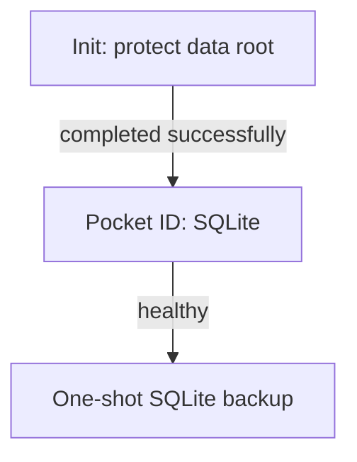

# Pocket ID

**User-approved controlled post-merge pilot — not deployed or approved for production reliance.**
Updated **2026-11-21**; app/init review cleared for the scope below, backup
conditionally accepted. [PR #949](https://github.com/DevSecNinja/truenas-apps/pull/949)
has not merged. Tracked in [issue #941](https://github.com/DevSecNinja/truenas-apps/issues/941).

## Why

Pilot a passkey-based OpenID Connect (OIDC) provider alongside Microsoft Entra ID.
Production reliance requires operator acceptance first. Entra remains
the active provider. Running a second provider does not automatically migrate
accounts, credentials, authorization, or sessions, and does not make switching
applications automatic.

The operator previously authorized and completed **SOPS secret provisioning**.
1Password CLI authentication and an existing Memos secret decryption succeeded;
plaintext was discarded. The app-specific encrypted secret file is now
provisioned and validated; its original ciphertext is unchanged. Independent
original-key recovery remains an operator first-run requirement.

## Controlled Pilot Scope

| Area                | Current decision / remaining work                                                                                                                                                                                      |
| ------------------- | ---------------------------------------------------------------------------------------------------------------------------------------------------------------------------------------------------------------------- |
| App                 | Exact `v2.19.3-distroless` approved for normal app use: dependency fixes delivered; residual OpenPGP source-traced to unused commit signing. No v3/dev/latest substitution                                             |
| Init                | New exact AMD64 BusyBox/glibc artifact approved only for the fixed, nonrecursive init operation; partial maintenance / medium confidence, not blanket image clearance                                                  |
| Backup              | Unchanged exact `4.9.2` AMD64 configuration under the [backup-only exception](#temporary-backup-risk-exception-2026-11-21); review/expiry **2026-12-21**, no automatic renewal                                         |
| Wiring              | Registry identity, DNS and active Traefik attachment declared; all three profiles removed. No host account/dataset provisioning, Custom App enrollment or deployment performed                                         |
| Secrets             | Existing SOPS provisioning/validation complete; ciphertext, server auto-discovery/default NAS key scope unchanged. Initial sync/decrypt must create raw `.env`                                                         |
| Evidence            | Dated runtime/recovery passes retained below; exact new-init, scoped proxy/config and full-suite validation passed November 21. Production DNS/TLS, Docker-provider and browser/passkey acceptance are not established |
| Operator acceptance | Execute only after merge and readiness; independently recover original keys/host access, establish first admin and primary/spare passkeys, and test clients before production reliance                                 |

The [November 21 evidence](#image-and-recovery-evidence-2026-11-21) records current findings and synthetic recovery.
The [November 8 evidence](#image-and-recovery-evidence-2026-11-08) is historical v2.19.2 proof.
The [October 29 review](#image-evidence-2026-10-29) remains historical evidence
for the old app pin, not the current artifact. Follow the
[image-adoption policy](https://homelab.devsecninja.com/ARCHITECTURE/#image-selection-upstream-dependency-maintenance);
do not maintain downstream patched dependency locks or forks as a workaround.
The controlled pilot is separately authorized; the backup exception alone
does not authorize activation. First-run acceptance is not a claim of completed
production testing or a blanket block on code implementation.

## Compose Files

Implementation source files:

- [compose.yaml](https://github.com/DevSecNinja/truenas-apps/blob/main/services/pocket-id/compose.yaml)
  — profile-free app, init, and backup.
- [Active Traefik Compose](https://github.com/DevSecNinja/truenas-apps/blob/main/services/traefik/compose.yaml)
  — frontend attachment and external network declaration; the inert fragment
  has been deleted.

Source links target the default branch and require PR #949 to be merged.
Deploy the active Traefik definition only after the Custom App creates the
network; do not use raw ad-hoc fragments or manual network connections.

Guide links use the published documentation URLs so they work from both this
GitHub README and its documentation-site copy. Updated sections become
available after merge and documentation publication.

## Access

| Surface             | Configured access                                                                          | Current status                                          |
| ------------------- | ------------------------------------------------------------------------------------------ | ------------------------------------------------------- |
| Pocket ID           | `https://id.${DOMAINNAME}`; native passkeys behind HTTPS Traefik with `chain-no-auth@file` | DNS → `${IP_SVLNAS}` and routing declared, not deployed |
| Host ports          | None published                                                                             | Required pilot boundary                                 |
| Active applications | Existing Entra, TFA, Immich, and Outline paths                                             | Unchanged                                               |

Pocket ID routing must not depend on the existing Entra
`chain-auth@file` or on a Pocket ID-backed Forward Auth chain: either would
create an authentication/recovery dependency. Validate the configured `chain-no-auth@file`
with native Pocket ID authentication during first run; it is not authorization
to bypass authentication on other apps.

## Architecture

The source implements the **controlled post-merge pilot**, not a validated
production deployment. All three services are selected without a profile.



The configured request path is client → HTTPS Traefik → Pocket ID over the
dedicated, stack-owned `pocket-id-frontend` bridge. No shared backend network
or host port is configured. This bridge is not an air gap or restricted outbound
egress. Init and backup use `network_mode: none` and have no host-control socket.

### Services

| Service               | Image status                                                                                                                                                                                  | Role and identity                                                                                 |
| --------------------- | --------------------------------------------------------------------------------------------------------------------------------------------------------------------------------------------- | ------------------------------------------------------------------------------------------------- |
| `pocket-id`           | `ghcr.io/pocket-id/pocket-id:v2.19.3-distroless@sha256:6a0045a89b80fa6624c091786e7be132a4dde880ca64727a6b019c056b091982`; scoped app review cleared                                           | Shell-free, nonroot Debian 13 image; explicit app UID/primary GID rather than PUID remapping      |
| `pocket-id-db-backup` | `docker.io/nfrastack/db-backup:4.9.2@sha256:cc95be0b5f551f432a218fc2811d63a2946233c8260598d5eda0ff624bb47412`; [temporary backup-only exception](#temporary-backup-risk-exception-2026-11-21) | One-shot SQLite Online Backup API job; image-local `pocketbackup` maps to app identity            |
| `pocket-id-init`      | `docker.io/library/busybox:1.38.0@sha256:a46257e06c82ad85242d0d38077d0a52d9896389ca60a1a59d3463db586e5fa4`; approved for this exact AMD64 operation                                           | Validate inputs, chown only `./data` root to PUID/PGID `3133:3133`, mode `0700`; never `./config` |

Declared account `svc-app-pocket-id` has no shared-purpose group memberships.
Its UID and matching private primary GID are **allocated in the registry,
not provisioned or available for reuse**. `admin_group_member=false`;
see [Infrastructure](https://homelab.devsecninja.com/INFRASTRUCTURE/#pocket-id-candidate-identity-reservation).
Init runs as root with narrowly declared capabilities and changes only the
data root, not its contents. The backup's writable-root s6 supervisor starts as
root and creates an image-local `pocketbackup` identity matching the app.
The isolated AMD64 run verified matching output ownership and restrictive
permissions; this does not establish TrueNAS provisioning or ACL behavior.
Separately review any recursive ownership/permission repair operation.

The selected distroless artifact reports version `2.19.3` and revision
`c0abd9322d0a67e200434baacc662e9c7cde1389` in its labels; retain the version-specific tag and exact digest.
GHCR was selected for the verified shell-free variant; cross-registry equality
for this distroless artifact is not established and remains a follow-up before
any registry change.
The image supports the explicit configured runtime user; this does not establish
full-stack runtime, recovery, or production acceptance.

### Image and Recovery Evidence 2026-11-21

**App/init review cleared for the controlled pilot on November 21.**
The exact app is approved for normal use; init clearance is restricted to the
fixed AMD64 operation below. Neither is a new risk exception or an all-feature
image-clean claim. The [backup-only exception](#temporary-backup-risk-exception-2026-11-21)
remains separately bounded; no PR merge or production deployment occurred.
[Release v2.19.3](https://github.com/pocket-id/pocket-id/releases/tag/v2.19.3), published **2026-11-15 at 19:10:25 UTC**, delivers Go/stdlib **1.27.4** and x/crypto **0.59.0**; Go-jose **4.1.6**, zod **4.6.7**, and x/net **0.62.0** remain delivered.
[Patch d6a0563](https://github.com/pocket-id/pocket-id/commit/d6a056355a3238b0d0c624d4788e8118dafed7f6) changes device-authorization approval from `BindOptionalJSON` to `BindJSON`: `{}` remains allowed, but a missing JSON body is rejected.
Upstream includes a unit regression; no local browser/device-approval ceremony was exercised.

Exact AMD64 identities (`sha256`) for the current app index in the services table:

- Manifest: `523271bff6390c33f149117915f63a375e49c6856695f3da71f9405954b7bb24`
- Config: `0de135f603004c51f81e2fa3734fc38070f1bf7401e8d8c8080769bfdff210a1`

Trivy **0.76.0**, November 21 UTC: DB updated **18:38:32**, downloaded **20:12:08**;
scans: app **20:12:19**, backup **20:12:22**, old init **20:12:24**.
The old-init result predates the scoped adoption below; raw counts are not exploitability judgments.

| Artifact / component                               | Inventory                                                            | Findings                                                                                     |
| -------------------------------------------------- | -------------------------------------------------------------------- | -------------------------------------------------------------------------------------------- |
| Historical init before scoped adoption             | No Trivy package database; BusyBox `1.38.0`, glibc `2.41-12+deb13u3` | Old pin, not scanned-clean                                                                   |
| nfrastack/db-backup 4.9.2 — OS                     | 166 Alpine 3.24.1 packages                                           | 4 CRITICAL / 167 HIGH / 152 MEDIUM / 90 LOW / 5 UNKNOWN                                      |
| nfrastack/db-backup 4.9.2 — Python                 | 15 packages                                                          | 3 MEDIUM                                                                                     |
| nfrastack/db-backup 4.9.2 — inactive engines/tools | `age`; `influx`; `influxd`                                           | HIGH/CRITICAL subset: age 14 HIGH; influx 28 HIGH / 2 CRITICAL; influxd 61 HIGH / 2 CRITICAL |
| Pocket ID — OS / npm                               | 6 Debian 13.7 OS packages; 44 npm entries                            | 0 findings in either inventory                                                               |
| Pocket ID — Go                                     | 194 modules                                                          | Only UNKNOWN `GO-2026-5932`, separate `golang.org/x/crypto/openpgp v0.1.0-deprecated`        |

**Maintenance flags / confidence:** Pocket ID **partial / medium** (supported v2 dependency fixes delivered; deprecated transitive dependency remains);
backup 4.9.2 **unmaintained tag / high** (latest-only policy; upstream project actively released 5.0.11);
BusyBox **partial / medium** (effective upstream rebuild to glibc u4 proven;
u5 exists, and the package-database gap remains).

**Narrow OpenPGP source finding:** x/crypto `0.59.0` does not fix/remove the separate deprecated module.
Pocket ID v2.19.3 `bootstrap/db_bootstrap.go` blank-imports golang-migrate **4.20.1** `source/github`.
The [migration utility](https://github.com/pocket-id/pocket-id/blob/v2.19.3/backend/internal/utils/db_migration_util.go) defaults to embedded `iofs` (lines 22–74); the GitHub path (119+) requires a newer database and `ALLOW_DOWNGRADE=true`.
The [versioned GitHub migration source](https://github.com/golang-migrate/migrate/blob/v4.20.1/source/github/github.go) uses google/go-github **39.2.0** `Repositories.GetContents`/`DownloadContents`.
That package's only non-test OpenPGP call is [git_commits.go](https://github.com/google/go-github/blob/v39.2.0/github/git_commits.go): `CreateCommit` → `createSignature` → `ArmoredDetachSign`, alongside the `SigningKey` type.
No `Git.CreateCommit`/OpenPGP call was found in Pocket ID or the GitHub migration source: this is a source-traced unused commit-signing dependency, not demonstrated authentication/backup-crypto exposure.
Deprecated upstream dependency hygiene remains a maintenance follow-up.
The November 21 scoped decision approves normal app use on this trace and
delivered fixes, not proof of binary-symbol absence or a new applicability exception.

**Shared backup:** active upstream's latest [5.0.11 release](https://github.com/nfrastack/db-backup/releases/tag/5.0.11) is dated **November 12**.
Its [latest-only security policy](https://github.com/nfrastack/db-backup/blob/5.0.11/SECURITY.md) leaves pinned **4.9.2 unsupported (high confidence)**, not the project abandoned.
The [5.0.11 SQLite source](https://github.com/nfrastack/db-backup/blob/5.0.11/src/internal/database/engine/sqlite/sqlite.go) still queries `*sql.DB` without a source `BEGIN`/transaction; `BEGIN`/`COMMIT` appear only in output SQL.
Empty-table autoincrement and positional-argument fixes do not establish live-source consistency or v4 snapshot/receipt compatibility. Keep the working **4.9.2** pin; no v5 substitution is approved.
Used musl **1.2.6-r2** has HIGH **CVE-2026-107891** (`regcomp`, fixed **-r3**): reviewed SQLite-pipeline patterns are fixed scripts/job `01` configuration, not database values; no crafted-regex precondition was identified.
sudo **1.9.17_p2-r1** HIGH **CVE-2026-96512** (fixed **1.9.17_p2-r2**) requires `NOTBEFORE`/`NOTAFTER` time-based policy absent from inspected `/etc/sudoers` and its empty include directory.
These narrow findings do not approve the whole image. The
[November 21 exception](#temporary-backup-risk-exception-2026-11-21) accepts
unsupported maintenance and residual dated-findings uncertainty only for this
tested backup scope; a maintained compatible replacement remains the exit goal.

**Scoped BusyBox adoption — November 21:** the services-table index replaces
old index `fd8d9aa63ba2f0982b5304e1ee8d3b90a210bc1ffb5314d980eb6962f1a9715d`.
Exact AMD64 manifest:
`sha256:f97baa533a26513c453a362be331a43eb60214302f449c16571b23cea141dce4`;
config: `sha256:aaef90e065235eb0b2d9938be85d1b81add2902cf89affe2cdfa19be33476ac0`.
Manual binary/library inventory confirms BusyBox **1.38.0**, glibc
**2.41-12+deb13u4**, replacing u3. Exact-artifact Trivy **0.76.0** returned no
package results; manual inventory complements this gap, not a “clean” scan.
[Official distribution metadata](https://github.com/docker-library/busybox/blob/7f8c76693ac4a64018eb67cf2768e5792d24bf6e/latest/glibc/amd64/index.json)
matches the manifest, published **September 22**. The
[upstream builder](https://github.com/docker-library/busybox/blob/master/latest/glibc/Dockerfile.builder)
verifies BusyBox SHA and GPG signature, builds on Debian trixie-slim with
Buildroot **2026.08.1**, and runs chroot environment/DNS smoke tests.
The binary's May 13 timestamp is `SOURCE_DATE_EPOCH`, not last rebuild age.

The [glibc tracker](https://security-tracker.debian.org/tracker/source-package/glibc)
still lists u5; approval is limited to the current operation:

- [CVE-2026-86805](https://security-tracker.debian.org/tracker/CVE-2026-86805) /
  [CVE-2026-95818](https://security-tracker.debian.org/tracker/CVE-2026-95818)
  require setuid/setgid, `AT_SECURE` and `$ORIGIN` prerequisites; no setuid/setgid
  files were found. [CVE-2026-97399](https://security-tracker.debian.org/tracker/CVE-2026-97399)
  concerns Power8, not AMD64.
- Reviewed glob (**CVE-2026-126765**), regex (**CVE-2026-100290**),
  iconv, wide-scanf and gettext cases are not used by fixed numeric,
  nonrecursive `chown`/`chmod` and quoted `printenv`/`case`. No user-controlled
  shell code, glob/regex input or NSS network lookup is required.
- BusyBox ash **CVE-2026-38754 / CVE-2026-38755** require crafted unquoted
  IFS/error-unwinding/recursive shell programs per
  [upstream patch 1](https://lists.busybox.net/pipermail/busybox/2026-June/092353.html)
  and [patch 2](https://lists.busybox.net/pipermail/busybox/2026-June/092354.html).
  This script has no functions, eval, recursion, glob or IFS-subject expansions;
  secrets are quoted values, not code.
- The [BusyBox tracker](https://security-tracker.debian.org/tracker/source-package/busybox)
  passwd-parser **CVE-2026-88839** prerequisite is absent: no attacker-controlled
  password/group files are mounted, root is read-only, and ownership is numeric.
  Network/archive/mount/parser applets are not invoked; no host socket or network exists.

**Decision:** approve this exact AMD64 artifact for this init command only,
maintenance **partial / medium confidence**, effective upstream rebuild proven.
Re-review if image, command, inputs, mounts or network boundaries change.
**Actual new-artifact validation passed:** five invalid-secret cases (empty
domain, `GENERATE`/short app key, empty/`CHANGE_ME` backup passphrase) failed before
ownership changes. The actual command ran twice: `./data` matched the declared
app UID/primary GID and mode `0700`; an existing child's different ownership and
mode `0600` were unchanged. `/proc` showed `NoNewPrivs=1` and `CapEff=0xb`
(only `CHOWN`, `FOWNER`, `DAC_OVERRIDE`); root writes failed, 64 MiB memory and
100-PID limits were verified. No host resources changed.

**App v2.19.3 AMD64 recovery — earlier November 21 pass:** named Linux volumes, synthetic keys, no host ports; unchanged guard/v4 engine against a live healthy app with read-only source produced one GPG/ZSTD ciphertext + SHA1 pair.
Independent decrypt/checksum, SQLite integrity/FKs, diagnostic linked rows/BLOB/index/view/trigger, and exact encrypted signing/session KV bytes passed.
A fresh **same-v2.19.3-image/same-key** restore became healthy after a **95-second test wait** for copied lease expiry; actual HTTP public JWKS/key IDs matched. Missing-SHM copies still rejected.
No production startup sleep, browser/passkey ceremony, token issuance, or production acceptance is claimed.
**Retention passed at 20:18:14 UTC:** exact v2.19.3/current guard, healthy app, one completion, exit `0`; valid 49h pair removed, 47h pair retained and SHA1-verified, exactly one new valid pair (two total). All test-owned resources were cleaned up.
**Earlier full required validation passed on 2026-11-21:** `mise exec -- lefthook run pre-commit`, all **11 applicable validators**, including **286 BATS tests (174 seconds)** and native format/schema/directory/Compose, Gitleaks, Trivy, Checkov, and MkDocs checks.
Separately, **71 targeted tests passed (32 guard + 39 DCCD)**. Baseline `format_duration` command-not-found warnings remain: suite success does **not** make those legacy assertions meaningful; no scope fix is claimed.
November 8 retention/BATS/full-hook passes below remain dated historical evidence, not tests of v2.19.3.
These earlier suite passes predate the controlled-pilot wiring changes.
**Current full verification — November 21 passed:** all **15 selected pre-commit
checks**, **113.67 seconds**; **293 BATS unit/config/guard tests**
(Pocket ID: **39 = 32 guard + 7 config**) plus **29 registry/provisioning
integration tests**. Both concurrent jobs used fresh whole-index archives with
identical `staged_index_entries_sha256`:
`67f6c6bff10b63be2a9f16002fce6cedbb99a8cec4504922ce1bc627ed7b2b4d`.
Strict MkDocs on the materialized index also passed, with the actual Pocket ID
heading and operator commands rendered; only two baseline BACKUP anchor INFO
messages remained. The earlier `286`/`71` results and legacy assertion caveat
above remain dated prior evidence.

**Scoped proxy/config proof — November 21 passed:** exact pinned Pocket ID
**v2.19.3** behind cached Docker Hub Traefik **3.7.10**, index
`sha256:0ae6898c4a6ad568e8eabad0839b1660eb54a72aa43089ead05c6f624f866b23`,
**not the production DHI image**. The file-provider fixture derived routing
from actual Compose Host/backend-port labels and used tracked `chain-no-auth`,
rate-limit and security-header definitions. It ran on an isolated internal
Linux network with named volumes, no host ports/sockets or public certificates.
HTTPS issuer `https://id.example.invalid` and JWKS checks, `/setup` → `200`,
protected `/api/users/me` → `401`/`403` without Entra redirect, wrong Host → `404`,
HTTP → HTTPS, HSTS and `X-Frame-Options: DENY` all passed. Owned resources were
removed. This validates the fixture's proxy/config behavior, not the production
DHI image, Docker-provider discovery/network attachment, real DNS, public-certificate
TLS or browser/passkey flows; those remain operator acceptance requirements.
The earlier exact-init pass remains separate evidence.

### Temporary Backup Risk Exception 2026-11-21

**Record:** `84889353`; historical acceptance scope retained below.
**Approving reviewer:** @DevSecNinja, **2026-11-21** — “Ok lets accept the risk for now.”
This accepts unsupported/unpatched maintenance risk and residual uncertainty
in the current dated package findings for **Pocket ID's backup job only**.
**Coordinator-defined bounds:** the exact scope below and conservative
**30-day review/expiry, 2026-12-21**, are not user-selected wording.
This changes only the backup gate to conditional acceptance while valid.
At acceptance, Pocket ID was still a blocked candidate; the later controlled
pilot authorization and scoped app/init clearance are separate decisions.

**Excluded:** TREK and every other 4.9.2 stack; Pocket ID's main app and
BusyBox init; different digests/configs, platforms, engines, paths, networks
or privileges; future unreviewed findings or deployment changes.
This record does **not itself authorize activation, production deployment,
PR merge, or profile changes**. The separately approved implementation now
declares DNS, registry and active Traefik wiring and removes the profiles.
It does not broaden this exception; Entra/client credentials and original SOPS
ciphertext remain unchanged. Independent key recovery, actual passkey/client
authorization and operational acceptance remain first-run requirements.

**Exact artifact and evidence**

- Registry/tag/index: `docker.io/nfrastack/db-backup:4.9.2@sha256:cc95be0b5f551f432a218fc2811d63a2946233c8260598d5eda0ff624bb47412`.
- Platform: **`linux/amd64`**; tested image config:
  `sha256:82b8ef8ca853939cd0ffec97b6401cfdfede6a1b2d821cedc55603adc819ef2d`.
- Existing [November 21 image/recovery review](#image-and-recovery-evidence-2026-11-21)
  and [backup/restore scope](https://homelab.devsecninja.com/BACKUP/#pocket-id-blocked-candidate-coverage-and-future-restore)
  supply the evidence. Trivy **0.76.0**, exact AMD64 backup scan
  **2026-11-21T20:12:22Z**, database updated **2026-11-21T18:38:32Z**.
  Saved scan JSON SHA256:
  `6ff7b5173645ad8a011a5f45632f78a2dfb61c9f734cc16766fbd0720a860c08`.
  This identifies existing findings, not a rescan.
- OS inventory: **166 Alpine 3.24.1 packages**; raw **4 CRITICAL / 167 HIGH /
  152 MEDIUM / 90 LOW / 5 UNKNOWN**. Inactive bundled Go engines/tools also
  have findings; presence does not automatically establish reachability.
  Neither all-reachable nor all-unreachable is asserted.
- Used musl **1.2.6-r2**, HIGH **CVE-2026-107891** (`regcomp`, fixed
  **1.2.6-r3**): reviewed scripts/job `01` use fixed patterns; no database-row
  regex input was identified in this local SQLite job. Used sudo
  **1.9.17_p2-r1**, HIGH **CVE-2026-96512** (fixed **1.9.17_p2-r2**):
  required `NOTBEFORE`/`NOTAFTER` policy was absent from inspected
  `/etc/sudoers` and its empty include directory. These are narrow
  prerequisite findings, not whole-image non-applicability or safety proof.

**Required scope and mitigations — unchanged**

- Only `pocket-id-db-backup`: local SQLite Online Backup API → GPG/ZSTD/SHA1,
  one-shot once per DCCD deployment, `DEFAULT_CLEANUP_TIME=2880`
  (**2880 minutes / 48 hours**), output `./backups/db-backup` mounted at `/backup`.
- `network_mode: none`, no host ports, no Docker/host-control socket;
  `./data:/pocket-id-data:ro`, with no rw or `immutable` fallback.
- `DBBACKUP_USER` / `DBBACKUP_GROUP` remain `pocketbackup`, mapped to the
  Compose/guard-verified UID/primary GID **3133:3133**; private output root
  **0700**, artifacts **0600**, private verification scratch with umask `077`.
- Read-only `./config/verify-backup.sh`, all existing fail-closed
  [guard verification](#database-backup), **180-second timeout plus
  10-second kill grace**, and `dccd.backup-jobs=01` remain required.
- Retain the root, writable-root-filesystem s6 supervisor,
  `no-new-privileges`, `cap_drop: ALL`, and only **CHOWN, FOWNER,
  DAC_OVERRIDE, SETUID, SETGID, KILL**. No broader capability/privilege scope.

**Residual risk:** root plus `DAC_OVERRIDE` permits sensitive source access.
A snapshot can contain identity keys, clients and passkey records; a
compromised image can read identity data, plaintext scratch and decryption
material, and read/modify backup output. Source read-only access is **not a
confidentiality control**. No network, read-only mounts, bounded capabilities
and the short lifecycle mitigate exposure but do not prove vulnerable paths
unreachable. Off-site encryption cannot protect against a compromised source
backup container or establish output authenticity.

**Upstream tracking and exit:** maintenance remains **unmaintained tag / high
confidence**, not project abandonment:
[latest-only fixes policy](https://github.com/nfrastack/db-backup/blob/5.0.11/SECURITY.md),
[active 5.0.11 release](https://github.com/nfrastack/db-backup/releases/tag/5.0.11).
The [5.0.11 SQLite source](https://github.com/nfrastack/db-backup/blob/5.0.11/src/internal/database/engine/sqlite/sqlite.go)
uses independent source queries, not a shared snapshot; output SQL `BEGIN`
is insufficient. This explains retaining the tested v4 workflow, not v5 approval.
Exit requires a maintained, compatible upstream artifact fixing applicable
issues, exact-digest/current-inventory review, and actual coherent live-SQLite
full-schema, same-key/JWKS encrypted recovery, retention and fail-closed tests.
No downstream fork or dependency-lock patch is an exit workaround.

Newly identified relevant findings or changed assumptions require **immediate
review before relying on this exception**; it grants no blanket future waiver.
There is **no automatic renewal or carry-over across digests/platforms**.
If no acceptable replacement is available, obtain an explicit fresh review
before expiry. On **2026-12-21**, this record no longer supplies exception
clearance: neither pilot activation nor continued use may rely on it.
If first use is on or after that date, complete the review before use.

### Image and Recovery Evidence 2026-11-08

**Historical v2.19.2 evidence — candidate remained blocked; no activation or applicability exception.**
Supported [release v2.19.2](https://github.com/pocket-id/pocket-id/releases/tag/v2.19.2)
was published **2026-11-02 at 20:18:20 UTC**, including PR #1872 and
vulnerable-dependency fixes. The selected artifact delivers **Go-jose 4.1.6**,
**zod 4.6.7**, and **x/net 0.62.0**: the former conditionally reachable
Go-jose HIGH and the older zod/x/net versions are fixed in this image,
not merely on an unreleased branch.

Historical app index: `ghcr.io/pocket-id/pocket-id:v2.19.2-distroless@sha256:a21166a4eb513d2ffcbf815398480998d996a9e719cfba029395517658626f9e`, not today's services-table pin.
Labels were `2.19.2` / revision `2b2750ed61e0016f4c15630322d15ca22143cdb6`; `v2-distroless` resolved to this same index on November 8.
Verified AMD64 identities (`sha256`); backup is unchanged; init used the old u3 pin:

- App manifest: `7b1231ff19150d2003ab4e2f26c363c812e051ac5df6f27e5e3835f9781890fb`
- App config: `7db4825f42e30135683fcfc5197ed36f041944f35177ad0148d429251760a6a4`
- Unchanged backup config: `82b8ef8ca853939cd0ffec97b6401cfdfede6a1b2d821cedc55603adc819ef2d`

Fresh Trivy **0.75.0** database: updated **12:51:20 UTC**, downloaded
**14:06:16 UTC** on November 8. App scan **14:06:25**, backup **14:07:44**,
BusyBox **14:07:47** (UTC). Counts below are raw, not deduplicated or
proof that every affected package/path executes.

| Artifact / component                | Inventory                                                                                   | Findings                                                                         |
| ----------------------------------- | ------------------------------------------------------------------------------------------- | -------------------------------------------------------------------------------- |
| BusyBox init                        | No Trivy package results; prior manual inventory: BusyBox `1.38.0`, glibc `2.41-12+deb13u3` | Inventory/security gap, **not scanned-clean**                                    |
| nfrastack/db-backup 4.9.2 — OS      | 166 Alpine 3.24.1 packages                                                                  | 4 CRITICAL / 54 HIGH / 70 MEDIUM / 80 LOW / 2 UNKNOWN                            |
| nfrastack/db-backup 4.9.2 — Python  | 15 packages                                                                                 | 3 MEDIUM                                                                         |
| nfrastack/db-backup 4.9.2 — age     | 8 packages                                                                                  | 14 HIGH / 15 MEDIUM / 2 LOW / 2 UNKNOWN                                          |
| nfrastack/db-backup 4.9.2 — influx  | 39 packages                                                                                 | 2 CRITICAL / 28 HIGH / 43 MEDIUM / 4 LOW / 1 UNKNOWN                             |
| nfrastack/db-backup 4.9.2 — influxd | 66 packages                                                                                 | 2 CRITICAL / 61 HIGH / 39 MEDIUM / 1 LOW / 3 UNKNOWN                             |
| Pocket ID — OS / npm                | 6 Debian 13.7 OS packages; 44 npm entries                                                   | 0 findings in either inventory                                                   |
| Pocket ID — Go                      | 193 modules                                                                                 | Only UNKNOWN `GO-2026-5932`, x/crypto `0.58.0`, concerning the `openpgp` package |

**Residual OpenPGP UNKNOWN:** inspection of the verified OCI-layer
`/app/pocket-id` binary for the app config above found
`golang.org/x/crypto/openpgp` **115 times** (positive controls: bcrypt **20**,
go-jose **428**). OpenPGP package symbols are **present in the binary**;
call-path reachability/use remains unresolved, with no exploit or applicability
exception established. The earlier absence of a direct app import does not
establish that the package is unlinked or non-applicable. This residual review
is separate from the delivered Go-jose, zod, and x/net fixes.

The fresh shared-backup review now rates runtime musl **CVE-2026-107891**
**HIGH** (October 29: UNKNOWN): `regcomp` integer overflow, installed
**1.2.6-r2**, fixed in **1.2.6-r3**. The affected libc is present; reachability
through untrusted regular expressions is **not proven**. sudo's HIGH remains
conditional on time-based policy controls. Other runtime-tool assessments remain
the [October 29 scoped evidence](#image-evidence-2026-10-29), not a complete
fresh applicability review or blanket clearance.
Backup **4.9.2 remains unsupported**. Latest upstream backup **5.0.10**
(November 4) is not selected or compatibility-approved; BusyBox/glibc security
and maintenance review remains incomplete.
Unlike the historical 5.0.6 review below, the
[5.0.10 SQLite implementation](https://github.com/nfrastack/db-backup/blob/5.0.10/src/internal/database/engine/sqlite/sqlite.go)
improves schema handling, including indexes/views/triggers, generated columns,
sequences, and statistics. Its `BEGIN TRANSACTION`/`COMMIT` wrap SQL-text
output only; independent `d.db` reads with `mode=ro` do not establish a shared
source snapshot. Live-source consistency and v4 binary-snapshot/receipt
compatibility remain unapproved.

**Final-image recovery regression passed:** isolated rootless Podman with
named Linux volumes initialized a healthy `v2.19.2` app. With read-only source
and guard configuration, the original guarded backup produced one dump/completion
and one GPG/ZSTD ciphertext + SHA1 pair. Independent checksum/decrypt/decompress,
SQLite integrity/FKs, diagnostic linked rows and schema, and exact encrypted
signing/session KV bytes passed. Restore into the **same v2.19.2 image** with
the same synthetic key became healthy after a **95-second test wait** for the
copied Francis lease; actual source/restored HTTP public JWKS and key IDs matched.
A missing-SHM copy still failed closed. This is not a production startup sleep
or browser/passkey/full OIDC acceptance.

**Final-image retention regression passed at 14:11:40 UTC:** the valid 49h
ciphertext/SHA1 pair was removed, the 47h pair retained and checksum-verified,
and exactly one new verified pair created. `DEFAULT_CLEANUP_TIME=2880`
is unchanged. No ports were published or production secrets accessed; all
test-owned resources were cleaned up and encrypted production secrets are unchanged.

The **required 281-test BATS suite passed** on November 8 (exit `0`) from a
faithful staged-index Linux snapshot with Node **22.23.3**, yq **4.54.1**,
Compose **5.5.1**, and BATS **1.14.0**. Baseline `format_duration` tests emitted
existing command-not-found warnings: suite success does **not** make those
legacy assertions meaningful. The **66 targeted October 29 passes** remain
historical evidence. Full mandatory `mise exec -- lefthook run pre-commit`
**passed on 2026-11-08**: all **15 selected validators**, including the actual
**281 BATS tests in 67 seconds**. BATS used a faithful fresh staged-index Linux
snapshot, pinned tools, and real symlinks; other hooks used the existing native
Windows setup, approved server-apps helper, and jq **1.8.1** in the process
environment. No validators were skipped and no signing bypass was used.
At that date, all profiles, production integration boundaries, independent
secret-recovery and acceptance gates remained.

### Native Runtime Evidence 2026-10-26

**Historical evidence — old app/init artifacts, not current pilot acceptance.**
Isolated tests used **Apple container 1.6.1**, `linux/arm64`, and native ext4
volumes with the old app pin recorded in the
[October 29 review](#image-evidence-2026-10-29) and the unchanged backup pin.
No production secrets were accessed; test containers and volumes were deleted.

| Test                        | Result / scope                                                                                                                                                                                   |
| --------------------------- | ------------------------------------------------------------------------------------------------------------------------------------------------------------------------------------------------ |
| Init                        | Ownership matched the reserved app UID/primary GID in Compose; mode `0700` passed on two runs                                                                                                    |
| App startup and health      | SQLite schema initialization and native healthcheck passed initially, after stop/start, and after recreation                                                                                     |
| Persistence                 | A synthetic SQLite record survived recreation; `integrity_check` returned `ok`                                                                                                                   |
| Selected app controls       | Native inspection confirmed the configured user, read-only root, capability drop `ALL`, memory limit, `/tmp` tmpfs, and no published ports                                                       |
| BusyBox helper              | Matching UID/GID, zero effective capabilities, rejected root writes, and successful `/tmp` and data writes                                                                                       |
| Pinned 4.9.2 backup         | Read-only source open and `.backup` failed with `unable to open database file`; encryption, checksum, and final output were skipped, but the routine reported exit code `0`                      |
| Writable scratch diagnostic | The stopped synthetic database copied to writable scratch opened in WAL mode; `.backup` produced an integrity-checked snapshot containing the seeded record. This is not encrypted restore proof |

The helper reported **`NoNewPrivs=0`**. Docker `no-new-privileges` and the
Compose PID limit were not exercised; do not claim full-stack hardening.
These volumes do not establish TrueNAS bind-mount/ZFS ACL behavior. The backup
source was stopped to avoid simultaneous native volume mounts, so live WAL
backup was not tested in that run. It provided no encrypted restore evidence;
the [2026-10-29 diagnostic](#exact-image-diagnostic-2026-10-29) below supplies
later AMD64 evidence, not a proven explanation of the earlier ARM64 failure.
A separate Docker/TrueNAS runtime validation is **not** a premerge gate.

### Image Evidence 2026-10-26

The historical Trivy **0.75.0** review at **16:27 UTC**, on the old app pin
recorded below, unchanged backup and old u3 init pin, blocked all images:
one HIGH Node finding for `zod`, one UNKNOWN Go finding, and backup OS counts
of 1 CRITICAL / 43 HIGH / 52 MEDIUM / 80 LOW / 4 UNKNOWN. BusyBox returned no
package inventory. These historical raw counts are not current applicability decisions.

### Image Evidence 2026-10-29

**Historical review — blocked at that date; no applicability exception or
adoption clearance.** These Trivy **0.75.0** scans used the old app index pin
`ghcr.io/pocket-id/pocket-id:v2-distroless@sha256:d035c9c229304cfd25f97a79b2da00bde9cf942abbd70430d452a95420e2836b`
(label `v2.19.1`, revision `23c7f07f7ef80cd14b991541784f1182dbdaf249`),
not the current v2.19.3 pin; backup is unchanged, init used the old u3 pin.
Counts are raw, not deduplicated or proof that every affected package/path executes.
All times UTC on **2026-10-29**: database updated **13:09:46**, downloaded
**18:48:53**; scans: app **18:49:07**, backup **18:49:23**, BusyBox **18:49:17**.

| Image                     | Historical inventory / findings                                                                                                                                    | Maintenance / remaining review at that date                                                                      |
| ------------------------- | ------------------------------------------------------------------------------------------------------------------------------------------------------------------ | ---------------------------------------------------------------------------------------------------------------- |
| BusyBox init              | Binary `v1.38.0` (`2026-05-13`), glibc `2.41-12+deb13u3`, libc libraries identified; Trivy still returns no package results                                        | Partial: exact-libc security and maintenance review remains open                                                 |
| nfrastack/db-backup 4.9.2 | 166 Alpine 3.24.1 OS packages; 6 CRITICAL / 42 HIGH / 58 MEDIUM / 80 LOW / 8 UNKNOWN; bundled `age`/`influx`/`influxd` findings need separate applicability review | Unsupported tag under upstream's latest-only fixes policy; functional success does not clear adoption            |
| Pocket ID distroless      | 6 Debian 13.7 OS packages, 0 OS findings; 43 npm entries, 0 Node findings; 194 Go modules, including the conditionally reachable HIGH below                        | Supported distroless fix and exact-artifact review required; release `v2.19.1` and selected pin remain unchanged |

**Then-blocking Go-jose path:** **CVE-2026-116587**, `go-jose/v4` **4.1.5**,
fixed in **4.1.6**, concerns [RSA JWK parameter parsing CPU denial of service](https://api.osv.dev/v1/vulns/GHSA-mgcc-cww5-fp2q).
[Pocket ID's `authenticateAssertion`](https://github.com/pocket-id/pocket-id/blob/v2.19.1/backend/internal/oidc/federated_client_auth.go#L117-L149)
first uses `jwx.ParseInsecure` and resolves the client. This path requires
syntactically valid issuer/sub, a **known existing client ID**, and no federated
credential matching the untrusted issuer. `errNoFederatedClientAssertion`
then [falls back](https://github.com/pocket-id/pocket-id/blob/v2.19.1/backend/internal/oidc/federated_client_auth.go#L89-L101)
to [Fosite's strategy](https://github.com/pocket-id/fosite/blob/v1.4.3/client_authentication.go):
[`ParseWithClaims`](https://github.com/pocket-id/fosite/blob/v1.4.3/token/jwt/token.go)
calls vulnerable `jwt.ParseSigned` before signature validation and Fosite's
own repeat client resolution. No authenticated client secret is required,
but arbitrary unknown clients do not meet these preconditions. A future
non-federated confidential TREK client fits; no exploit/integration test is claimed.

[PR #1872](https://github.com/pocket-id/pocket-id/pull/1872) merged **2026-10-23**
at `819a804b017b925eee72ad406717845b66f12a91`; upstream CI and
[Build Next Image](https://github.com/pocket-id/pocket-id/actions/runs/39982697318) succeeded.
As of October 29, main selected **4.1.6**; a development build existed but was
not exact-artifact reviewed/adopted. The latest supported/versioned release was
**v2.19.1** (**2026-10-22**) and the old digest above remained selected.
Supported distroless delivery and exact-artifact review were still pending then;
the [November 8 evidence](#image-and-recovery-evidence-2026-11-08) supersedes
that release/fix status, not these historical findings.

- **Node discrepancy:** `zod` **4.6.5** remains inventoried; Trivy reports zero
  Node findings, but [OSV](https://api.osv.dev/v1/vulns/GHSA-mrhx-c7xc-m3w5)
  still lists it as affected. Reconciliation remains open, not clearance.
- **Other Go findings:** UNKNOWN **GO-2026-5932** concerns `x/crypto` **0.58.0**
  `openpgp`; no direct app import was found. `x/net` **0.61.0** advisories
  **CVE-2026-78661** / **CVE-2026-97045** are HTML-specific, fixed in **0.62.0**.
  Package reachability remains unproven; module presence alone is insufficient.

In the backup scan, exercised SQLite **3.53.4-r0**, GPG **2.4.9-r1** /
libgcrypt **1.12.2-r0**, ZSTD **1.5.7-r2**, Bash **5.3.9-r1**, and musl
**1.2.6-r2** have no HIGH/CRITICAL findings. This is not zero total findings:
musl has unresolved UNKNOWN **CVE-2026-107891** (fixed **1.2.6-r3**), applicable
to the libc runtime in use. Relevant-tool sudo **1.9.17_p2-r1** has HIGH
**CVE-2026-96512** (fixed **-r2**), but inspected sudoers lacks the
required `NOTBEFORE`/`NOTAFTER` policy controls. curl HTTP/2, OpenSSL QUIC,
Brotli decoding, Perl regex, and unused-engine Go paths are not exercised by
this no-network local SQLite pipeline. Complete explicit scoped review is
still required; this is not a blanket exception. The [upstream support policy](https://github.com/nfrastack/db-backup/blob/main/SECURITY.md)
still leaves 4.9.2 unsupported, independently of functional compatibility.

The [official BusyBox mapping](https://raw.githubusercontent.com/docker-library/official-images/master/library/busybox)
ties latest/glibc AMD64 variants to upstream builds, not exact-libc security clearance.

### Windows Continuation Status 2026-10-28

**Historical candidate configuration — profiles below have since been removed.**

- Approved Podman WSL startup and synthetic Compose **v5.5.1** `config` passed:
  zero default-profile services, all three under `pocket-id-candidate`; no candidate ran.
- Releases/pins were unchanged: Pocket ID **v2.19.1**, backup latest **5.0.6**.
- Source review of the [5.0.6 SQLite implementation](https://github.com/nfrastack/db-backup/blob/5.0.6/src/internal/database/engine/sqlite/sqlite.go)
  found independent queries without a shared snapshot, SQL-text output, and
  omitted indexes/views/triggers; its WAL warning does not establish compatibility.

### Exact-Image Diagnostic 2026-10-29

**Historical synthetic diagnostic — not production acceptance.**

Isolated local rootless **Podman client 5.8.3 / server 5.8.6**,
`linux/amd64`, used native named Linux volumes, no network or published ports,
and test-only secrets. The app used the **old index pin in the October 29
image review**, not the current services-table pin; the backup pin is unchanged.
Inspected AMD64 identities (`sha256`) were:

- App platform: `22de1d64490a444a7d9cb92a6f3cb2cae1b48b335023d6c4072ba0d42cdfe11c`
- App config: `5a68ed8a0ca4e64fd6a2c9a825a4514c387dc63e075c3d5a24f892655385ff0d`
- Backup config: `82b8ef8ca853939cd0ffec97b6401cfdfede6a1b2d821cedc55603adc819ef2d`

| Check                          | Result / scope                                                                                                                                                                                                                                                                                                                                                                    |
| ------------------------------ | --------------------------------------------------------------------------------------------------------------------------------------------------------------------------------------------------------------------------------------------------------------------------------------------------------------------------------------------------------------------------------- |
| Real app initialization        | Alive and healthy; migration `20261011120000`, dirty `0`; nonempty encrypted signing/session KV rows                                                                                                                                                                                                                                                                              |
| Source permissions             | Private root `0700`; database/WAL/SHM `0644`, all owned by the reserved app UID/primary GID                                                                                                                                                                                                                                                                                       |
| Original backup job            | Inspected genuinely read-only source; original `/init` with `backup01-now now` and existing environment; exit `0`, exactly one actual dump start/completion and one `.sqlite3.zst.gpg` + SHA1 set                                                                                                                                                                                 |
| Output permissions             | Reserved app UID/primary GID ownership, files `0600`, output root `0700`                                                                                                                                                                                                                                                                                                          |
| Independent verification       | SHA1, GPG decryption, ZSTD decompression, SQLite integrity/FKs, full seeded schema/records including linked two-row/BLOB data and index/view/trigger, and exact encrypted signing/session KV bytes all passed                                                                                                                                                                     |
| Fresh app restore              | Same synthetic `ENCRYPTION_KEY`; copied Francis host lease initially caused “already one instance Pocket ID running”; healthy after a 95-second natural-expiry wait, without snapshot edits or key regeneration                                                                                                                                                                   |
| Guarded backup                 | Current thin verifier around the original engine passed against the actual image; its output restored healthy                                                                                                                                                                                                                                                                     |
| Public key continuity          | Actual source and restored HTTP `/.well-known/jwks.json` responses contained exactly identical public JWKS and key IDs after lease expiry; no real passkey/login tested                                                                                                                                                                                                           |
| Regression tests               | 66 passed on repository-pinned BATS **1.14.0** via Linux/WSL: 27 guard mocks + 39 DCCD freshness/receipt tests; sanitized actual Pocket ID v4 receipt accepted once, duplicate job `01` rejected with `dccd.backup-jobs=01`                                                                                                                                                       |
| Retention boundary — 19:14 UTC | Exact image/current guard with `DEFAULT_CLEANUP_TIME=2880`: valid ZSTD-compressed, test-passphrase GPG-encrypted binary SQLite snapshots with SHA1 pairs at 49h/47h mtimes; 49h pair removed, 47h pair retained with independently verified checksum. One verified new encrypted pair (two total), one dump/completion, exit `0`; healthy read-only source on named Linux volumes |

Both the image's default `sqlite3` invocation and `-readonly` succeeded live.
A graceful app stop left WAL/SHM present and backup still passed. Deliberately
omitting SHM from a stopped synthetic DB/WAL copy under a read-only mount
reproduced `unable to open database file` in both modes. Missing read-only WAL
metadata is a **conditional reproduced cause**, not proof of the earlier
ARM64 cause or permanent v4 incompatibility. No rw fallback or `immutable`
change was used.

Tests used synthetic fixtures; no production secrets or host data were used;
no deployment occurred. Actual passkeys/login, OIDC issuance/token signing, and
mobile acceptance were not exercised. Original encrypted secrets are unchanged;
all test-owned resources were cleaned up. Adoption/profile/integration gates
remained closed at that date.

### Persistent State Classification

| Path / input                         | Classification                                                       | Recovery requirement                                                                      |
| ------------------------------------ | -------------------------------------------------------------------- | ----------------------------------------------------------------------------------------- |
| `./data` mounted at `/app/data`      | Sensitive, irreplaceable identity-provider state                     | Preserve the SQLite database and consistent recovery point; do not treat as cache         |
| `/app/data/pocket-id.db`             | SQLite source via `DB_CONNECTION_STRING=/app/data/pocket-id.db`      | Consistent SQLite backup plus the same app encryption key                                 |
| Database-backed uploads/signing keys | `FILE_BACKEND=database`; uploads are included in the database backup | Demonstrate complete restore and signing-key continuity before claiming verified coverage |
| `./backups/db-backup`                | Sensitive encrypted recovery artifacts                               | Preserve verified dumps and independently recoverable decryption material                 |
| `ENCRYPTION_KEY`                     | Irreplaceable external secret                                        | Recover the original key with the database; never generate a replacement during restore   |
| Tracked Compose and documentation    | Rebuildable configuration                                            | Preserve the exact compatible image/schema revision with each recovery point              |

The identity database must be treated as containing users, passkey public
credentials, client configuration, and sensitive identity-provider material,
not as replaceable authentication cache. Verify the selected release's actual
storage layout, including any writable paths outside `/app/data`.

The SQLite path and `FILE_BACKEND=database` configuration were verified against
[v2.19.1 `backend/internal/common/env_config.go`](https://github.com/pocket-id/pocket-id/blob/v2.19.1/backend/internal/common/env_config.go).
This supports a consistent SQLite Online Backup API recovery path; upstream's
export mechanism need not be the sole supported backup path. It does not
replace an actual backup/restore acceptance test.

### Database Backup

The [verified 4.9.2 shell implementation](https://github.com/nfrastack/db-backup/blob/4.9.2/rootfs/container/functions/10-dbbackup#L796-L821)
uses SQLite's `.backup` command (the SQLite Online Backup API), producing a
**binary SQLite snapshot**, not SQL text or a raw live-file copy, before
compression, encryption, and checksumming.
Manual mode runs once per DCCD deployment, with ZSTD compression, SHA1 checksum,
GPG encryption, retention of **2880 minutes**, and output at
`./backups/db-backup`. This is not an independent nightly schedule or a
verified production backup. A checksum detects accidental corruption; it is
not proof of authenticity or restorability.

Compose mounts `config/verify-backup.sh` read-only and runs it with a
**180-second timeout / 10-second kill grace**, declaring `dccd.backup-jobs=01`.
This thin guard retains `backup01-now now` and its engine, checking:

- Initialized read-only SQLite access; one dump and successful upstream completion.
- Exactly one fresh matching ciphertext/SHA1 pair: both files must be new or
  changed according to pre/post metadata (device, inode, size, and mtime/ctime
  at full `stat` precision). Overwriting an existing timestamped pair is accepted
  only when both files change and all checks pass; unchanged stale output and
  partial pair updates fail.
- Declared app ownership, files `0600`, output root `0700`, and SHA1 verification
  before decryption.
- GPG/ZSTD recovery in private `077`-umask scratch, integrity/FKs, matching clean
  migration version, and nonempty signing/session keys; failures close the job.

The upstream child uses a fixed `022` umask, independent of the caller, so a
caller umask of `0077` cannot make root-created SQLite scratch unreadable by
`pocketbackup`; private verification scratch keeps `077`.

Exact key bytes, full seeded
schema/records, and public JWKS equality were independently tested, not checked
by the guard. Existing `depends_on: service_healthy` needs no arbitrary sleep;
unreadable/missing source or WAL metadata must fail closed, not use rw/`immutable`
fallback. The October 29 guard/DCCD regressions passed; final-image synthetic
restore and 49h/47h retention passed again on
[November 8](#image-and-recovery-evidence-2026-11-08) and
[November 21](#image-and-recovery-evidence-2026-11-21). See the
[pilot scope and bounded restore readiness procedure](https://homelab.devsecninja.com/BACKUP/#pocket-id-blocked-candidate-coverage-and-future-restore).
Do not substitute v5 or a moving latest tag: the
[v4 compatibility constraint](https://homelab.devsecninja.com/BACKUP/#v4-compatibility-constraint)
requires a separately tested migration.

## Secrets

`services/pocket-id/secret.sops.env` was created from a SOPS-encrypted template.
Only `DOMAINNAME` was copied from Memos in memory; both app-owned secrets were
generated independently through `scripts/generate-sops-secrets.sh` sentinels.
Canonical `scripts/validate-sops-secrets.sh` validation passed for all three
required variables with no unresolved sentinels. No temporary ciphertext
remains, no vault items were changed, and no plaintext files were created or
secret values printed. This is not deployment or runtime evidence.

| Variable            | Purpose                                                      | Provisioning requirement                                                            |
| ------------------- | ------------------------------------------------------------ | ----------------------------------------------------------------------------------- |
| `DB_ENC_PASSPHRASE` | GPG encryption of this app's database backups                | Provisioned: independent random 36-byte secret encoded as 72 hexadecimal characters |
| `DOMAINNAME`        | Nonsecret deployment domain for URL and routing substitution | Provisioned: copied from Memos in memory into the per-app encrypted dotenv          |
| `ENCRYPTION_KEY`    | Pocket ID application encryption                             | Provisioned: independent random 32-byte key encoded as 64 hexadecimal characters    |

Future OIDC clients require separate credentials and exact redirect URI
allowlists. Do not reuse or modify active Entra, TFA, Immich, or Outline client
credentials. Store generated credentials only through the approved encrypted
workflow, after the operator authorizes it.

Shared encrypted credentials contain Docker Hub credentials, not `DOMAINNAME`.
The per-app encrypted dotenv now contains the domain and both app-owned secrets.
Init's minimum-length check is not proof of the required random key generation.

## First-Run Setup

<!-- dprint-ignore -->
!!! warning "Controlled post-merge pilot only"
    Execute only after PR #949 is merged and the operator is ready.
    This change has not deployed or provisioned Pocket ID. App/init review is
    cleared for the documented scope; backup acceptance expires on 2026-12-21.
    Complete review before first or continued use on or after expiry.
    Operator recovery, passkey and client acceptance must precede production reliance.

### Windows Continuation Checklist

- [x] Complete scoped app/init review and actual new-init AMD64 validation
      on November 21; retain exact artifact identities and partial maintenance confidence.
- [x] Preserve dated guarded synthetic recovery, same-key/JWKS continuity,
      retention and test-suite evidence above, including the legacy assertion caveat.
- [x] Implement registry, DNS, active Traefik attachment and profile removal
      for the controlled pilot; preserve server/SOPS scope and original ciphertext.
- [x] Pass scoped proxy/config checks on November 21 using the file-provider
      fixture above; this is not production Docker-provider/DNS/TLS or browser proof.
- [x] Complete full-suite validation of the changed wiring on November 21;
      current indexed verification passed as recorded above.
- [ ] After merge and readiness, follow the ordered enrollment below; establish
      independent original-key/passphrase/host recovery and first-admin passkeys.
- [ ] Prove representative uploads/client recovery, actual passkey/OIDC
      signing/mobile acceptance and authorization before production reliance.
- [ ] Track a maintained compatible backup replacement and complete the
      **2026-12-21** review before expiry; no automatic exception renewal.

The native passes above need not be repeated solely to add a Docker/TrueNAS
premerge gate. Retest behavior affected by replacement artifacts or backup
changes in the chosen environment. Browser/passkey, registration policy,
spare-key recovery, and client authorization checks remain conditional rollout
acceptance before production reliance, not evidence already obtained.

### Enrollment and Independent Recovery Policy

Before admitting real users, verify identity out of band with a trusted
administrator; an email address or invitation possession alone is insufficient.
Keep enrollment administrator-controlled, narrowly scoped, time-limited, and
auditable. Verify that unapproved users cannot self-enroll or become admins.
Require WebAuthn user verification (PIN/biometric), not merely key presence,
and prove that the selected release enforces the policy.

Enroll a primary and a separately stored spare hardware passkey for each
administrator before relying on Pocket ID. Test loss of the primary key.
Retain independent TrueNAS/SSH/console recovery that does not authenticate
through Pocket ID, Entra/TFA, or an app protected by them. Store recovery
material and spare hardware off-host so a NAS outage cannot also remove the
only route to keys and backups.

Pocket ID's native `one-time-access-token` recovery mechanism is the proposed
break-glass path. Verify its exact invocation, user targeting, expiry, and
single-use behavior in the selected image before production reliance; do not assume a
shell exists in a distroless image. An authorized operator must run it through
independent host access, with sensitive token/URL output visible only in the
operator's terminal, never CI logs, tickets, chat, or shared transcripts.
Complete recovery only for an independently verified account, enroll a new
passkey, invalidate unused recovery access and affected sessions, and audit
the event without recording the token.

### Controlled Post-Merge Operator Handoff

Execute **only after PR #949 is merged and the operator is ready**, within
the backup exception's validity. These actions have not been performed.
On the TrueNAS host, use the deployment user with aliases already sourced from
`/mnt/vm-pool/apps/scripts/aliases.sh`. Coordinate cron before the first sync
through network enrollment: the active Traefik definition now requires an
external network that the new Custom App must create first. Do not use raw
`git pull`, raw `dccd.sh`, ad-hoc fragments or manual network connections.

**1. Sync/decrypt Pocket ID first.**

```sh
dccd-app pocket-id
```

This creates the required raw `services/pocket-id/.env`. Expect deployment to
be **skipped because the TrueNAS Custom App config directory is missing**.
Confirm that skip before continuing. The guard is TrueNAS-mode-specific, not
a raw Compose safety control. Do not run `dccd-all` first.

**2. Prepare the declared account/group and dataset from the updated checkout.**

```sh
cd /mnt/vm-pool/apps
sudo bash scripts/truenas-prep-app.sh pocket-id
```

Verify the host allocation and checkout preservation; the helper now supports
registry key `pocket-id` with no administrator group membership.

**3. TrueNAS Custom App name: `pocket-id`**

```yaml
include:
    - /mnt/vm-pool/apps/services/pocket-id/compose.yaml
services: {}
```

Let the app create `pocket-id-frontend` and verify it exists before deploying
Traefik. Its attachment is already in the active tracked Compose definition;
no fragment merge or manual connection is needed.

**4. Complete the canonical deployment.**

```sh
dccd-all
```

**5. Complete first-run acceptance before production reliance.**

- Verify init completion, healthy rootless app, actual HTTPS origin,
  issuer/discovery/JWKS, no published ports, and a fresh encrypted backup
  with successful freshness verification.
- Open `https://id.${DOMAINNAME}/setup` to establish the independently verified
  first administrator. Enroll primary and separately stored spare
  hardware passkeys, enforce controlled registration and WebAuthn user
  verification, and test spare-key/lost-primary recovery.
- Establish independent recovery of the **original** `ENCRYPTION_KEY`,
  `DB_ENC_PASSPHRASE` and host access; test native recovery and representative
  uploads/client acceptance rather than relying on synthetic proof alone.
- Confirm Entra/TFA/Immich/Outline behavior is unchanged before resuming
  coordinated automation. A separate Docker/TrueNAS runtime test is not a
  premerge prerequisite; these are actual operator acceptance requirements.

For a separately approved TREK integration after rollout, register a
**confidential OIDC client** with exact callback
`https://trek.${DOMAINNAME}/api/auth/oidc/callback` and issuer
`https://id.${DOMAINNAME}`. Store its separate client credentials through the
approved encrypted workflow and test authorization/denial and recovery.
TREK configuration is not present in this checkout; this is a continuation
task, not a verified integration or a claim that credentials were issued.
No Entra migration is included.

## Optional Per-App Cutover and Rollback

These are future, separately approved changes, not part of the controlled pilot.
An Entra browser SSO session, a TFA cookie, a native app session, and an app's
OIDC identity binding are different state. Changing an issuer does not migrate
or revoke them all; a warm browser can hide a broken integration. Test fresh
private-browser and native-app sessions, renewal, logout, revocation, and
rollback independently. Existing Entra sessions are not Pocket ID sessions.

1. Preserve app data/configuration and the current Entra client/issuer. Record
   the existing internal user ID, provider/issuer and immutable subject/object
   identifier, roles, ownership, and the proposed Pocket ID issuer/subject.
   Securely retain a reviewed, explicit mapping; **never match only by email**.
2. Create a distinct test client with least scopes, exact callbacks, explicit
   user/group assignment, and reviewed claims/authorization semantics. Prove
   negative authorization tests as well as successful login.
3. Rehearse linking/migration with a non-admin test identity on an isolated
   instance. Confirm no duplicate account, privilege escalation, lost ownership,
   or inaccessible content; verify an independent admin recovery path.
4. Approve one app at a time with a checkpoint and rollback window. Do not
   globally replace `chain-auth@file`, the shared `main` portal, or client
   credentials. Retain Entra until the operator explicitly retires each path.
5. If acceptance fails, stop further enrollment/cutover, restore that app's
   provider configuration and verified identity bindings/checkpoint, invalidate
   affected new-provider sessions, and retest fresh Entra access and ownership.
   Reverting an issuer alone may not undo database migrations or linked users.

| Integration          | Additional cutover gate                                                                                                                                                                                                                                                                                                                                                                                                          |
| -------------------- | -------------------------------------------------------------------------------------------------------------------------------------------------------------------------------------------------------------------------------------------------------------------------------------------------------------------------------------------------------------------------------------------------------------------------------- |
| Immich               | Preserve existing accounts, photo ownership, sharing, admin roles and quotas; prove explicit identity linking and rollback without email-only matching. Test web and real mobile OAuth, the existing mobile callback relay, token renewal and logout without adding a browser-TFA dependency or broadening bypasses. Current config has automatic registration and disables password login; neither is a safe migration fallback |
| Open Archiver        | Prove exact authorization equivalence to `Role("open-archiver-access")` on every request, including setup/API, with absent/wrong-role denial. Do not replace this with “any authenticated user” or email-domain checks. Keep local authentication/MFA and the separate candidate's own adoption gate; OSS native SSO is not assumed                                                                                              |
| Outline              | Prove supported migration from Azure auth to the selected OIDC integration while retaining workspace, internal user IDs, documents/collections, ownership, memberships, permissions and admin access. Test native app login separately from its TFA gate; email login is currently disabled. Require an isolated database/config rollback rehearsal before any production switch                                                 |
| Traefik Forward Auth | First verify the selected TFA release supports the intended Pocket ID provider and claim conditions. Future clients must be server-isolated, with separate credentials, callbacks, cookie prefixes and test portal/routes; leave active Entra `main` unchanged. Prove authorization and session isolation per host, not just a successful OIDC redirect                                                                          |

See the existing [Immich](https://homelab.devsecninja.com/services/immich/), [Open Archiver](https://homelab.devsecninja.com/services/open-archiver/),
[Outline](https://homelab.devsecninja.com/services/outline/), and [Traefik Forward Auth](https://homelab.devsecninja.com/services/traefik-forward-auth/)
guides. No active integration change or automatic failover is provided here.

## Upgrade Notes

No production upgrade path has been exercised. Review supported releases,
exact-image findings, schema/key changes and versioned storage behavior for
every proposed update. Preserve a compatible image reference, verified
pre-upgrade backup, original encryption key and identity mappings; prove the
rollback/restore path before upgrading. Do not assume database downgrades are
supported or that passkeys survive an origin/RP-ID change. Keep the configured
origin stable and test real passkey/OIDC clients after changes.
