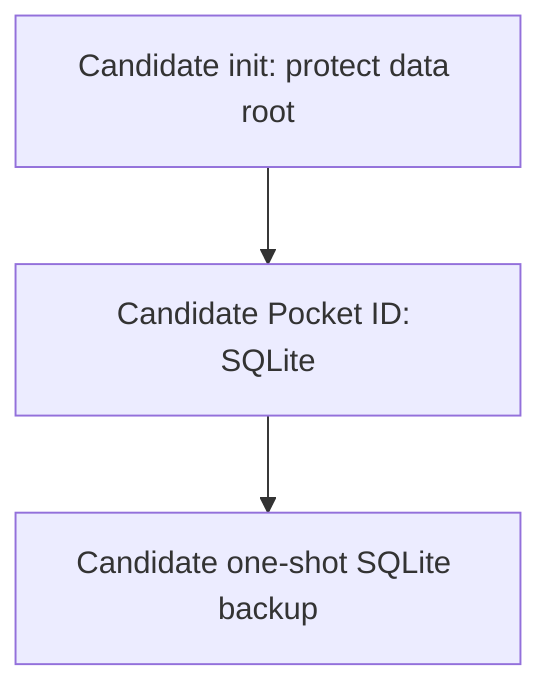

# Pocket ID

**Blocked candidate — not deployed, deploy-ready, or approved for production.**
Review date: **2026-10-26**.
Tracked in [issue #941](https://github.com/DevSecNinja/truenas-apps/issues/941).

## Why

Evaluate a passkey-based OpenID Connect (OIDC) provider for an eventual full
side-by-side production deployment alongside Microsoft Entra ID. Entra remains
the active provider. Running a second provider does not automatically migrate
accounts, credentials, authorization, or sessions, and does not make switching
applications automatic.

The operator authorized and completed **SOPS secret provisioning only**.
1Password CLI authentication and an existing Memos secret decryption succeeded;
plaintext was discarded. The app-specific encrypted secret file is now
provisioned and validated. This does not authorize candidate activation.

## Candidate Blockers

| Gate                 | Status / required evidence                                                                                                                                                            |
| -------------------- | ------------------------------------------------------------------------------------------------------------------------------------------------------------------------------------- |
| Image selection      | Compose pins the selected distroless artifact; the dated review below does not approve adoption; BusyBox inventory remains a gap                                                      |
| Dependency security  | Pocket ID's pinned frontend inventory contains a fixable HIGH finding; applicability needs assessment and the merged upstream fix has not reached this artifact                       |
| Backup artifact      | `docker.io/nfrastack/db-backup:4.9.2` is an unsupported tag with HIGH/CRITICAL findings; require a maintained upstream replacement and same-engine restore tests                      |
| Encrypted secrets    | SOPS provisioning and canonical validation completed for `DOMAINNAME`, `ENCRYPTION_KEY`, and `DB_ENC_PASSPHRASE`; independent recovery remains to be established                      |
| Activation           | No registry allocation, dataset provisioning, active Traefik attachment, DNS wiring, or Custom App enrollment is authorized                                                           |
| Runtime and recovery | Native Apple ARM64 startup/health/init/persistence passed; pinned backup failed; encrypted restore remains blocked. Separate Docker/TrueNAS validation is not a premerge prerequisite |
| Passkeys and clients | Browser/passkey, recovery, and client authorization acceptance remain required before production reliance; Entra migration is outside this candidate                                  |

The [dated image review](#image-evidence-2026-10-26) records verified
exact-artifact inventories and findings. A fix on an upstream branch is not
evidence that a published image contains it. Follow the
[image-adoption policy](https://homelab.devsecninja.com/ARCHITECTURE/#image-selection-upstream-dependency-maintenance);
do not maintain downstream patched dependency locks or forks as a workaround.
Completed secret provisioning does not clear image adoption or any remaining
deployment gate.

## Compose Files

Candidate source files:

- [compose.yaml](https://github.com/DevSecNinja/truenas-apps/blob/main/services/pocket-id/compose.yaml)
  — profiled candidate app, init, and backup.
- [Traefik candidate fragment](https://github.com/DevSecNinja/truenas-apps/blob/main/services/traefik/compose.pocket-id.yaml)
  — inert network additions, not selected by normal `dccd` or the active
  TrueNAS include.

Source links target the default branch and require the candidate changes to
be merged. After approval and creation of the app network, merge the fragment's
entries into active `services/traefik/compose.yaml` through review. Do not apply
the fragment as a raw ad-hoc production override.

Guide links use the published documentation URLs so they work from both this
GitHub README and its documentation-site copy. New candidate sections become
available after merge and documentation publication.

## Access

| Surface             | Proposed access                                                                        | Current status                             |
| ------------------- | -------------------------------------------------------------------------------------- | ------------------------------------------ |
| Pocket ID           | `https://id.${DOMAINNAME}`; native passkey authentication behind HTTPS Traefik routing | Not exposed or DNS-wired by this candidate |
| Host ports          | None published                                                                         | Required candidate boundary                |
| Active applications | Existing Entra, TFA, Immich, and Outline paths                                         | Unchanged                                  |

Future Pocket ID routing must not depend on the existing Entra
`chain-auth@file` or on a Pocket ID-backed Forward Auth chain: either would
create an authentication/recovery dependency. Review `chain-no-auth@file`
with native Pocket ID authentication before exposure; it is not authorization
to bypass authentication on other apps.

## Architecture

The source implements a **blocked candidate**, not a validated deployment.
All three services carry profile `pocket-id-candidate`. Do not activate the
profile or explicitly target a service to bypass the block.



The future request path is client → HTTPS Traefik → Pocket ID over the private,
stack-owned `pocket-id-frontend` bridge. No shared backend network or host port
is proposed. A private bridge is not proof of an air gap or restricted outbound
egress. The separate Traefik fragment must stay inert while the candidate
is blocked; do not edit active Traefik, DNS, registry, or server configuration
to make it reachable.

### Services

| Service               | Image status                                                                                                                     | Proposed role and identity                                                                                                                   |
| --------------------- | -------------------------------------------------------------------------------------------------------------------------------- | -------------------------------------------------------------------------------------------------------------------------------------------- |
| `pocket-id`           | `ghcr.io/pocket-id/pocket-id:v2-distroless@sha256:d035c9c229304cfd25f97a79b2da00bde9cf942abbd70430d452a95420e2836b`; blocked     | Shell-free, nonroot Debian 13 image; explicitly select the proposed app UID/primary GID rather than PUID remapping                           |
| `pocket-id-db-backup` | `docker.io/nfrastack/db-backup:4.9.2@sha256:cc95be0b5f551f432a218fc2811d63a2946233c8260598d5eda0ff624bb47412`; blocked           | One-shot SQLite Online Backup API job; identity mapping and output permissions need runtime proof                                            |
| `pocket-id-init`      | `docker.io/library/busybox:1.38.0@sha256:fd8d9aa63ba2f0982b5304e1ee8d3b90a210bc1ffb5314d980eb6962f1a9715d`; inventory/review gap | Validate required inputs, chown only the `./data` root to the proposed app PUID/PGID, set root directory mode `0700`; never chown `./config` |

Proposed account `svc-app-pocket-id` has no shared-purpose group memberships.
Its UID and matching primary GID are **reserved for this inactive candidate,
not provisioned or available for reuse**. This is not an active registry account;
see [Infrastructure](https://homelab.devsecninja.com/INFRASTRUCTURE/#pocket-id-candidate-identity-reservation).
Init runs as root with narrowly declared capabilities and changes only the
data root, not its contents. The backup's writable-root s6 supervisor starts as
root and creates an image-local `pocketbackup` identity matching the app.
Neither this mapping nor backup file permissions have runtime proof here.
Separately review any recursive ownership/permission repair operation.

The selected distroless artifact reports version `v2.19.1` in its labels;
a version-specific distroless tag was not available. Keep the exact digest
pinned rather than relying on the moving `v2-distroless` tag. The label revision
is `23c7f07f7ef80cd14b991541784f1182dbdaf249`. GHCR was selected for the
verified shell-free variant; cross-registry equality for this distroless
artifact is not established and remains a follow-up before any registry change.
The image supports the explicit proposed runtime user; this does not establish
full-stack runtime, recovery, or production acceptance.

### Native Runtime Evidence 2026-10-26

Isolated tests used **Apple container 1.6.1**, `linux/arm64`, and native ext4
volumes with the pinned app and backup artifacts above. No production secrets
were accessed; test containers and volumes were deleted.

| Test                        | Result / scope                                                                                                                                                                                   |
| --------------------------- | ------------------------------------------------------------------------------------------------------------------------------------------------------------------------------------------------ |
| Init                        | Ownership matched the reserved app UID/primary GID in Compose; mode `0700` passed on two runs                                                                                                    |
| App startup and health      | SQLite schema initialization and native healthcheck passed initially, after stop/start, and after recreation                                                                                     |
| Persistence                 | A synthetic SQLite record survived recreation; `integrity_check` returned `ok`                                                                                                                   |
| Selected app controls       | Native inspection confirmed the configured user, read-only root, capability drop `ALL`, memory limit, `/tmp` tmpfs, and no published ports                                                       |
| BusyBox helper              | Matching UID/GID, zero effective capabilities, rejected root writes, and successful `/tmp` and data writes                                                                                       |
| Pinned 4.9.2 backup         | Read-only source open and `.backup` failed with `unable to open database file`; encryption, checksum, and final output were skipped, but the routine reported exit code `0`                      |
| Writable scratch diagnostic | The stopped synthetic database copied to writable scratch opened in WAL mode; `.backup` produced an integrity-checked snapshot containing the seeded record. This is not encrypted restore proof |

The helper reported **`NoNewPrivs=0`**. Docker `no-new-privileges` and the
Compose PID limit were not exercised; do not claim full-stack hardening.
These volumes do not establish TrueNAS bind-mount/ZFS ACL behavior. The backup
source was stopped to avoid simultaneous native volume mounts, so live WAL
backup was not tested. There is no successful encrypted/compressed restore,
AMD64 execution, Docker Compose execution, Traefik, passkey, or production
acceptance evidence. The operator explicitly does **not** require a separate
Docker/TrueNAS runtime validation as a premerge gate; image adoption and
encrypted restore remain blocked independently.

### Image Evidence 2026-10-26

**Decision: BLOCKED for every image; no applicability exception or adoption
clearance is approved.** This review summarizes parent-verified Trivy JSON and
CycloneDX inventories for the exact pins above on `linux/amd64`. It is not
runtime, browser, or restore evidence.

- Scanner: **Trivy 0.75.0**, remote-image source, vulnerability scanner with
  `--list-all-pkgs`; run **2026-10-26 16:27 UTC**.
- Vulnerability database: updated **2026-10-26 14:38:04 UTC**, downloaded
  **16:04:34 UTC** that day. Reruns use their own database/timestamps.
- Counts below are **raw findings, not deduplicated vulnerabilities or
  exploitability determinations**. Inventory presence does not prove execution
  or reachability; a missing inventory does not establish safety.

| Image                     | Verified inventory / findings                                                                                                                                                                         | Maintenance flag / confidence                                                                                                                | Adoption requirement                                                                                                                       |
| ------------------------- | ----------------------------------------------------------------------------------------------------------------------------------------------------------------------------------------------------- | -------------------------------------------------------------------------------------------------------------------------------------------- | ------------------------------------------------------------------------------------------------------------------------------------------ |
| BusyBox init              | Scanner returned no package inventory/results; this is not a clean bill of health                                                                                                                     | **unknown / medium** — available scan cannot establish dependency coverage or maintenance delivery                                           | Refresh/review supported artifact and obtain meaningful inventory/evidence before adoption                                                 |
| nfrastack/db-backup 4.9.2 | Alpine 3.24.1, 166 OS packages; raw OS findings: 1 CRITICAL, 43 HIGH, 52 MEDIUM, 80 LOW, 4 UNKNOWN. Bundled Go binaries: `age` 14 HIGH; `influx` 28 HIGH / 2 CRITICAL; `influxd` 60 HIGH / 2 CRITICAL | **unmaintained tag / high** — upstream supports only latest; this does not classify the project as abandoned                                 | Maintained upstream replacement, applicability review, and same-engine backup/restore validation without silently changing the v4 contract |
| Pocket ID distroless      | Debian 13.7, 6 OS packages, 194 Go modules, 43 npm entries from embedded frontend SBOM; 0 OS findings, 1 HIGH Node finding, 1 UNKNOWN Go finding                                                      | **partial / medium** — a dependency fix was merged, but delivery into the selected artifact lags; policy/support evidence remains incomplete | Verify upstream-fixed published artifact and assess affected frontend validation paths; no exception approved                              |

Pocket ID's HIGH finding is **CVE-2023-54404**, `zod` **4.6.5**, fixed in
**4.6.6**, confirmed by the
[OSV advisory](https://api.osv.dev/v1/vulns/GHSA-mrhx-c7xc-m3w5).
The image contains a Go application binary; npm entries describe its bundled
browser UI/SBOM, not a Node server runtime. The affected client-side validation
path still needs applicability assessment: this review does **not** establish
a remotely exploitable server denial of service. The Go inventory also reports
**GO-2026-5932**, `golang.org/x/crypto` **0.58.0**, severity UNKNOWN; investigate
applicability rather than treating UNKNOWN as cleared.

[Upstream PR #1872](https://github.com/pocket-id/pocket-id/pull/1872)
merged on **2026-10-23**, after the
[v2.19.1 release](https://github.com/pocket-id/pocket-id/releases/tag/v2.19.1)
on **2026-10-22**. The pinned artifact still contains `zod` 4.6.5; the fix is
not delivered in this image. Require an upstream rebuilt/released artifact and
verify its inventory, not just the merged source.

Representative fixable backup OS findings are **CVE-2026-13221**, CRITICAL,
`perl` **5.42.2-r0 → 5.42.2-r1**, and **CVE-2026-14456**, HIGH,
`libcrypto3` / `libssl3` / `openssl` **3.5.7-r0 → 3.5.8-r0**.
Bundled engines unrelated to SQLite may not execute in this job; the counts
do not make every finding applicable. No applicability exception is approved.
The verified [upstream security policy](https://github.com/nfrastack/db-backup/blob/main/SECURITY.md)
states only latest receives fixes, leaving the selected 4.9.2 tag unsupported.
Do not infer that a v5 replacement is compatible without migration tests.

Reproduce inventory collection with Trivy 0.75.0 and the exact pins below.
These commands only inspect remote images; they neither execute containers
nor clear the deployment gate. JSON and CycloneDX are emitted to the operator's
terminal; retain review artifacts through an approved evidence workflow, not
temporary filesystem links in documentation.

```sh
for IMAGE in \
    ghcr.io/pocket-id/pocket-id:v2-distroless@sha256:d035c9c229304cfd25f97a79b2da00bde9cf942abbd70430d452a95420e2836b \
    docker.io/nfrastack/db-backup:4.9.2@sha256:cc95be0b5f551f432a218fc2811d63a2946233c8260598d5eda0ff624bb47412 \
    docker.io/library/busybox:1.38.0@sha256:fd8d9aa63ba2f0982b5304e1ee8d3b90a210bc1ffb5314d980eb6962f1a9715d
do
    mise exec -- trivy image --platform linux/amd64 --image-src remote --scanners vuln --list-all-pkgs --format json "${IMAGE}"
    mise exec -- trivy image --platform linux/amd64 --image-src remote --scanners vuln --list-all-pkgs --format cyclonedx "${IMAGE}"
done
```

### Windows Continuation Status 2026-10-28

- **Runtime status:** Docker CLI absent. With explicit approval, the existing
  rootless Podman WSL machine started; `podman info` reports server **5.8.6**
  (`linux/amd64`), with Windows client **5.8.3**. No containers were running;
  prior unrelated exited test resources were left untouched. No candidate
  containers or recovery tests were started. No runtime installation or
  production access was authorized.
- **Static validation:** Compose **v5.5.1** `config` passed with synthetic
  inputs. The default profile selected zero services; the explicit
  `pocket-id-candidate` profile selected all three. This is configuration
  evidence only, not candidate execution or restore evidence.
- **Upstream releases:** GitHub latest remained Pocket ID
  [v2.19.1](https://github.com/pocket-id/pocket-id/releases/tag/v2.19.1)
  (**2026-10-22**) and nfrastack/db-backup
  [5.0.6](https://github.com/nfrastack/db-backup/releases/tag/5.0.6)
  (**2026-10-26**). The SQLite-specific release note only adds a warning about
  an unwritable WAL directory; it does not establish v4 compatibility or clear
  adoption.
- **Selected tag unchanged:** public registry GET for
  `ghcr.io/pocket-id/pocket-id:v2-distroless` still returned
  `Docker-Content-Digest: sha256:d035c9c229304cfd25f97a79b2da00bde9cf942abbd70430d452a95420e2836b`,
  exactly the current pin. No upstream rebuilt artifact was delivered through
  this selected tag; this metadata check is not a fresh artifact scan.
- **Concrete replacement blocker — source review, not runtime proof or an
  exploitability assessment:** in the
  [5.0.6 SQLite implementation](https://github.com/nfrastack/db-backup/blob/5.0.6/src/internal/database/engine/sqlite/sqlite.go),
  `Dump` → `listTables` selects only `sqlite_master` entries with `type='table'`,
  then loops through `dumpTable` using independent `*sql.DB` `Query` calls
  without a shared read transaction or Online Backup snapshot. This path emits
  SQL text rather than v4's binary SQLite snapshot and omits indexes, views,
  and triggers. It is not an approved drop-in for coherent live-writer,
  full-schema recovery.
- **Unchanged:** no service versions, pins, Compose, secrets, or integrations
  changed. Production secrets remain provisioned and were not accessed for
  these checks. The **2026-10-26** evidence above remains distinct. Engine
  availability adds no candidate execution, fresh artifact scan, recovery, or
  production evidence. Candidate gates remain blocked; future rollout remains
  **DO NOT EXECUTE**.

### Persistent State Classification

| Path / input                         | Classification                                                       | Recovery requirement                                                                      |
| ------------------------------------ | -------------------------------------------------------------------- | ----------------------------------------------------------------------------------------- |
| `./data` mounted at `/app/data`      | Sensitive, irreplaceable identity-provider state                     | Preserve the SQLite database and consistent recovery point; do not treat as cache         |
| `/app/data/pocket-id.db`             | SQLite source via `DB_CONNECTION_STRING=/app/data/pocket-id.db`      | Consistent SQLite backup plus the same app encryption key                                 |
| Database-backed uploads/signing keys | `FILE_BACKEND=database`; uploads are included in the database backup | Demonstrate complete restore and signing-key continuity before claiming verified coverage |
| `./backups/db-backup`                | Sensitive encrypted recovery artifacts                               | Preserve verified dumps and independently recoverable decryption material                 |
| `ENCRYPTION_KEY`                     | Irreplaceable external secret                                        | Recover the original key with the database; never generate a replacement during restore   |
| Tracked Compose and documentation    | Rebuildable configuration                                            | Preserve the exact compatible image/schema revision with each recovery point              |

The identity database must be treated as containing users, passkey public
credentials, client configuration, and sensitive identity-provider material,
not as replaceable authentication cache. Verify the selected release's actual
storage layout, including any writable paths outside `/app/data`.

The SQLite path and `FILE_BACKEND=database` configuration were verified against
[v2.19.1 `backend/internal/common/env_config.go`](https://github.com/pocket-id/pocket-id/blob/v2.19.1/backend/internal/common/env_config.go).
This supports a consistent SQLite Online Backup API recovery path; upstream's
export mechanism need not be the sole supported backup path. It does not
replace an actual backup/restore acceptance test.

### Database Backup

The [verified 4.9.2 shell implementation](https://github.com/nfrastack/db-backup/blob/4.9.2/rootfs/container/functions/10-dbbackup#L796-L821)
uses SQLite's `.backup` command (the SQLite Online Backup API), producing a
**binary SQLite snapshot**, not SQL text or a raw live-file copy, before
compression, encryption, and checksumming. This is source-confirmed behavior,
but the native run failed before those output stages as recorded above.
It is manual mode, once per DCCD
deployment, with ZSTD compression, SHA1
checksum, GPG encryption, retention of **2880 minutes**, and output at
`./backups/db-backup`. This is not an independent nightly schedule or a
verified production backup. A checksum detects accidental corruption; it is
not proof of authenticity or restorability.

The writable-scratch `.backup` diagnostic passed, but no encrypted
backup/decrypt/restore or target-host run has been completed. Fix consistent
SQLite/WAL backup and failure propagation; verify one-shot output count,
freshness, encrypted output, restrictive permissions, and seeded-record restore
before adoption. Do not blindly make the live source writable or use SQLite
`immutable` against a live database/snapshot without proving consistency. See the
[blocked-candidate backup scope and future restore procedure](https://homelab.devsecninja.com/BACKUP/#pocket-id-blocked-candidate-coverage-and-future-restore).
Do not substitute v5 or a moving latest tag: the
[v4 compatibility constraint](https://homelab.devsecninja.com/BACKUP/#v4-compatibility-constraint)
requires a separately tested migration.

## Secrets

`services/pocket-id/secret.sops.env` was created from a SOPS-encrypted template.
Only `DOMAINNAME` was copied from Memos in memory; both app-owned secrets were
generated independently through `scripts/generate-sops-secrets.sh` sentinels.
Canonical `scripts/validate-sops-secrets.sh` validation passed for all three
required variables with no unresolved sentinels. No temporary ciphertext
remains, no vault items were changed, and no plaintext files were created or
secret values printed. This is not deployment or runtime evidence.

| Variable            | Purpose                                                      | Provisioning requirement                                                            |
| ------------------- | ------------------------------------------------------------ | ----------------------------------------------------------------------------------- |
| `DB_ENC_PASSPHRASE` | GPG encryption of this app's database backups                | Provisioned: independent random 36-byte secret encoded as 72 hexadecimal characters |
| `DOMAINNAME`        | Nonsecret deployment domain for URL and routing substitution | Provisioned: copied from Memos in memory into the per-app encrypted dotenv          |
| `ENCRYPTION_KEY`    | Pocket ID application encryption                             | Provisioned: independent random 32-byte key encoded as 64 hexadecimal characters    |

Future OIDC clients require separate credentials and exact redirect URI
allowlists. Do not reuse or modify active Entra, TFA, Immich, or Outline client
credentials. Store generated credentials only through the approved encrypted
workflow, after the operator authorizes it.

Shared encrypted credentials contain Docker Hub credentials, not `DOMAINNAME`.
The per-app encrypted dotenv now contains the domain and both app-owned secrets.
Init's minimum-length check is not proof of the required random key generation.

## First-Run Setup

<!-- dprint-ignore -->
!!! danger "DO NOT EXECUTE — blocked candidate"
    Do not deploy, create a Custom App or dataset, run the preparation helper,
    activate the profile, or wire a route now. SOPS secret provisioning is
    complete; it does not authorize activation. The sequence below is
    future-only, not a deploy-now handoff.

### Windows Continuation Checklist

- [ ] Use the existing chosen runtime if available. Podman/WSL2 is the
      preferred optional environment; do not install anything without approval.
      Keep test data on a Linux ext4 filesystem, not Windows bind paths.
      Use synthetic state and test-only secrets, not production secrets.
- [ ] Review maintained upstream **exact artifacts** and retain dated
      dependency inventories/applicability decisions: Pocket ID `zod` 4.6.5
      HIGH (fixed in 4.6.6) and Go UNKNOWN; unsupported backup 4.9.2
      HIGH/CRITICAL; BusyBox inventory gap. Verify delivered fixes, not merged
      source alone; do not assume a newer major preserves the backup contract.
      Recheck versioned storage, health/recovery commands, and writable paths
      when selecting replacement artifacts.
- [ ] Fix consistent SQLite/WAL backup and propagate actual failures as
      nonzero job exits. Test source-open, dump, compression, encryption, and
      checksum failures; assert one successful snapshot/output set per one-shot
      invocation, not success based only on logs or exit `0`.
- [ ] Prove GPG-encrypted ZSTD backup → SHA1 verification → decrypt/decompress
      → fresh SQLite/app restore with seeded records, integrity checks,
      restrictive permissions, and the same test app key. Check uploads/client
      state and signing-key continuity before claiming complete recovery.
      A writable-scratch `.backup` alone does not satisfy this item; do not
      blindly rw-mount the live source or mark a live snapshot `immutable`.
- [ ] Keep all candidate profiles and active DNS/Traefik/registry unchanged
      until adoption and restore clear. Existing encrypted secrets are
      completed: no rotation or unnecessary re-encryption. Establish
      independent recovery of the original app key and backup passphrase.
- [ ] **Only after clearance and approval**, integrate registry key `pocket-id`
      with the [reserved account](https://homelab.devsecninja.com/INFRASTRUCTURE/#pocket-id-candidate-identity-reservation),
      distinct from TREK's reservation; recheck host allocation, server scope,
      and SOPS rules only if needed. Review DNS `id.${DOMAINNAME}`, active
      Traefik frontend attachment, app/dataset/init/env/identity inventories,
      and remove `pocket-id-candidate` from all three services. Activate the
      Traefik attachment only after the app network exists.

The native passes above need not be repeated solely to add a Docker/TrueNAS
premerge gate. Retest behavior affected by replacement artifacts or backup
changes in the chosen environment. Browser/passkey, registration policy,
spare-key recovery, and client authorization checks remain conditional rollout
acceptance before production reliance, not evidence already obtained.

### Enrollment and Independent Recovery Policy

Before admitting real users, verify identity out of band with a trusted
administrator; an email address or invitation possession alone is insufficient.
Keep enrollment administrator-controlled, narrowly scoped, time-limited, and
auditable. Verify that unapproved users cannot self-enroll or become admins.
Require WebAuthn user verification (PIN/biometric), not merely key presence,
and prove that the selected release enforces the policy.

Enroll a primary and a separately stored spare hardware passkey for each
administrator before relying on Pocket ID. Test loss of the primary key.
Retain independent TrueNAS/SSH/console recovery that does not authenticate
through Pocket ID, Entra/TFA, or an app protected by them. Store recovery
material and spare hardware off-host so a NAS outage cannot also remove the
only route to keys and backups.

Pocket ID's native `one-time-access-token` recovery mechanism is the proposed
break-glass path. Verify its exact invocation, user targeting, expiry, and
single-use behavior in the selected image before adoption; do not assume a
shell exists in a distroless image. An authorized operator must run it through
independent host access, with sensitive token/URL output visible only in the
operator's terminal, never CI logs, tickets, chat, or shared transcripts.
Complete recovery only for an independently verified account, enroll a new
passkey, invalidate unused recovery access and affected sessions, and audit
the event without recording the token.

### Future Rollout Only After All Gates Clear

**DO NOT EXECUTE until adoption, independent secret recovery, registry activation,
reviewed active Traefik/DNS wiring plan, profile removal, and encrypted restore
acceptance are all cleared.** A separate Docker/TrueNAS runtime test is not a
premerge prerequisite. Actual host access/passkey acceptance
must then pass before production reliance or any application cutover.

On the TrueNAS host, use the deployment user with aliases already sourced from
`/mnt/vm-pool/apps/scripts/aliases.sh`. Coordinate scheduled deployments during
network enrollment; no normal deployment selects the candidate Traefik fragment.

1. Sync/decrypt only the future registered app:

   ```sh
   dccd-app pocket-id
   ```

   The missing TrueNAS app-config directory must cause deployment to be
   skipped on this first pass. This guard is TrueNAS-mode-specific, not a
   general raw Compose safety control. Do not run `dccd-all` first.
2. From the updated checkout, prepare the approved registry entry:

   ```sh
   cd /mnt/vm-pool/apps
   sudo bash scripts/truenas-prep-app.sh pocket-id
   ```

   The helper must preserve checked-out files while creating the approved
   dataset/account. It does not support this candidate before registry activation.
3. **TrueNAS Custom App name:** `pocket-id`

   ```yaml
   include:
     - /mnt/vm-pool/apps/services/pocket-id/compose.yaml
   services: {}
   ```

   Let the app create its frontend network first. Only then activate the
   reviewed, tracked Traefik attachment by merging the fragment's entries into
   active `services/traefik/compose.yaml`, and activate approved DNS wiring.
   Do not manually connect networks, apply the fragment ad hoc, or assume it
   is discovered automatically.
4. Complete the future canonical deployment:

   ```sh
   dccd-all
   ```

5. Verify init completion, healthy rootless app, HTTPS origin and issuer,
   no published ports, one successful encrypted backup and freshness check,
   and target-host recovery behavior before production reliance (not a redundant
   premerge gate). Use the selected release's native
   bootstrap flow to establish the independently verified first administrator,
   enforce controlled enrollment and user verification, and enroll/test spare
   passkeys. Confirm Entra/TFA/Immich/Outline behavior remains unchanged.

For a separately approved TREK integration after rollout, register a
**confidential OIDC client** with exact callback
`https://trek.${DOMAINNAME}/api/auth/oidc/callback` and issuer
`https://id.${DOMAINNAME}`. Store its separate client credentials through the
approved encrypted workflow and test authorization/denial and recovery.
TREK configuration is not present in this checkout; this is a continuation
task, not a verified integration. No Entra migration is included.

## Optional Per-App Cutover and Rollback

These are future, separately approved changes, not part of candidate activation.
An Entra browser SSO session, a TFA cookie, a native app session, and an app's
OIDC identity binding are different state. Changing an issuer does not migrate
or revoke them all; a warm browser can hide a broken integration. Test fresh
private-browser and native-app sessions, renewal, logout, revocation, and
rollback independently. Existing Entra sessions are not Pocket ID sessions.

1. Preserve app data/configuration and the current Entra client/issuer. Record
   the existing internal user ID, provider/issuer and immutable subject/object
   identifier, roles, ownership, and the proposed Pocket ID issuer/subject.
   Securely retain a reviewed, explicit mapping; **never match only by email**.
2. Create a distinct test client with least scopes, exact callbacks, explicit
   user/group assignment, and reviewed claims/authorization semantics. Prove
   negative authorization tests as well as successful login.
3. Rehearse linking/migration with a non-admin test identity on an isolated
   instance. Confirm no duplicate account, privilege escalation, lost ownership,
   or inaccessible content; verify an independent admin recovery path.
4. Approve one app at a time with a checkpoint and rollback window. Do not
   globally replace `chain-auth@file`, the shared `main` portal, or client
   credentials. Retain Entra until the operator explicitly retires each path.
5. If acceptance fails, stop further enrollment/cutover, restore that app's
   provider configuration and verified identity bindings/checkpoint, invalidate
   affected new-provider sessions, and retest fresh Entra access and ownership.
   Reverting an issuer alone may not undo database migrations or linked users.

| Integration          | Additional cutover gate                                                                                                                                                                                                                                                                                                                                                                                                          |
| -------------------- | -------------------------------------------------------------------------------------------------------------------------------------------------------------------------------------------------------------------------------------------------------------------------------------------------------------------------------------------------------------------------------------------------------------------------------- |
| Immich               | Preserve existing accounts, photo ownership, sharing, admin roles and quotas; prove explicit identity linking and rollback without email-only matching. Test web and real mobile OAuth, the existing mobile callback relay, token renewal and logout without adding a browser-TFA dependency or broadening bypasses. Current config has automatic registration and disables password login; neither is a safe migration fallback |
| Open Archiver        | Prove exact authorization equivalence to `Role("open-archiver-access")` on every request, including setup/API, with absent/wrong-role denial. Do not replace this with “any authenticated user” or email-domain checks. Keep local authentication/MFA and the separate candidate's own adoption gate; OSS native SSO is not assumed                                                                                              |
| Outline              | Prove supported migration from Azure auth to the selected OIDC integration while retaining workspace, internal user IDs, documents/collections, ownership, memberships, permissions and admin access. Test native app login separately from its TFA gate; email login is currently disabled. Require an isolated database/config rollback rehearsal before any production switch                                                 |
| Traefik Forward Auth | First verify the selected TFA release supports the intended Pocket ID provider and claim conditions. Future clients must be server-isolated, with separate credentials, callbacks, cookie prefixes and test portal/routes; leave active Entra `main` unchanged. Prove authorization and session isolation per host, not just a successful OIDC redirect                                                                          |

See the existing [Immich](https://homelab.devsecninja.com/services/immich/), [Open Archiver](https://homelab.devsecninja.com/services/open-archiver/),
[Outline](https://homelab.devsecninja.com/services/outline/), and [Traefik Forward Auth](https://homelab.devsecninja.com/services/traefik-forward-auth/)
guides. No active integration change or automatic failover is provided here.

## Upgrade Notes

No production upgrade path has been exercised. Review supported releases,
exact-image findings, schema/key changes and versioned storage behavior for
every proposed update. Preserve a compatible image reference, verified
pre-upgrade backup, original encryption key and identity mappings; prove the
rollback/restore path before upgrading. Do not assume database downgrades are
supported or that passkeys survive an origin/RP-ID change. Keep the proposed
origin stable and test real passkey/OIDC clients after changes.
