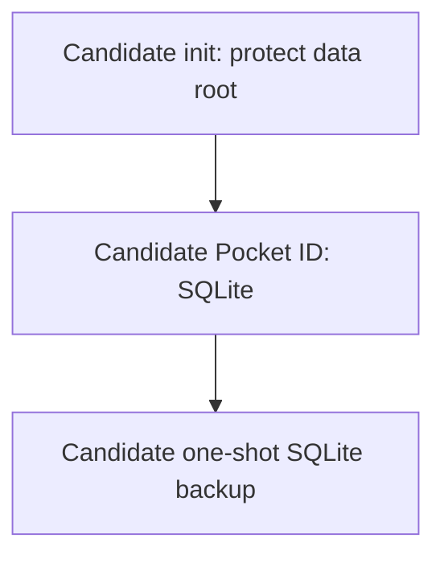

# Pocket ID

**Blocked candidate — not deployed, deploy-ready, or approved for production.**
Evidence updated: **2026-11-08**; image adoption remains blocked.
Tracked in [issue #941](https://github.com/DevSecNinja/truenas-apps/issues/941).

## Why

Evaluate a passkey-based OpenID Connect (OIDC) provider for an eventual full
side-by-side production deployment alongside Microsoft Entra ID. Entra remains
the active provider. Running a second provider does not automatically migrate
accounts, credentials, authorization, or sessions, and does not make switching
applications automatic.

The operator authorized and completed **SOPS secret provisioning only**.
1Password CLI authentication and an existing Memos secret decryption succeeded;
plaintext was discarded. The app-specific encrypted secret file is now
provisioned and validated. This does not authorize candidate activation.

## Candidate Blockers

| Gate                 | Status / required evidence                                                                                                                                                                                                                                                                                        |
| -------------------- | ----------------------------------------------------------------------------------------------------------------------------------------------------------------------------------------------------------------------------------------------------------------------------------------------------------------- |
| Image selection      | Supported `v2.19.2-distroless` is now pinned and exact-artifact reviewed; backup and BusyBox pins are unchanged, with maintenance/security gates still open                                                                                                                                                       |
| Dependency security  | Go-jose `4.1.6`, zod `4.6.7`, and x/net `0.62.0` fixes are delivered. Residual UNKNOWN `GO-2026-5932`: OpenPGP symbols are present in the binary; call-path/applicability assessment remains open                                                                                                                 |
| Backup artifact      | `docker.io/nfrastack/db-backup:4.9.2` remains unsupported; the November 8 scan still reports raw HIGH/CRITICAL findings. Functional restore success does not clear maintenance/adoption                                                                                                                           |
| Encrypted secrets    | SOPS provisioning and canonical validation completed for `DOMAINNAME`, `ENCRYPTION_KEY`, and `DB_ENC_PASSPHRASE`; independent recovery remains to be established                                                                                                                                                  |
| Activation           | No registry allocation, dataset provisioning, active Traefik attachment, DNS wiring, or Custom App enrollment is authorized                                                                                                                                                                                       |
| Runtime and recovery | November 8 final-image AMD64 synthetic recovery, public JWKS/key-ID equality, and 49h/47h retention passed; required 281-test BATS suite passed with the legacy-assertion caveat below. Full mandatory pre-commit validation passed November 8; separate Docker/TrueNAS validation is not a premerge prerequisite |
| Passkeys and clients | Browser/passkey, recovery, and client authorization acceptance remain required before production reliance; Entra migration is outside this candidate                                                                                                                                                              |

The [November 8 evidence](#image-and-recovery-evidence-2026-11-08) records
the supported release's exact-artifact fixes and synthetic recovery results.
The [October 29 review](#image-evidence-2026-10-29) remains historical evidence
for the old app pin, not the current artifact. Follow the
[image-adoption policy](https://homelab.devsecninja.com/ARCHITECTURE/#image-selection-upstream-dependency-maintenance);
do not maintain downstream patched dependency locks or forks as a workaround.
Completed secret provisioning does not clear image adoption or any remaining
deployment gate.

## Compose Files

Candidate source files:

- [compose.yaml](https://github.com/DevSecNinja/truenas-apps/blob/main/services/pocket-id/compose.yaml)
  — profiled candidate app, init, and backup.
- [Traefik candidate fragment](https://github.com/DevSecNinja/truenas-apps/blob/main/services/traefik/compose.pocket-id.yaml)
  — inert network additions, not selected by normal `dccd` or the active
  TrueNAS include.

Source links target the default branch and require the candidate changes to
be merged. After approval and creation of the app network, merge the fragment's
entries into active `services/traefik/compose.yaml` through review. Do not apply
the fragment as a raw ad-hoc production override.

Guide links use the published documentation URLs so they work from both this
GitHub README and its documentation-site copy. New candidate sections become
available after merge and documentation publication.

## Access

| Surface             | Proposed access                                                                        | Current status                             |
| ------------------- | -------------------------------------------------------------------------------------- | ------------------------------------------ |
| Pocket ID           | `https://id.${DOMAINNAME}`; native passkey authentication behind HTTPS Traefik routing | Not exposed or DNS-wired by this candidate |
| Host ports          | None published                                                                         | Required candidate boundary                |
| Active applications | Existing Entra, TFA, Immich, and Outline paths                                         | Unchanged                                  |

Future Pocket ID routing must not depend on the existing Entra
`chain-auth@file` or on a Pocket ID-backed Forward Auth chain: either would
create an authentication/recovery dependency. Review `chain-no-auth@file`
with native Pocket ID authentication before exposure; it is not authorization
to bypass authentication on other apps.

## Architecture

The source implements a **blocked candidate**, not a validated deployment.
All three services carry profile `pocket-id-candidate`. Do not activate the
profile or explicitly target a service to bypass the block.



The future request path is client → HTTPS Traefik → Pocket ID over the private,
stack-owned `pocket-id-frontend` bridge. No shared backend network or host port
is proposed. A private bridge is not proof of an air gap or restricted outbound
egress. The separate Traefik fragment must stay inert while the candidate
is blocked; do not edit active Traefik, DNS, registry, or server configuration
to make it reachable.

### Services

| Service               | Image status                                                                                                                                        | Proposed role and identity                                                                                                                   |
| --------------------- | --------------------------------------------------------------------------------------------------------------------------------------------------- | -------------------------------------------------------------------------------------------------------------------------------------------- |
| `pocket-id`           | `ghcr.io/pocket-id/pocket-id:v2.19.2-distroless@sha256:a21166a4eb513d2ffcbf815398480998d996a9e719cfba029395517658626f9e`; candidate remains blocked | Shell-free, nonroot Debian 13 image; explicitly select the proposed app UID/primary GID rather than PUID remapping                           |
| `pocket-id-db-backup` | `docker.io/nfrastack/db-backup:4.9.2@sha256:cc95be0b5f551f432a218fc2811d63a2946233c8260598d5eda0ff624bb47412`; blocked                              | One-shot SQLite Online Backup API job; identity mapping and private output permissions verified in the isolated AMD64 diagnostic             |
| `pocket-id-init`      | `docker.io/library/busybox:1.38.0@sha256:fd8d9aa63ba2f0982b5304e1ee8d3b90a210bc1ffb5314d980eb6962f1a9715d`; inventory/review gap                    | Validate required inputs, chown only the `./data` root to the proposed app PUID/PGID, set root directory mode `0700`; never chown `./config` |

Proposed account `svc-app-pocket-id` has no shared-purpose group memberships.
Its UID and matching primary GID are **reserved for this inactive candidate,
not provisioned or available for reuse**. This is not an active registry account;
see [Infrastructure](https://homelab.devsecninja.com/INFRASTRUCTURE/#pocket-id-candidate-identity-reservation).
Init runs as root with narrowly declared capabilities and changes only the
data root, not its contents. The backup's writable-root s6 supervisor starts as
root and creates an image-local `pocketbackup` identity matching the app.
The isolated AMD64 run verified matching output ownership and restrictive
permissions; this does not establish TrueNAS provisioning or ACL behavior.
Separately review any recursive ownership/permission repair operation.

The selected distroless artifact reports version `2.19.2` and revision
`2b2750ed61e0016f4c15630322d15ca22143cdb6` in its labels. On November 8,
`v2.19.2-distroless` and `v2-distroless` resolved to the same index digest
listed above; retain the version-specific tag and exact digest.
GHCR was selected for the verified shell-free variant; cross-registry equality
for this distroless artifact is not established and remains a follow-up before
any registry change.
The image supports the explicit proposed runtime user; this does not establish
full-stack runtime, recovery, or production acceptance.

### Image and Recovery Evidence 2026-11-08

**Candidate remains blocked; no activation or applicability exception.**
Supported [release v2.19.2](https://github.com/pocket-id/pocket-id/releases/tag/v2.19.2)
was published **2026-11-02 at 20:18:20 UTC**, including PR #1872 and
vulnerable-dependency fixes. The selected artifact delivers **Go-jose 4.1.6**,
**zod 4.6.7**, and **x/net 0.62.0**: the former conditionally reachable
Go-jose HIGH and the older zod/x/net versions are fixed in this image,
not merely on an unreleased branch.

Verified AMD64 identities (`sha256`), using the index pins in the services table:

- App manifest: `7b1231ff19150d2003ab4e2f26c363c812e051ac5df6f27e5e3835f9781890fb`
- App config: `7db4825f42e30135683fcfc5197ed36f041944f35177ad0148d429251760a6a4`
- Unchanged backup config: `82b8ef8ca853939cd0ffec97b6401cfdfede6a1b2d821cedc55603adc819ef2d`

Fresh Trivy **0.75.0** database: updated **12:51:20 UTC**, downloaded
**14:06:16 UTC** on November 8. App scan **14:06:25**, backup **14:07:44**,
BusyBox **14:07:47** (UTC). Counts below are raw, not deduplicated or
proof that every affected package/path executes.

| Artifact / component                | Inventory                                                                                   | Findings                                                                         |
| ----------------------------------- | ------------------------------------------------------------------------------------------- | -------------------------------------------------------------------------------- |
| BusyBox init                        | No Trivy package results; prior manual inventory: BusyBox `1.38.0`, glibc `2.41-12+deb13u3` | Inventory/security gap, **not scanned-clean**                                    |
| nfrastack/db-backup 4.9.2 — OS      | 166 Alpine 3.24.1 packages                                                                  | 4 CRITICAL / 54 HIGH / 70 MEDIUM / 80 LOW / 2 UNKNOWN                            |
| nfrastack/db-backup 4.9.2 — Python  | 15 packages                                                                                 | 3 MEDIUM                                                                         |
| nfrastack/db-backup 4.9.2 — age     | 8 packages                                                                                  | 14 HIGH / 15 MEDIUM / 2 LOW / 2 UNKNOWN                                          |
| nfrastack/db-backup 4.9.2 — influx  | 39 packages                                                                                 | 2 CRITICAL / 28 HIGH / 43 MEDIUM / 4 LOW / 1 UNKNOWN                             |
| nfrastack/db-backup 4.9.2 — influxd | 66 packages                                                                                 | 2 CRITICAL / 61 HIGH / 39 MEDIUM / 1 LOW / 3 UNKNOWN                             |
| Pocket ID — OS / npm                | 6 Debian 13.7 OS packages; 44 npm entries                                                   | 0 findings in either inventory                                                   |
| Pocket ID — Go                      | 193 modules                                                                                 | Only UNKNOWN `GO-2026-5932`, x/crypto `0.58.0`, concerning the `openpgp` package |

**Residual OpenPGP UNKNOWN:** inspection of the verified OCI-layer
`/app/pocket-id` binary for the app config above found
`golang.org/x/crypto/openpgp` **115 times** (positive controls: bcrypt **20**,
go-jose **428**). OpenPGP package symbols are **present in the binary**;
call-path reachability/use remains unresolved, with no exploit or applicability
exception established. The earlier absence of a direct app import does not
establish that the package is unlinked or non-applicable. This residual review
is separate from the delivered Go-jose, zod, and x/net fixes.

The fresh shared-backup review now rates runtime musl **CVE-2026-107891**
**HIGH** (October 29: UNKNOWN): `regcomp` integer overflow, installed
**1.2.6-r2**, fixed in **1.2.6-r3**. The affected libc is present; reachability
through untrusted regular expressions is **not proven**. sudo's HIGH remains
conditional on time-based policy controls. Other runtime-tool assessments remain
the [October 29 scoped evidence](#image-evidence-2026-10-29), not a complete
fresh applicability review or blanket clearance.
Backup **4.9.2 remains unsupported**. Latest upstream backup **5.0.10**
(November 4) is not selected or compatibility-approved; BusyBox/glibc security
and maintenance review remains incomplete.
Unlike the historical 5.0.6 review below, the
[5.0.10 SQLite implementation](https://github.com/nfrastack/db-backup/blob/5.0.10/src/internal/database/engine/sqlite/sqlite.go)
improves schema handling, including indexes/views/triggers, generated columns,
sequences, and statistics. Its `BEGIN TRANSACTION`/`COMMIT` wrap SQL-text
output only; independent `d.db` reads with `mode=ro` do not establish a shared
source snapshot. Live-source consistency and v4 binary-snapshot/receipt
compatibility remain unapproved.

**Final-image recovery regression passed:** isolated rootless Podman with
named Linux volumes initialized a healthy `v2.19.2` app. With read-only source
and guard configuration, the original guarded backup produced one dump/completion
and one GPG/ZSTD ciphertext + SHA1 pair. Independent checksum/decrypt/decompress,
SQLite integrity/FKs, diagnostic linked rows and schema, and exact encrypted
signing/session KV bytes passed. Restore into the **same v2.19.2 image** with
the same synthetic key became healthy after a **95-second test wait** for the
copied Francis lease; actual source/restored HTTP public JWKS and key IDs matched.
A missing-SHM copy still failed closed. This is not a production startup sleep
or browser/passkey/full OIDC acceptance.

**Final-image retention regression passed at 14:11:40 UTC:** the valid 49h
ciphertext/SHA1 pair was removed, the 47h pair retained and checksum-verified,
and exactly one new verified pair created. `DEFAULT_CLEANUP_TIME=2880`
is unchanged. No ports were published or production secrets accessed; all
test-owned resources were cleaned up and encrypted production secrets are unchanged.

The **required 281-test BATS suite passed** on November 8 (exit `0`) from a
faithful staged-index Linux snapshot with Node **22.23.3**, yq **4.54.1**,
Compose **5.5.1**, and BATS **1.14.0**. Baseline `format_duration` tests emitted
existing command-not-found warnings: suite success does **not** make those
legacy assertions meaningful. The **66 targeted October 29 passes** remain
historical evidence. Full mandatory `mise exec -- lefthook run pre-commit`
**passed on 2026-11-08**: all **15 selected validators**, including the actual
**281 BATS tests in 67 seconds**. BATS used a faithful fresh staged-index Linux
snapshot, pinned tools, and real symlinks; other hooks used the existing native
Windows setup, approved server-apps helper, and jq **1.8.1** in the process
environment. No validators were skipped and no signing bypass was used.
All profiles, production
integration boundaries, independent secret-recovery and acceptance gates remain.

### Native Runtime Evidence 2026-10-26

Isolated tests used **Apple container 1.6.1**, `linux/arm64`, and native ext4
volumes with the old app pin recorded in the
[October 29 review](#image-evidence-2026-10-29) and the unchanged backup pin.
No production secrets were accessed; test containers and volumes were deleted.

| Test                        | Result / scope                                                                                                                                                                                   |
| --------------------------- | ------------------------------------------------------------------------------------------------------------------------------------------------------------------------------------------------ |
| Init                        | Ownership matched the reserved app UID/primary GID in Compose; mode `0700` passed on two runs                                                                                                    |
| App startup and health      | SQLite schema initialization and native healthcheck passed initially, after stop/start, and after recreation                                                                                     |
| Persistence                 | A synthetic SQLite record survived recreation; `integrity_check` returned `ok`                                                                                                                   |
| Selected app controls       | Native inspection confirmed the configured user, read-only root, capability drop `ALL`, memory limit, `/tmp` tmpfs, and no published ports                                                       |
| BusyBox helper              | Matching UID/GID, zero effective capabilities, rejected root writes, and successful `/tmp` and data writes                                                                                       |
| Pinned 4.9.2 backup         | Read-only source open and `.backup` failed with `unable to open database file`; encryption, checksum, and final output were skipped, but the routine reported exit code `0`                      |
| Writable scratch diagnostic | The stopped synthetic database copied to writable scratch opened in WAL mode; `.backup` produced an integrity-checked snapshot containing the seeded record. This is not encrypted restore proof |

The helper reported **`NoNewPrivs=0`**. Docker `no-new-privileges` and the
Compose PID limit were not exercised; do not claim full-stack hardening.
These volumes do not establish TrueNAS bind-mount/ZFS ACL behavior. The backup
source was stopped to avoid simultaneous native volume mounts, so live WAL
backup was not tested in that run. It provided no encrypted restore evidence;
the [2026-10-29 diagnostic](#exact-image-diagnostic-2026-10-29) below supplies
later AMD64 evidence, not a proven explanation of the earlier ARM64 failure.
A separate Docker/TrueNAS runtime validation is **not** a premerge gate.

### Image Evidence 2026-10-26

The historical Trivy **0.75.0** review at **16:27 UTC**, on the old app pin
recorded below and unchanged backup/init pins, blocked all images:
one HIGH Node finding for `zod`, one UNKNOWN Go finding, and backup OS counts
of 1 CRITICAL / 43 HIGH / 52 MEDIUM / 80 LOW / 4 UNKNOWN. BusyBox returned no
package inventory. These historical raw counts are not current applicability decisions.

### Image Evidence 2026-10-29

**Historical review — blocked at that date; no applicability exception or
adoption clearance.** These Trivy **0.75.0** scans used the old app index pin
`ghcr.io/pocket-id/pocket-id:v2-distroless@sha256:d035c9c229304cfd25f97a79b2da00bde9cf942abbd70430d452a95420e2836b`
(label `v2.19.1`, revision `23c7f07f7ef80cd14b991541784f1182dbdaf249`),
not the current v2.19.2 pin; backup/init pins are unchanged.
Counts are raw, not deduplicated or proof that every affected package/path executes.
All times UTC on **2026-10-29**: database updated **13:09:46**, downloaded
**18:48:53**; scans: app **18:49:07**, backup **18:49:23**, BusyBox **18:49:17**.

| Image                     | Historical inventory / findings                                                                                                                                    | Maintenance / remaining review at that date                                                                      |
| ------------------------- | ------------------------------------------------------------------------------------------------------------------------------------------------------------------ | ---------------------------------------------------------------------------------------------------------------- |
| BusyBox init              | Binary `v1.38.0` (`2026-05-13`), glibc `2.41-12+deb13u3`, libc libraries identified; Trivy still returns no package results                                        | Partial: exact-libc security and maintenance review remains open                                                 |
| nfrastack/db-backup 4.9.2 | 166 Alpine 3.24.1 OS packages; 6 CRITICAL / 42 HIGH / 58 MEDIUM / 80 LOW / 8 UNKNOWN; bundled `age`/`influx`/`influxd` findings need separate applicability review | Unsupported tag under upstream's latest-only fixes policy; functional success does not clear adoption            |
| Pocket ID distroless      | 6 Debian 13.7 OS packages, 0 OS findings; 43 npm entries, 0 Node findings; 194 Go modules, including the conditionally reachable HIGH below                        | Supported distroless fix and exact-artifact review required; release `v2.19.1` and selected pin remain unchanged |

**Then-blocking Go-jose path:** **CVE-2026-116587**, `go-jose/v4` **4.1.5**,
fixed in **4.1.6**, concerns [RSA JWK parameter parsing CPU denial of service](https://api.osv.dev/v1/vulns/GHSA-mgcc-cww5-fp2q).
[Pocket ID's `authenticateAssertion`](https://github.com/pocket-id/pocket-id/blob/v2.19.1/backend/internal/oidc/federated_client_auth.go#L117-L149)
first uses `jwx.ParseInsecure` and resolves the client. This path requires
syntactically valid issuer/sub, a **known existing client ID**, and no federated
credential matching the untrusted issuer. `errNoFederatedClientAssertion`
then [falls back](https://github.com/pocket-id/pocket-id/blob/v2.19.1/backend/internal/oidc/federated_client_auth.go#L89-L101)
to [Fosite's strategy](https://github.com/pocket-id/fosite/blob/v1.4.3/client_authentication.go):
[`ParseWithClaims`](https://github.com/pocket-id/fosite/blob/v1.4.3/token/jwt/token.go)
calls vulnerable `jwt.ParseSigned` before signature validation and Fosite's
own repeat client resolution. No authenticated client secret is required,
but arbitrary unknown clients do not meet these preconditions. A future
non-federated confidential TREK client fits; no exploit/integration test is claimed.

[PR #1872](https://github.com/pocket-id/pocket-id/pull/1872) merged **2026-10-23**
at `819a804b017b925eee72ad406717845b66f12a91`; upstream CI and
[Build Next Image](https://github.com/pocket-id/pocket-id/actions/runs/39982697318) succeeded.
As of October 29, main selected **4.1.6**; a development build existed but was
not exact-artifact reviewed/adopted. The latest supported/versioned release was
**v2.19.1** (**2026-10-22**) and the old digest above remained selected.
Supported distroless delivery and exact-artifact review were still pending then;
the [November 8 evidence](#image-and-recovery-evidence-2026-11-08) supersedes
that release/fix status, not these historical findings.

- **Node discrepancy:** `zod` **4.6.5** remains inventoried; Trivy reports zero
  Node findings, but [OSV](https://api.osv.dev/v1/vulns/GHSA-mrhx-c7xc-m3w5)
  still lists it as affected. Reconciliation remains open, not clearance.
- **Other Go findings:** UNKNOWN **GO-2026-5932** concerns `x/crypto` **0.58.0**
  `openpgp`; no direct app import was found. `x/net` **0.61.0** advisories
  **CVE-2026-78661** / **CVE-2026-97045** are HTML-specific, fixed in **0.62.0**.
  Package reachability remains unproven; module presence alone is insufficient.

In the backup scan, exercised SQLite **3.53.4-r0**, GPG **2.4.9-r1** /
libgcrypt **1.12.2-r0**, ZSTD **1.5.7-r2**, Bash **5.3.9-r1**, and musl
**1.2.6-r2** have no HIGH/CRITICAL findings. This is not zero total findings:
musl has unresolved UNKNOWN **CVE-2026-107891** (fixed **1.2.6-r3**), applicable
to the libc runtime in use. Relevant-tool sudo **1.9.17_p2-r1** has HIGH
**CVE-2026-96512** (fixed **-r2**), but inspected sudoers lacks the
required `NOTBEFORE`/`NOTAFTER` policy controls. curl HTTP/2, OpenSSL QUIC,
Brotli decoding, Perl regex, and unused-engine Go paths are not exercised by
this no-network local SQLite pipeline. Complete explicit scoped review is
still required; this is not a blanket exception. The [upstream support policy](https://github.com/nfrastack/db-backup/blob/main/SECURITY.md)
still leaves 4.9.2 unsupported, independently of functional compatibility.

The [official BusyBox mapping](https://raw.githubusercontent.com/docker-library/official-images/master/library/busybox)
ties latest/glibc AMD64 variants to upstream builds, not exact-libc security clearance.

### Windows Continuation Status 2026-10-28

- Approved Podman WSL startup and synthetic Compose **v5.5.1** `config` passed:
  zero default-profile services, all three under `pocket-id-candidate`; no candidate ran.
- Releases/pins were unchanged: Pocket ID **v2.19.1**, backup latest **5.0.6**.
- Source review of the [5.0.6 SQLite implementation](https://github.com/nfrastack/db-backup/blob/5.0.6/src/internal/database/engine/sqlite/sqlite.go)
  found independent queries without a shared snapshot, SQL-text output, and
  omitted indexes/views/triggers; its WAL warning does not establish compatibility.

### Exact-Image Diagnostic 2026-10-29

Isolated local rootless **Podman client 5.8.3 / server 5.8.6**,
`linux/amd64`, used native named Linux volumes, no network or published ports,
and test-only secrets. The app used the **old index pin in the October 29
image review**, not the current services-table pin; the backup pin is unchanged.
Inspected AMD64 identities (`sha256`) were:

- App platform: `22de1d64490a444a7d9cb92a6f3cb2cae1b48b335023d6c4072ba0d42cdfe11c`
- App config: `5a68ed8a0ca4e64fd6a2c9a825a4514c387dc63e075c3d5a24f892655385ff0d`
- Backup config: `82b8ef8ca853939cd0ffec97b6401cfdfede6a1b2d821cedc55603adc819ef2d`

| Check                          | Result / scope                                                                                                                                                                                                                                                                                                                                                                    |
| ------------------------------ | --------------------------------------------------------------------------------------------------------------------------------------------------------------------------------------------------------------------------------------------------------------------------------------------------------------------------------------------------------------------------------- |
| Real app initialization        | Alive and healthy; migration `20261011120000`, dirty `0`; nonempty encrypted signing/session KV rows                                                                                                                                                                                                                                                                              |
| Source permissions             | Private root `0700`; database/WAL/SHM `0644`, all owned by the reserved app UID/primary GID                                                                                                                                                                                                                                                                                       |
| Original backup job            | Inspected genuinely read-only source; original `/init` with `backup01-now now` and existing environment; exit `0`, exactly one actual dump start/completion and one `.sqlite3.zst.gpg` + SHA1 set                                                                                                                                                                                 |
| Output permissions             | Reserved app UID/primary GID ownership, files `0600`, output root `0700`                                                                                                                                                                                                                                                                                                          |
| Independent verification       | SHA1, GPG decryption, ZSTD decompression, SQLite integrity/FKs, full seeded schema/records including linked two-row/BLOB data and index/view/trigger, and exact encrypted signing/session KV bytes all passed                                                                                                                                                                     |
| Fresh app restore              | Same synthetic `ENCRYPTION_KEY`; copied Francis host lease initially caused “already one instance Pocket ID running”; healthy after a 95-second natural-expiry wait, without snapshot edits or key regeneration                                                                                                                                                                   |
| Guarded backup                 | Current thin verifier around the original engine passed against the actual image; its output restored healthy                                                                                                                                                                                                                                                                     |
| Public key continuity          | Actual source and restored HTTP `/.well-known/jwks.json` responses contained exactly identical public JWKS and key IDs after lease expiry; no real passkey/login tested                                                                                                                                                                                                           |
| Regression tests               | 66 passed on repository-pinned BATS **1.14.0** via Linux/WSL: 27 guard mocks + 39 DCCD freshness/receipt tests; sanitized actual Pocket ID v4 receipt accepted once, duplicate job `01` rejected with `dccd.backup-jobs=01`                                                                                                                                                       |
| Retention boundary — 19:14 UTC | Exact image/current guard with `DEFAULT_CLEANUP_TIME=2880`: valid ZSTD-compressed, test-passphrase GPG-encrypted binary SQLite snapshots with SHA1 pairs at 49h/47h mtimes; 49h pair removed, 47h pair retained with independently verified checksum. One verified new encrypted pair (two total), one dump/completion, exit `0`; healthy read-only source on named Linux volumes |

Both the image's default `sqlite3` invocation and `-readonly` succeeded live.
A graceful app stop left WAL/SHM present and backup still passed. Deliberately
omitting SHM from a stopped synthetic DB/WAL copy under a read-only mount
reproduced `unable to open database file` in both modes. Missing read-only WAL
metadata is a **conditional reproduced cause**, not proof of the earlier
ARM64 cause or permanent v4 incompatibility. No rw fallback or `immutable`
change was used.

Tests used synthetic fixtures; no production secrets or host data were used;
no deployment occurred. Actual passkeys/login, OIDC issuance/token signing, and
mobile acceptance were not exercised. Original encrypted secrets are unchanged;
all test-owned resources were cleaned up. Adoption/profile/integration gates stay closed.

### Persistent State Classification

| Path / input                         | Classification                                                       | Recovery requirement                                                                      |
| ------------------------------------ | -------------------------------------------------------------------- | ----------------------------------------------------------------------------------------- |
| `./data` mounted at `/app/data`      | Sensitive, irreplaceable identity-provider state                     | Preserve the SQLite database and consistent recovery point; do not treat as cache         |
| `/app/data/pocket-id.db`             | SQLite source via `DB_CONNECTION_STRING=/app/data/pocket-id.db`      | Consistent SQLite backup plus the same app encryption key                                 |
| Database-backed uploads/signing keys | `FILE_BACKEND=database`; uploads are included in the database backup | Demonstrate complete restore and signing-key continuity before claiming verified coverage |
| `./backups/db-backup`                | Sensitive encrypted recovery artifacts                               | Preserve verified dumps and independently recoverable decryption material                 |
| `ENCRYPTION_KEY`                     | Irreplaceable external secret                                        | Recover the original key with the database; never generate a replacement during restore   |
| Tracked Compose and documentation    | Rebuildable configuration                                            | Preserve the exact compatible image/schema revision with each recovery point              |

The identity database must be treated as containing users, passkey public
credentials, client configuration, and sensitive identity-provider material,
not as replaceable authentication cache. Verify the selected release's actual
storage layout, including any writable paths outside `/app/data`.

The SQLite path and `FILE_BACKEND=database` configuration were verified against
[v2.19.1 `backend/internal/common/env_config.go`](https://github.com/pocket-id/pocket-id/blob/v2.19.1/backend/internal/common/env_config.go).
This supports a consistent SQLite Online Backup API recovery path; upstream's
export mechanism need not be the sole supported backup path. It does not
replace an actual backup/restore acceptance test.

### Database Backup

The [verified 4.9.2 shell implementation](https://github.com/nfrastack/db-backup/blob/4.9.2/rootfs/container/functions/10-dbbackup#L796-L821)
uses SQLite's `.backup` command (the SQLite Online Backup API), producing a
**binary SQLite snapshot**, not SQL text or a raw live-file copy, before
compression, encryption, and checksumming.
Manual mode runs once per DCCD deployment, with ZSTD compression, SHA1 checksum,
GPG encryption, retention of **2880 minutes**, and output at
`./backups/db-backup`. This is not an independent nightly schedule or a
verified production backup. A checksum detects accidental corruption; it is
not proof of authenticity or restorability.

Compose mounts `config/verify-backup.sh` read-only and runs it with a
**180-second timeout / 10-second kill grace**, declaring `dccd.backup-jobs=01`.
This thin guard retains `backup01-now now` and its engine, checking:

- Initialized read-only SQLite access; one dump and successful upstream completion.
- Exactly one new matching ciphertext/SHA1 pair, reserved app ownership,
  files `0600`, output root `0700`, and SHA1 verification before decryption.
- GPG/ZSTD recovery in private `077`-umask scratch, integrity/FKs, matching clean
  migration version, and nonempty signing/session keys; failures close the job.

The upstream child retains its inherited umask. Exact key bytes, full seeded
schema/records, and public JWKS equality were independently tested, not checked
by the guard. Existing `depends_on: service_healthy` needs no arbitrary sleep;
unreadable/missing source or WAL metadata must fail closed, not use rw/`immutable`
fallback. The October 29 guard/DCCD regressions passed; final-image synthetic
restore and 49h/47h retention passed again on
[November 8](#image-and-recovery-evidence-2026-11-08). See the
[blocked-candidate scope and bounded restore readiness procedure](https://homelab.devsecninja.com/BACKUP/#pocket-id-blocked-candidate-coverage-and-future-restore).
Do not substitute v5 or a moving latest tag: the
[v4 compatibility constraint](https://homelab.devsecninja.com/BACKUP/#v4-compatibility-constraint)
requires a separately tested migration.

## Secrets

`services/pocket-id/secret.sops.env` was created from a SOPS-encrypted template.
Only `DOMAINNAME` was copied from Memos in memory; both app-owned secrets were
generated independently through `scripts/generate-sops-secrets.sh` sentinels.
Canonical `scripts/validate-sops-secrets.sh` validation passed for all three
required variables with no unresolved sentinels. No temporary ciphertext
remains, no vault items were changed, and no plaintext files were created or
secret values printed. This is not deployment or runtime evidence.

| Variable            | Purpose                                                      | Provisioning requirement                                                            |
| ------------------- | ------------------------------------------------------------ | ----------------------------------------------------------------------------------- |
| `DB_ENC_PASSPHRASE` | GPG encryption of this app's database backups                | Provisioned: independent random 36-byte secret encoded as 72 hexadecimal characters |
| `DOMAINNAME`        | Nonsecret deployment domain for URL and routing substitution | Provisioned: copied from Memos in memory into the per-app encrypted dotenv          |
| `ENCRYPTION_KEY`    | Pocket ID application encryption                             | Provisioned: independent random 32-byte key encoded as 64 hexadecimal characters    |

Future OIDC clients require separate credentials and exact redirect URI
allowlists. Do not reuse or modify active Entra, TFA, Immich, or Outline client
credentials. Store generated credentials only through the approved encrypted
workflow, after the operator authorizes it.

Shared encrypted credentials contain Docker Hub credentials, not `DOMAINNAME`.
The per-app encrypted dotenv now contains the domain and both app-owned secrets.
Init's minimum-length check is not proof of the required random key generation.

## First-Run Setup

<!-- dprint-ignore -->
!!! danger "DO NOT EXECUTE — blocked candidate"
    Do not deploy, create a Custom App or dataset, run the preparation helper,
    activate the profile, or wire a route now. SOPS secret provisioning is
    complete; it does not authorize activation. The sequence below is
    future-only, not a deploy-now handoff.

### Windows Continuation Checklist

- [x] Run isolated exact-image diagnostics on the approved rootless Podman
      runtime with native Linux volumes, synthetic state, and test-only secrets.
- [x] Verify supported `v2.19.2-distroless` delivers Go-jose **4.1.6**,
      zod **4.6.7**, and x/net **0.62.0** in the exact pinned artifact.
- [ ] Review maintained upstream **exact artifacts** and retain dated
      inventories/applicability decisions. Complete `GO-2026-5932` OpenPGP
      call-path/applicability assessment (binary symbols are present),
      scoped backup/libc and BusyBox review, and resolve the
      unsupported backup artifact; fixed app dependencies do not clear adoption.
- [x] Execute the thin fail-closed guard around the original backup engine;
      verify its actual output restores healthy without rw/`immutable` fallback.
- [x] Pass 27 guard mock regressions and 39 DCCD freshness/receipt tests
      (October 29 historical result).
- [x] Pass the required 281-test BATS suite from the November 8 staged-index
      Linux snapshot; retain the `format_duration` legacy-assertion caveat above.
- [x] Verify Pocket ID's 48-hour retention boundary with valid 49h/47h
      encrypted fixtures; final-image rerun passed November 8 at 14:11:40 UTC.
- [x] Verify GPG/ZSTD/SHA1 output, private ownership/modes, full seeded schema
      and records, exact encrypted signing/session KV bytes, and fresh app health
      with the same test key after natural Francis lease expiry; actual source
      and restored HTTP endpoints returned identical public JWKS/key IDs;
      final `v2.19.2` image rerun passed November 8.
- [x] Complete full mandatory pre-commit validation on November 8;
      all 15 selected validators passed, including the required 281-test BATS suite.
- [ ] Prove representative uploads/client recovery and actual passkey/OIDC
      signing/mobile acceptance before production reliance; synthetic encrypted
      KV-byte and public JWKS continuity are not proof of those flows.
- [ ] Keep all candidate profiles and active DNS/Traefik/registry unchanged
      until adoption and restore clear. Existing encrypted secrets are
      completed: no rotation or unnecessary re-encryption. Establish
      independent recovery of the original app key and backup passphrase.
- [ ] **Only after clearance and approval**, integrate registry key `pocket-id`
      with the [reserved account](https://homelab.devsecninja.com/INFRASTRUCTURE/#pocket-id-candidate-identity-reservation),
      distinct from TREK's reservation; recheck host allocation, server scope,
      and SOPS rules only if needed. Review DNS `id.${DOMAINNAME}`, active
      Traefik frontend attachment, app/dataset/init/env/identity inventories,
      and remove `pocket-id-candidate` from all three services. Activate the
      Traefik attachment only after the app network exists.

The native passes above need not be repeated solely to add a Docker/TrueNAS
premerge gate. Retest behavior affected by replacement artifacts or backup
changes in the chosen environment. Browser/passkey, registration policy,
spare-key recovery, and client authorization checks remain conditional rollout
acceptance before production reliance, not evidence already obtained.

### Enrollment and Independent Recovery Policy

Before admitting real users, verify identity out of band with a trusted
administrator; an email address or invitation possession alone is insufficient.
Keep enrollment administrator-controlled, narrowly scoped, time-limited, and
auditable. Verify that unapproved users cannot self-enroll or become admins.
Require WebAuthn user verification (PIN/biometric), not merely key presence,
and prove that the selected release enforces the policy.

Enroll a primary and a separately stored spare hardware passkey for each
administrator before relying on Pocket ID. Test loss of the primary key.
Retain independent TrueNAS/SSH/console recovery that does not authenticate
through Pocket ID, Entra/TFA, or an app protected by them. Store recovery
material and spare hardware off-host so a NAS outage cannot also remove the
only route to keys and backups.

Pocket ID's native `one-time-access-token` recovery mechanism is the proposed
break-glass path. Verify its exact invocation, user targeting, expiry, and
single-use behavior in the selected image before adoption; do not assume a
shell exists in a distroless image. An authorized operator must run it through
independent host access, with sensitive token/URL output visible only in the
operator's terminal, never CI logs, tickets, chat, or shared transcripts.
Complete recovery only for an independently verified account, enroll a new
passkey, invalidate unused recovery access and affected sessions, and audit
the event without recording the token.

### Future Rollout Only After All Gates Clear

**DO NOT EXECUTE until adoption, independent secret recovery, registry activation,
reviewed active Traefik/DNS wiring plan, profile removal, and encrypted restore
acceptance are all cleared.** A separate Docker/TrueNAS runtime test is not a
premerge prerequisite. Actual host access/passkey acceptance
must then pass before production reliance or any application cutover.

On the TrueNAS host, use the deployment user with aliases already sourced from
`/mnt/vm-pool/apps/scripts/aliases.sh`. Coordinate scheduled deployments during
network enrollment; no normal deployment selects the candidate Traefik fragment.

1. Sync/decrypt only the future registered app:

   ```sh
   dccd-app pocket-id
   ```

   The missing TrueNAS app-config directory must cause deployment to be
   skipped on this first pass. This guard is TrueNAS-mode-specific, not a
   general raw Compose safety control. Do not run `dccd-all` first.
2. From the updated checkout, prepare the approved registry entry:

   ```sh
   cd /mnt/vm-pool/apps
   sudo bash scripts/truenas-prep-app.sh pocket-id
   ```

   The helper must preserve checked-out files while creating the approved
   dataset/account. It does not support this candidate before registry activation.
3. **TrueNAS Custom App name:** `pocket-id`

   ```yaml
   include:
     - /mnt/vm-pool/apps/services/pocket-id/compose.yaml
   services: {}
   ```

   Let the app create its frontend network first. Only then activate the
   reviewed, tracked Traefik attachment by merging the fragment's entries into
   active `services/traefik/compose.yaml`, and activate approved DNS wiring.
   Do not manually connect networks, apply the fragment ad hoc, or assume it
   is discovered automatically.
4. Complete the future canonical deployment:

   ```sh
   dccd-all
   ```

5. Verify init completion, healthy rootless app, HTTPS origin and issuer,
   no published ports, one successful encrypted backup and freshness check,
   and target-host recovery behavior before production reliance (not a redundant
   premerge gate). Use the selected release's native
   bootstrap flow to establish the independently verified first administrator,
   enforce controlled enrollment and user verification, and enroll/test spare
   passkeys. Confirm Entra/TFA/Immich/Outline behavior remains unchanged.

For a separately approved TREK integration after rollout, register a
**confidential OIDC client** with exact callback
`https://trek.${DOMAINNAME}/api/auth/oidc/callback` and issuer
`https://id.${DOMAINNAME}`. Store its separate client credentials through the
approved encrypted workflow and test authorization/denial and recovery.
TREK configuration is not present in this checkout; this is a continuation
task, not a verified integration. No Entra migration is included.

## Optional Per-App Cutover and Rollback

These are future, separately approved changes, not part of candidate activation.
An Entra browser SSO session, a TFA cookie, a native app session, and an app's
OIDC identity binding are different state. Changing an issuer does not migrate
or revoke them all; a warm browser can hide a broken integration. Test fresh
private-browser and native-app sessions, renewal, logout, revocation, and
rollback independently. Existing Entra sessions are not Pocket ID sessions.

1. Preserve app data/configuration and the current Entra client/issuer. Record
   the existing internal user ID, provider/issuer and immutable subject/object
   identifier, roles, ownership, and the proposed Pocket ID issuer/subject.
   Securely retain a reviewed, explicit mapping; **never match only by email**.
2. Create a distinct test client with least scopes, exact callbacks, explicit
   user/group assignment, and reviewed claims/authorization semantics. Prove
   negative authorization tests as well as successful login.
3. Rehearse linking/migration with a non-admin test identity on an isolated
   instance. Confirm no duplicate account, privilege escalation, lost ownership,
   or inaccessible content; verify an independent admin recovery path.
4. Approve one app at a time with a checkpoint and rollback window. Do not
   globally replace `chain-auth@file`, the shared `main` portal, or client
   credentials. Retain Entra until the operator explicitly retires each path.
5. If acceptance fails, stop further enrollment/cutover, restore that app's
   provider configuration and verified identity bindings/checkpoint, invalidate
   affected new-provider sessions, and retest fresh Entra access and ownership.
   Reverting an issuer alone may not undo database migrations or linked users.

| Integration          | Additional cutover gate                                                                                                                                                                                                                                                                                                                                                                                                          |
| -------------------- | -------------------------------------------------------------------------------------------------------------------------------------------------------------------------------------------------------------------------------------------------------------------------------------------------------------------------------------------------------------------------------------------------------------------------------- |
| Immich               | Preserve existing accounts, photo ownership, sharing, admin roles and quotas; prove explicit identity linking and rollback without email-only matching. Test web and real mobile OAuth, the existing mobile callback relay, token renewal and logout without adding a browser-TFA dependency or broadening bypasses. Current config has automatic registration and disables password login; neither is a safe migration fallback |
| Open Archiver        | Prove exact authorization equivalence to `Role("open-archiver-access")` on every request, including setup/API, with absent/wrong-role denial. Do not replace this with “any authenticated user” or email-domain checks. Keep local authentication/MFA and the separate candidate's own adoption gate; OSS native SSO is not assumed                                                                                              |
| Outline              | Prove supported migration from Azure auth to the selected OIDC integration while retaining workspace, internal user IDs, documents/collections, ownership, memberships, permissions and admin access. Test native app login separately from its TFA gate; email login is currently disabled. Require an isolated database/config rollback rehearsal before any production switch                                                 |
| Traefik Forward Auth | First verify the selected TFA release supports the intended Pocket ID provider and claim conditions. Future clients must be server-isolated, with separate credentials, callbacks, cookie prefixes and test portal/routes; leave active Entra `main` unchanged. Prove authorization and session isolation per host, not just a successful OIDC redirect                                                                          |

See the existing [Immich](https://homelab.devsecninja.com/services/immich/), [Open Archiver](https://homelab.devsecninja.com/services/open-archiver/),
[Outline](https://homelab.devsecninja.com/services/outline/), and [Traefik Forward Auth](https://homelab.devsecninja.com/services/traefik-forward-auth/)
guides. No active integration change or automatic failover is provided here.

## Upgrade Notes

No production upgrade path has been exercised. Review supported releases,
exact-image findings, schema/key changes and versioned storage behavior for
every proposed update. Preserve a compatible image reference, verified
pre-upgrade backup, original encryption key and identity mappings; prove the
rollback/restore path before upgrading. Do not assume database downgrades are
supported or that passkeys survive an origin/RP-ID change. Keep the proposed
origin stable and test real passkey/OIDC clients after changes.
