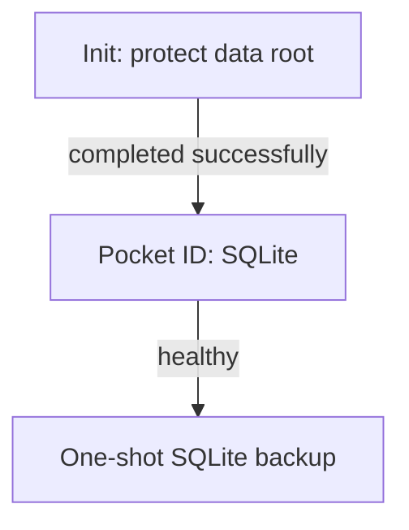

# Pocket ID

## Why

Passkey-based OpenID Connect (OIDC) pilot alongside Microsoft Entra ID.
**As of 2026-11-22: authorized for a controlled post-merge pilot, not deployed
or approved for production reliance.** Introduced by
[PR #949](https://github.com/DevSecNinja/truenas-apps/pull/949), tracked in
[issue #941](https://github.com/DevSecNinja/truenas-apps/issues/941).

Entra remains active; no accounts, credentials, authorization or sessions are
migrated. App/init adoption is cleared within the
[current review](#current-adoption-review-2026-11-22); the backup has a separate,
temporary exception. Real routing, passkey, client and recovery acceptance
remain operator work.

## Compose Files

- [Pocket ID Compose](https://github.com/DevSecNinja/truenas-apps/blob/3b6339facfa1ddca202346c2fde656e11493e1f4/services/pocket-id/compose.yaml): profile-free app, init and backup.
- [Active Traefik Compose](https://github.com/DevSecNinja/truenas-apps/blob/3b6339facfa1ddca202346c2fde656e11493e1f4/services/traefik/compose.yaml): frontend attachment and external network declaration.

Source links pin the reviewed implementation; deployments use the tracked checkout.
Existing guide links use published documentation URLs to work from both this
GitHub README and its MkDocs copy; updates become available after publication.

## Access and Prerequisites

| Surface        | Configuration                                                                                                                                                      |
| -------------- | ------------------------------------------------------------------------------------------------------------------------------------------------------------------ |
| Origin         | `https://id.${DOMAINNAME}`; DNS maps `id.${DOMAINNAME}` to `${IP_SVLNAS}`                                                                                          |
| Authentication | Native Pocket ID passkeys behind HTTPS Traefik, `chain-no-auth@file`                                                                                               |
| Network        | Dedicated `pocket-id-frontend` bridge; no host-published ports or shared backend                                                                                   |
| Host identity  | Registry account `svc-app-pocket-id`, UID/primary GID `3133:3133`, no shared memberships or administrator group access; provision using the first-run helper below |

Do not put Pocket ID behind Entra `chain-auth@file` or a Pocket ID-backed
Forward Auth chain: authentication and recovery must not depend on either.
The bridge is not an air gap or an outbound-egress restriction.

Before deployment, have the sourced TrueNAS deployment aliases, SOPS decryption
access, and independent recovery of the **original** `ENCRYPTION_KEY`,
`DB_ENC_PASSPHRASE` and host/console access. The encrypted per-app secrets are
provisioned; the first sync must create the raw `.env`. Do not keep the only
recovery material behind Pocket ID, Entra/TFA, or on the NAS.

### Local Pilot Bootstrap Decision 2026-11-22

**Operator choice — 2026-11-22:** proceed locally
without a technical bootstrap access restriction, accepting first-admin claim
risk. This is not a takeover fix and is **not covered by the backup exception**.

On a fresh instance, unauthenticated `POST /api/signup/setup` creates the first
administrator; any reachable client can claim first. Closed ordinary
registration and localhost/LAN placement do not authenticate that claimant.
Immediately claim the intended admin at `https://id.${DOMAINNAME}/setup` and
verify the account before adding other real accounts or clients.

If unexpectedly claimed, **STOP, isolate and treat the instance as untrusted**.
Rebuild or recover a trusted baseline with security review before adding
accounts or clients. Later noticing the claim or resetting the account cannot
undo a possible compromise.

## First-Run Setup

### Controlled Post-Merge Operator Handoff

Execute **only after PR #949 is merged and the operator is ready**, with valid
[backup exception clearance](#temporary-backup-risk-exception-2026-11-21).
These actions had not been performed as of 2026-11-22.

On `svlnas`, use the deployment user with aliases already sourced from
`/mnt/vm-pool/apps/scripts/aliases.sh`. Coordinate cron from initial sync
through network enrollment: the active Traefik definition requires the
external network created by the new Custom App. Do not substitute raw
`git pull`, raw `dccd.sh`, ad-hoc fragments or manual network connections.

**1. Sync/decrypt Pocket ID first.**

```sh
dccd-app pocket-id
```

Confirm creation of `services/pocket-id/.env` and the expected deployment
**skip because the TrueNAS Custom App config directory is missing**.
This guard is TrueNAS-mode-specific, not a raw Compose safety control.
Do not run `dccd-all` first.

**2. Prepare the declared account/group and dataset from the updated checkout.**

```sh
cd /mnt/vm-pool/apps
sudo bash scripts/truenas-prep-app.sh pocket-id
```

Verify host allocation and checkout preservation. Registry key `pocket-id`
sets `admin_group_member=false`.

**3. Create the TrueNAS Custom App named `pocket-id`.**

```yaml
include:
    - /mnt/vm-pool/apps/services/pocket-id/compose.yaml
services: {}
```

Verify that it creates `pocket-id-frontend` before deploying Traefik.
Be ready to claim the first admin as soon as the intended HTTPS route is
reachable; do not leave the fresh instance unattended.

**4. Complete the canonical deployment.**

```sh
dccd-all
```

**5. Immediately claim and verify the intended administrator, then complete acceptance.**

- Open `https://id.${DOMAINNAME}/setup` immediately. Follow the
    [bootstrap decision](#local-pilot-bootstrap-decision-2026-11-22), including
    isolation if unexpectedly claimed, before adding real accounts or clients.
- Enroll primary and separately stored spare hardware passkeys. Keep
    registration administrator-controlled and test lost-primary recovery;
    apply the [enrollment policy](#enrollment-and-independent-recovery-policy).
- Verify init completion, healthy nonroot app, actual HTTPS origin,
    issuer/discovery/JWKS, native access and no published ports. Check the
    initial encrypted backup and successful freshness verification.
- Independently recover the original app key, backup passphrase and host
    access. Test native recovery, representative uploads, real passkey/OIDC
    signing, client authorization/denial and applicable mobile flows.
- Confirm Entra/TFA/Immich/Outline behavior is unchanged before resuming
    coordinated automation. Synthetic evidence does not replace these checks.

**6. Capture and verify a post-enrollment recovery point.**

After admin, primary/spare passkey and client setup, run again:

```sh
dccd-all
```

Verify a **new successful job `01` completion and fresh encrypted artifact/SHA1
pair from after enrollment**, not the earlier pre-admin backup. Use the
[bounded restore procedure](https://homelab.devsecninja.com/BACKUP/#pocket-id-blocked-candidate-coverage-and-future-restore)
and independently recovered original keys to verify that this recovery point
includes the intended admin, passkeys and clients **before production reliance**.
This extra run does not change the one-shot backup cadence.

### Enrollment and Independent Recovery Policy

- Verify identity out of band with a trusted administrator; email or invitation
    possession alone is insufficient. Keep enrollment narrow, time-limited and
    auditable; verify unapproved users cannot self-enroll or become admins.
- Require and test WebAuthn user verification (PIN/biometric), not just key
    presence. Prove spare-key recovery for each administrator.
- Verify the selected image's native `one-time-access-token` invocation,
    targeting, expiry and single-use behavior before relying on it. Do not
    assume a shell exists in the distroless image.
- Use independent host access for recovery. Token/URL output belongs only in
    the authorized operator's terminal, never CI, tickets, chat or transcripts.
    Verify the account, enroll a replacement passkey, invalidate unused
    recovery access and affected sessions, and audit without recording tokens.

### Recovery Token Log Privacy

Pocket ID v2.19.3 logs raw HTTP paths, queries and referrers that can contain
recovery tokens. `LOG_QUERY_ARGS=false` suppresses **SQL arguments only**;
`LOG_LEVEL=error` still logs raw requests on `5xx`. There is no HTTP
disable/sanitize environment setting in this version; see
[router logging](https://github.com/pocket-id/pocket-id/blob/v2.19.3/backend/internal/bootstrap/router_bootstrap.go#L401-L460)
and [observability setup](https://github.com/pocket-id/pocket-id/blob/v2.19.3/backend/internal/bootstrap/observability_boostrap.go#L82-L160).

| Boundary         | Required configured control                                                                                 |
| ---------------- | ----------------------------------------------------------------------------------------------------------- |
| App console      | Docker `logging.driver: none`: no local stdout/stderr retention or Alloy Docker-source export               |
| App telemetry    | `OTEL_LOGS_EXPORTER=none`, `OTEL_TRACES_EXPORTER=none`                                                      |
| Pocket ID router | `traefik.http.routers.pocket-id-rtr.observability.accesslogs=false`, including pre-backend `429` rejections |

App console and Pocket ID proxy access diagnostics are lost; health checks,
container state and separate backup receipt logs remain. Do not re-enable
these logging/export paths for real recovery flows or log real tokens.
[Synthetic privacy evidence](#privacy-test-subset-2026-11-22) is scoped below.

## Architecture



All three services are profile-free. Active Traefik attaches to the stack-owned
frontend bridge; the other-server override excludes Pocket ID. Init and backup
use `network_mode: none` with no host-control socket.

### Services

Exact image indexes and reviewed AMD64 identities are recorded once in the
[adoption review](#image-and-recovery-evidence-2026-11-21).

| Service               | Image                                            | Role and identity                                                                                                      |
| --------------------- | ------------------------------------------------ | ---------------------------------------------------------------------------------------------------------------------- |
| `pocket-id`           | `ghcr.io/pocket-id/pocket-id:v2.19.3-distroless` | Shell-free Debian 13 app; explicit nonroot Compose user, read-only root, capabilities dropped, `/tmp` tmpfs            |
| `pocket-id-db-backup` | `docker.io/nfrastack/db-backup:4.9.2`            | One-shot Online Backup API job; root s6 supervisor creates image-local `pocketbackup` matching the app UID/primary GID |
| `pocket-id-init`      | `docker.io/library/busybox:1.38.0`               | Validates inputs, sets only `./data` root to PUID/PGID `3133:3133`, mode `0700`; never `./config`                      |

The [declared identity](https://homelab.devsecninja.com/INFRASTRUCTURE/#pocket-id-candidate-identity-reservation)
is allocated and unavailable for reuse; provision it using the first-run helper.
Init is nonrecursive, with read-only root and only `CHOWN`, `FOWNER`, `DAC_OVERRIDE`.
Review any descendant ownership repair separately; synthetic tests do not prove TrueNAS ACL behavior.

### Persistent State and Secrets

| Path / input                | Purpose and recovery requirement                                                                                                      |
| --------------------------- | ------------------------------------------------------------------------------------------------------------------------------------- |
| `./backups/db-backup`       | Critical mutable file state — encrypted recovery copies; preserve verified snapshots and decryption material                          |
| `./config/verify-backup.sh` | Tracked verifier mounted read-only, never an ownership-repair target                                                                  |
| `./data` → `/app/data`      | Database — SQLite at `/app/data/pocket-id.db`; irreplaceable identity state, `FILE_BACKEND=database` uploads and signing/session keys |
| `DB_ENC_PASSPHRASE`         | Independently generated backup passphrase; recover the matching original                                                              |
| `DOMAINNAME`                | Origin/routing substitution from the per-app encrypted dotenv, not shared Docker Hub credentials                                      |
| `ENCRYPTION_KEY`            | Original app encryption key; a newly generated key cannot restore the existing encrypted state                                        |

SOPS provisioning/validation is complete; original ciphertext and server key
scope are unchanged. Only app/init load per-app `.env`; all three load
`tz.env`. Backup receives explicit variables, including
`DEFAULT_ENCRYPT_PASSPHRASE=${DB_ENC_PASSPHRASE:-}`, **not** the per-app `.env`,
`ENCRYPTION_KEY`, `DOMAINNAME` or raw `DB_ENC_PASSPHRASE`.
Future OIDC clients need separate encrypted credentials and exact redirect
allowlists; do not reuse or modify active Entra/client credentials.

### Database Backup

The [v4.9.2 engine](https://github.com/nfrastack/db-backup/blob/4.9.2/rootfs/container/functions/10-dbbackup#L796-L821)
uses SQLite `.backup` (Online Backup API): a **binary SQLite snapshot**, not
SQL text or a raw live-file copy. It runs once per DCCD deployment in manual
mode, producing one GPG/ZSTD ciphertext + SHA1 pair with
`DEFAULT_CLEANUP_TIME=2880` (**48 hours**) at `./backups/db-backup`.
It is not an independent nightly schedule.

The [guard](https://github.com/DevSecNinja/truenas-apps/blob/3b6339facfa1ddca202346c2fde656e11493e1f4/services/pocket-id/config/verify-backup.sh)
wraps the original `backup01-now now` engine, bounded by **180 seconds plus
10 seconds kill grace**, with `dccd.backup-jobs=01`. It fails closed on:

- Uninitialized/unreadable read-only source, upstream errors, or anything
    other than one dump and one successful completion.
- Missing, stale, partial or corrupt output. Both files must be new or changed
    by device/inode/size/full-precision mtime/ctime; replacement of an existing
    timestamped pair is accepted only when both files change and verify.
- Wrong ownership or permissions: output root `0700`, files `0600`, app
    UID/primary GID; invalid SHA1, GPG decryption or ZSTD decompression.
- Failed SQLite integrity/FK checks, mismatched clean migration version or
    missing or empty encrypted signing/session key rows.

The upstream child uses fixed umask `022` so root-created SQLite scratch
remains readable by `pocketbackup`; private verification scratch retains
umask `077`. The guard checks encrypted key-row bytes, not their decryption,
exact equality, public JWKS or real passkey login. A checksum is not proof of
authenticity or full recovery.

Keep the healthy writer and readable WAL/SHM available. Missing SHM reproduced
a conditional read-only open failure; it does not explain every platform
failure. Never use a read-write/`immutable` shortcut or arbitrary startup sleep.
Follow the [single restore procedure](https://homelab.devsecninja.com/BACKUP/#pocket-id-blocked-candidate-coverage-and-future-restore);
storage-layer coverage must be verified separately.

## Current Adoption Review 2026-11-22

This is the authoritative current decision record. Dated evidence below is
not a live CI/head assertion, production deployment or merge approval.
Follow the [image-adoption policy](https://homelab.devsecninja.com/ARCHITECTURE/#image-selection-upstream-dependency-maintenance);
no downstream dependency-lock patch or fork is an approved workaround.

### Image and Recovery Evidence 2026-11-21

**App normal use and the fixed AMD64 init operation were cleared on November 21.**
Neither is a blanket image-clean claim or a new risk exception.
The backup decision is separate below.

| Artifact                 | Exact image index (`sha256`)                                       | Reviewed AMD64 manifest / config (`sha256`)                                                                                                            | Maintenance / confidence |
| ------------------------ | ------------------------------------------------------------------ | ------------------------------------------------------------------------------------------------------------------------------------------------------ | ------------------------ |
| App `v2.19.3-distroless` | `6a0045a89b80fa6624c091786e7be132a4dde880ca64727a6b019c056b091982` | Manifest `523271bff6390c33f149117915f63a375e49c6856695f3da71f9405954b7bb24`; config `0de135f603004c51f81e2fa3734fc38070f1bf7401e8d8c8080769bfdff210a1` | Partial / medium         |
| Backup `4.9.2`           | `cc95be0b5f551f432a218fc2811d63a2946233c8260598d5eda0ff624bb47412` | Config `82b8ef8ca853939cd0ffec97b6401cfdfede6a1b2d821cedc55603adc819ef2d`                                                                              | Unmaintained tag / high  |
| Init `1.38.0` glibc      | `a46257e06c82ad85242d0d38077d0a52d9896389ca60a1a59d3463db586e5fa4` | Manifest `f97baa533a26513c453a362be331a43eb60214302f449c16571b23cea141dce4`; config `aaef90e065235eb0b2d9938be85d1b81add2902cf89affe2cdfa19be33476ac0` | Partial / medium         |

**App:** [v2.19.3](https://github.com/pocket-id/pocket-id/releases/tag/v2.19.3)
delivers Go/stdlib 1.27.4, x/crypto 0.59.0, Go-jose 4.1.6, zod 4.6.7 and
x/net 0.62.0. Labels report revision `c0abd9322d0a67e200434baacc662e9c7cde1389`.
Trivy 0.76.0 at **2026-11-21T20:12:19Z**, DB updated **18:38:32Z** and
downloaded **20:12:08Z**, inventoried 6 Debian 13.7 packages, 44 npm entries
and 194 Go modules. Only UNKNOWN `GO-2026-5932` remained: separate deprecated
`golang.org/x/crypto/openpgp v0.1.0-deprecated`.

The source trace is golang-migrate 4.20.1 `source/github` → go-github 39.2.0;
Pocket ID normally uses embedded `iofs`. The GitHub migration source calls
content retrieval, not `Git.CreateCommit` → `createSignature` →
`ArmoredDetachSign`. This supports **unused optional Git commit-signing
dependency**, not absence of binary symbols or global non-applicability.
Deprecated-dependency cleanup remains an upstream maintenance follow-up.
[Immutable review and source links](https://github.com/DevSecNinja/truenas-apps/blob/3cead72475781c2e5edd7de082a9f4ce1b602c43/services/pocket-id/README.md#image-and-recovery-evidence-2026-11-21)
retain the full trace and device-approval patch review.

**Init:** manual inventory confirms BusyBox 1.38.0 and glibc
**2.41-12+deb13u4**, replacing u3; u5 existed at review.
Exact-artifact Trivy 0.76.0 returned **no package results, not a clean scan**.
[Immutable official metadata](https://github.com/docker-library/busybox/blob/7f8c76693ac4a64018eb67cf2768e5792d24bf6e/latest/glibc/amd64/index.json)
and the [full scoped CVE review](https://github.com/DevSecNinja/truenas-apps/blob/3cead72475781c2e5edd7de082a9f4ce1b602c43/services/pocket-id/README.md#image-and-recovery-evidence-2026-11-21)
support only fixed numeric, nonrecursive `chown`/`chmod` and quoted input
checks. Reviewed setuid/architecture, glob/regex, shell-program and parser
preconditions were absent from that path, not globally cleared.
Re-review changes to image, command, inputs, mounts or network.
Actual AMD64 validation rejected five invalid-secret cases before ownership
changes; two runs preserved child ownership/mode while setting the data root.
Capabilities, no-new-privileges, read-only root and resource limits were checked.

**Recovery/retention:** on November 21 the exact v2.19.3 app, original v4 engine
and guard passed live read-only-source backup, independent decryption,
integrity/FKs, full seeded schema/linked rows and encrypted key-byte checks.
A fresh same-image/same-key restore became healthy after natural copied-lease
expiry; public JWKS/key IDs matched. The 49h pair was removed, 47h pair retained,
and one new pair verified. The 95-second lease wait was a test observation,
not a production sleep. These were synthetic Linux-volume tests, not real
passkey/client or TrueNAS storage acceptance.

### Temporary Backup Risk Exception 2026-11-21

**Approval source:** @DevSecNinja, **2026-11-21** — “Ok lets accept the risk for now.”
[Acceptance record `84889353`](https://github.com/DevSecNinja/truenas-apps/commit/848893530fd7de4883dea3f90a6290e974cf3738).
The **coordinator**, not the user, defined the scope and **2026-12-21
review/expiry**. This temporarily accepts unsupported/unpatched maintenance
and residual dated-findings uncertainty for **Pocket ID backup only**.
It does not itself authorize activation, merge or production reliance;
app/init clearance, pilot authorization and bootstrap risk are separate.

The approval originated on November 21. The November 22 environment change
removed inherited app secrets/domain from the backup job: a least-secret
reduction, not a new or broader exception. The scope below includes that reduction.

**Exact scope:** only the table's `4.9.2` index and tested `linux/amd64` config,
with the current Compose/guard:

- Local SQLite Online Backup API, manual one-shot job `01`, GPG/ZSTD/SHA1,
    2880-minute retention and `./backups/db-backup:/backup`.
- `network_mode: none`, no ports/host-control socket, read-only
    `./data:/pocket-id-data:ro` and verifier; no rw/`immutable` fallback.
- Only `tz.env` and explicit backup variables; no inherited app key/domain.
    Image-local `pocketbackup` matches the declared app UID/primary GID.
- All [guard checks, timeout and private-output requirements](#database-backup)
    remain required. Root s6 retains a writable root filesystem,
    `no-new-privileges`, `cap_drop: ALL`, and only `CHOWN`, `FOWNER`,
    `DAC_OVERRIDE`, `SETUID`, `SETGID`, `KILL`.

**Dated findings:** Trivy **0.76.0**, backup scan **2026-11-21T20:12:22Z**,
DB updated **2026-11-21T18:38:32Z**; saved scan JSON SHA256
`6ff7b5173645ad8a011a5f45632f78a2dfb61c9f734cc16766fbd0720a860c08`.
The 166 Alpine 3.24.1 packages had raw **4 CRITICAL / 167 HIGH / 152 MEDIUM /
90 LOW / 5 UNKNOWN**; 15 Python packages had 3 MEDIUM findings. Inactive
bundled Go tools also had HIGH/CRITICAL findings. These counts prove neither
all-reachable nor all-unreachable paths; the [detailed dated inventory assessment](https://github.com/DevSecNinja/truenas-apps/blob/3cead72475781c2e5edd7de082a9f4ce1b602c43/services/pocket-id/README.md#image-and-recovery-evidence-2026-11-21)
is retained immutably.

- Used musl **1.2.6-r2**, HIGH **CVE-2026-107891** (`regcomp`, fixed **-r3**):
    inspected scripts/job `01` use fixed patterns; no database-row regex input
    was identified.
- Used sudo **1.9.17_p2-r1**, HIGH **CVE-2026-96512** (fixed **-r2**):
    required `NOTBEFORE`/`NOTAFTER` time-based policy was absent from inspected
    `/etc/sudoers` and its empty include directory.

Those are narrow prerequisite findings, not whole-image safety.
**Residual risk:** root plus `DAC_OVERRIDE` can read identity data and plaintext
scratch/decryption material and modify backup output. Read-only source is not
a confidentiality control. No network and the short lifecycle reduce exposure
but do not prove vulnerable paths unreachable; off-site encryption does not
protect against a compromised source backup container or authenticate output.

**Maintenance/exit:** the tag is **unmaintained / high confidence**, not an
abandoned project. Upstream's [latest-only policy](https://github.com/nfrastack/db-backup/blob/5.0.11/SECURITY.md)
and active [5.0.11 release](https://github.com/nfrastack/db-backup/releases/tag/5.0.11)
leave 4.9.2 unsupported. The [5.0.11 SQLite source](https://github.com/nfrastack/db-backup/blob/5.0.11/src/internal/database/engine/sqlite/sqlite.go)
uses independent source queries; output SQL `BEGIN`/`COMMIT` is not a coherent
live-source snapshot. No v5/latest substitution is approved.
Exit requires a maintained compatible artifact fixing applicable issues, exact-digest/current-inventory
review and actual coherent full-schema live-SQLite, same-key/JWKS encrypted
recovery, retention and fail-closed tests.

**Owner/action:** the Compose TODO assigns **@DevSecNinja** review **before
2026-12-21**; the TODO-to-Issue workflow runs on `main` (no existing issue is
claimed). Record a qualified replacement, a fresh explicit exception review,
or controlled rollback/retirement preserving independent recovery.
Expiry removes exception clearance for first or continued use; it does **not
automatically stop the IdP or its backups**.

**No automatic renewal:** no TREK/other stacks, app/init, other images/digests,
platforms, engines, paths, networks, privileges or future findings are covered.
New relevant findings or changed assumptions require immediate review.

### Privacy Test Subset 2026-11-22

Exact v2.19.3 inspection confirmed Docker logging and OTEL log/trace export
disabled; synthetic path/query/referrer markers were absent from app logs.
A same-version Traefik **3.7.10 file-provider fixture** excluded the marker on
a pre-backend `429`, while a wrong-Host `404` positive control logged its marker.
No real tokens were used.

This and the November 21 proxy fixture do **not** prove the production DHI
artifact, Docker-provider attachment, real DNS/public TLS, browser/passkey or
client acceptance. [Immutable fixture details](https://github.com/DevSecNinja/truenas-apps/blob/3cead72475781c2e5edd7de082a9f4ce1b602c43/services/pocket-id/README.md#privacy-test-subset-2026-11-22).

### Backup Environment Test Subset 2026-11-22

The actual reduced-environment job (`tz.env` plus explicit variables, no app
key/domain/raw passphrase input) passed against a healthy v2.19.3 writer:
one start, one completion, exit `0`, one private encrypted pair, guard
decryption/integrity/FK/key-row checks and usable receipts. No fresh full
same-app restore/JWKS/retention rerun was performed.
[Immutable test details](https://github.com/DevSecNinja/truenas-apps/blob/3cead72475781c2e5edd7de082a9f4ce1b602c43/services/pocket-id/README.md#backup-environment-test-subset-2026-11-22).

### Local Validation 2026-11-22

Dated local passes: 11 selected mandatory hooks, 296 BATS tests including
42 Pocket ID cases, 12 separate Node policy/compatibility cases, strict
materialized MkDocs and 8 distinct canonical documentation targets.
[Original validation record](https://github.com/DevSecNinja/truenas-apps/blob/3cead72475781c2e5edd7de082a9f4ce1b602c43/services/pocket-id/README.md#local-validation-2026-11-22).
These predate this editorial cleanup and are not current remote CI outcomes.
No production deployment or real OIDC/passkey-flow proof is recorded.

## Historical Evidence

These immutable records preserve prior evidence, not current procedures or
still-open candidate gates. Use the [current runbook](#controlled-post-merge-operator-handoff).

| Evidence date | Record and limits                                                                                                                                                                                                                                                                                                                                                                                                                      |
| ------------- | -------------------------------------------------------------------------------------------------------------------------------------------------------------------------------------------------------------------------------------------------------------------------------------------------------------------------------------------------------------------------------------------------------------------------------------- |
| 2026-10-26    | [Initial blocked image review](https://github.com/DevSecNinja/truenas-apps/blob/3cead72475781c2e5edd7de082a9f4ce1b602c43/services/pocket-id/README.md#image-evidence-2026-10-26) and [ARM64 runtime/backup failure](https://github.com/DevSecNinja/truenas-apps/blob/3cead72475781c2e5edd7de082a9f4ce1b602c43/services/pocket-id/README.md#native-runtime-evidence-2026-10-26); later AMD64 success does not explain the ARM64 failure |
| 2026-10-28    | [Windows candidate status](https://github.com/DevSecNinja/truenas-apps/blob/3cead72475781c2e5edd7de082a9f4ce1b602c43/services/pocket-id/README.md#windows-continuation-status-2026-10-28); profile and activation gates superseded                                                                                                                                                                                                     |
| 2026-10-29    | [v2.19.1 inventory/source-path review](https://github.com/DevSecNinja/truenas-apps/blob/3cead72475781c2e5edd7de082a9f4ce1b602c43/services/pocket-id/README.md#image-evidence-2026-10-29) and [AMD64 backup, restore/JWKS and retention proof](https://github.com/DevSecNinja/truenas-apps/blob/3cead72475781c2e5edd7de082a9f4ce1b602c43/services/pocket-id/README.md#exact-image-diagnostic-2026-10-29); old app/init pins             |
| 2026-11-08    | [v2.19.2 review/recovery](https://github.com/DevSecNinja/truenas-apps/blob/3cead72475781c2e5edd7de082a9f4ce1b602c43/services/pocket-id/README.md#image-and-recovery-evidence-2026-11-08); binary OpenPGP symbols present; candidate remained blocked at that date                                                                                                                                                                      |
| 2026-11-21    | [Full v2.19.3 and scoped init review, recovery and fixture evidence](https://github.com/DevSecNinja/truenas-apps/blob/3cead72475781c2e5edd7de082a9f4ce1b602c43/services/pocket-id/README.md#image-and-recovery-evidence-2026-11-21); not production acceptance                                                                                                                                                                         |
| 2026-11-22    | [Archived Windows handoff checklist](https://github.com/DevSecNinja/truenas-apps/blob/3cead72475781c2e5edd7de082a9f4ce1b602c43/services/pocket-id/README.md#windows-continuation-checklist); replaced by the current ordered runbook                                                                                                                                                                                                   |

Implementation history: [original guard](https://github.com/DevSecNinja/truenas-apps/commit/49f0027c199a6e62bc62a7444faadd12c4f2eff4),
[umask/replacement proof](https://github.com/DevSecNinja/truenas-apps/commit/c893b8ce5c54cc1ee04757d8d5d8d3ca7da5930a),
[v2.19.3 refresh](https://github.com/DevSecNinja/truenas-apps/commit/343bd75773aae8e8cb626727da32b90621a75343),
[pilot wiring](https://github.com/DevSecNinja/truenas-apps/commit/5646268cd9fc06b6ba8b62472f89d3cd882e0233),
[CI fixtures](https://github.com/DevSecNinja/truenas-apps/commit/275905da70ad578d256c0b2d7610e81261c32737).

## Optional Per-App Cutover and Rollback

Future integrations, including TREK, need separate approval, explicit identity
mapping (never email-only), authorization/denial testing and reversible
per-app checkpoints. No automatic migration or failover is provided.
The [archived per-app planning notes](https://github.com/DevSecNinja/truenas-apps/blob/3cead72475781c2e5edd7de082a9f4ce1b602c43/services/pocket-id/README.md#optional-per-app-cutover-and-rollback)
are not part of this deployment runbook.

## Upgrade Notes

Every Docker image update in `services/pocket-id/compose.yaml` requires manual,
exact-artifact review: Renovate disables automerge and grouping for this file
without suppressing update visibility; the nfrastack v4 version constraint
remains. No v3/dev/latest or registry substitution is approved; cross-registry
equality for the distroless artifact is unproven.

Preserve a compatible image/schema reference, verified pre-upgrade backup,
original key and identity mappings. Prove restore/rollback before upgrading;
do not assume schema downgrades or passkey survival across origin/RP-ID
changes. Keep the origin stable and test real clients after changes.
No production upgrade path has been exercised.
