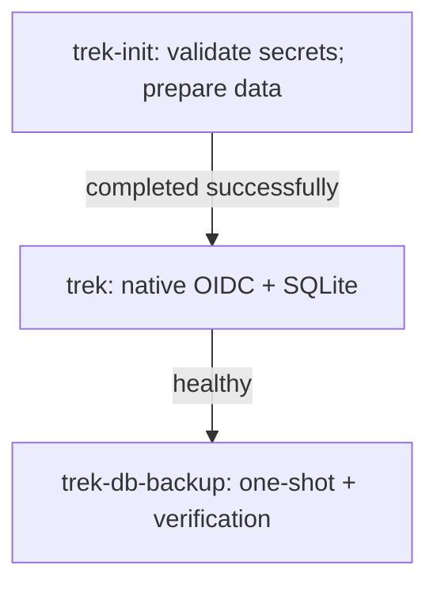

# TREK

[TREK](https://github.com/liketrek/TREK) is a collaborative travel planner.
**Blocked candidate for [issue #948](https://github.com/DevSecNinja/truenas-apps/issues/948);
not deployed or approved.** This integration depends on completion of Pocket ID
[PR #949](https://github.com/DevSecNinja/truenas-apps/pull/949), reviewed at
commit `a383ae2`. Do not merge TREK before Pocket ID is complete.

## Why

Keep trip planning and uploaded travel documents on TrueNAS, using native
Pocket ID OIDC rather than an additional Entra Forward Auth login.

## Compose Files

- [compose.yaml](https://github.com/DevSecNinja/truenas-apps/blob/main/services/trek/compose.yaml) — candidate init, app, and backup services.
- [config/backup.sh](https://github.com/DevSecNinja/truenas-apps/blob/main/services/trek/config/backup.sh) — fail-closed backup verification wrapper.
- [compose.trek.yaml](https://github.com/DevSecNinja/truenas-apps/blob/main/services/traefik/compose.trek.yaml) — inert Traefik fragment, not included by active Compose.

## Access

These are **planned settings**, not an active endpoint:

| Setting                 | Value                                                               |
| ----------------------- | ------------------------------------------------------------------- |
| Application             | `https://trek.${DOMAINNAME}`                                        |
| Issuer                  | `https://id.${DOMAINNAME}`                                          |
| Exact callback          | `https://trek.${DOMAINNAME}/api/auth/oidc/callback`                 |
| Client                  | Dedicated confidential Pocket ID client; credentials not yet issued |
| Scopes / username claim | `openid email profile` / `preferred_username`                       |
| Authentication          | `OIDC_ONLY=true`; native TREK sessions                              |
| Proxy                   | HTTPS entrypoint, `chain-no-auth@file`; no Entra TFA on TREK        |

There is no inferred admin-group mapping. Per the upstream
[v5 wiki](https://github.com/liketrek/TREK/wiki), **the first SSO user becomes
administrator**. Restrict assignment on the dedicated Pocket ID client to the
bootstrap administrator **before any first login**. After bootstrap, explicitly
choose TREK's invitation/SSO auto-provisioning policy before widening assignment.
Pocket ID authentication and TREK authorization are separate checks.

## Architecture

Candidate startup order:



### Services

| Service          | Image                                 | Role and isolation                                                                                                                        |
| ---------------- | ------------------------------------- | ----------------------------------------------------------------------------------------------------------------------------------------- |
| `trek`           | `docker.io/mauriceboe/trek:5.0.0`     | Direct non-root Node process with dumb-init; bypasses root-only chown/gosu startup; read-only root, no capabilities, private `/tmp` tmpfs |
| `trek-db-backup` | `docker.io/nfrastack/db-backup:4.9.2` | Unapproved writable-root s6 compatibility candidate; no network; read-only database source                                                |
| `trek-init`      | `docker.io/library/busybox:1.38.0`    | Root, one-shot, no network; only `CHOWN`, `FOWNER`, `DAC_OVERRIDE`                                                                        |

All three services use `trek-candidate`, shared `tz.env`,
`no-new-privileges=true`, and a PID limit of 100. Memory declarations are
`64m` for init, `${MEM_LIMIT:-1024m}` for the app, and
`${BACKUP_MEM_LIMIT:-512m}` for backup. These declarations are not all
runtime-validated.

Init recursively chowns `./data/app` and `./data/uploads` under `/data` to the
[reserved app identity](../INFRASTRUCTURE.md#trek-candidate-identity), applies
`u=rwX,g=,o=`, and sets `/data` to mode `0700`. It never chowns `./config`.
The app uses direct `user:`, not PUID/PGID environment variables. Backup's
pre-init command creates and verifies the image-local `trekbackup` user/group
with the same reserved identity; s6 manages backup output ownership.
Its capability additions are `CHOWN`, `FOWNER`, `DAC_OVERRIDE`, `SETUID`,
`SETGID`, and `KILL`; this and its writable root remain unapproved.

The app alone joins `trek-frontend`; no host port is published. Readiness uses
`/api/health/ready` on container port `3000`. Homepage, Gatus, and Traefik
labels describe future discovery, not live integration. Shared Traefik has
no attachment to this network.

## State

| Host path             | Container path                              | Recovery role                                                      |
| --------------------- | ------------------------------------------- | ------------------------------------------------------------------ |
| `./backups/db-backup` | `/backup` (backup)                          | Encrypted SQLite artifacts and SHA1 sidecars                       |
| `./config`            | `/trek-config:ro` (backup)                  | Git-tracked wrapper; never runtime-owned                           |
| `./data/app`          | `/app/data` (app), `/trek-data:ro` (backup) | `travel.db`, SQLite WAL/SHM, persisted encryption/JWT key material |
| `./data/uploads`      | `/app/uploads` (app)                        | Travel documents; not included in the database dump                |

The dataset and service account are **reserved, not provisioned**. Preserve
the database, original keys, and uploads as a consistent recovery set;
database-only recovery is insufficient.

## Secrets

Only variable names and the implementation handoff status are recorded here;
no secret file was opened or decrypted for this documentation.

| Variable             | Purpose / candidate status                                                              |
| -------------------- | --------------------------------------------------------------------------------------- |
| `DB_ENC_PASSPHRASE`  | Independent 36-byte random value encoded as hex; GPG backup passphrase                  |
| `DOMAINNAME`         | Existing deployment domain reused without documenting its value                         |
| `ENCRYPTION_KEY`     | Independent 32-byte random value encoded as 64 hex characters; preserve across restores |
| `OIDC_CLIENT_ID`     | Present but intentionally empty until the dedicated Pocket ID client is issued          |
| `OIDC_CLIENT_SECRET` | Present but intentionally empty until issued                                            |

The implementation handoff reports successful encrypted-sentinel generation
and validation of `secret.sops.env`. Init rejects missing, empty, `GENERATE`,
or `CHANGE_ME` values for every variable above and rejects an invalid
`ENCRYPTION_KEY` length/encoding. Empty OIDC credentials therefore fail closed.
Never replace original application keys merely to make a restore start.

## First-Run Setup

<!-- dprint-ignore -->
!!! danger "DO NOT EXECUTE — all activation gates must clear first"
    Profiles are selection controls, not a security boundary. Explicitly
    targeting a service can start it despite its profile; do not use targeted
    Compose, profile overrides, or generic deployment to bypass this gate.
    No image exception or production activation is approved.

### Activation Prerequisites

- Complete Pocket ID first; verify its issuer, dedicated confidential client,
  exact callback, claims, and bootstrap-admin-only assignment. Store the
  issued `OIDC_CLIENT_ID` and `OIDC_CLIENT_SECRET` in TREK's encrypted
  secrets before deployment; both are currently empty.
- Clear every [image adoption gate](#image-evidence), including a supported,
  compatible upstream backup artifact. Record reviewed pins and approval;
  do not carry the current backup tag forward by exception.
- Complete target `linux/amd64` Compose/hardening validation, live SQLite WAL
  backup validation, and a restore drill including original keys and uploads.
  The native ARM64 evidence below does not clear these gates.
- Through review, add registry key `trek` to `truenas-apps.json` with
  `account_name: svc-app-trek`, `account_id: 3134`, and
  `admin_group_member: false`; verify the reservation is collision-free.
  No registry entry currently exists.
- Review DNS `trek.${DOMAINNAME}` → `${IP_SVLNAS}`, removal of
  `trek-candidate` from all three services, and transfer of the inert
  Traefik network attachment/external declaration into active Compose.
  Apply the Traefik change only after the Custom App creates its network.
  Coordinate scheduled deployments so Traefik cannot reference a missing
  network. Do not change shared authentication or manually connect networks.

### Windows Continuation Checklist

This PR is a candidate handoff, **not deployment approval**.

- [ ] Resume branch `devsecninja-trek-service` on Windows. Preserve the
      encrypted secrets and original application/backup keys; do not rotate or
      regenerate them.
- [ ] Complete Pocket ID #949 operationally, not merely merge it. Verify the
      issuer, dedicated confidential client, exact callback, claims, and
      bootstrap-admin-only assignment; enter the issued `OIDC_CLIENT_ID` and
      `OIDC_CLIENT_SECRET` through the repository's canonical SOPS workflow.
- [ ] Clear supported upstream image adoption for every image, including a
      compatible backup replacement; record current exact-artifact scans and
      reviewed pins. No downstream dependency patching or blind v5 upgrade.
- [ ] Resolve consistent backup from the read-only SQLite WAL source and
      validate live-writer/shared-volume behavior. Re-test the 300-second TERM /
      10-second KILL grace and fail-closed missing/invalid-output checks; do not
      make the source writable or use an immutable override.
- [ ] Demonstrate a synthetic encrypted restore with representative
      `users`/`trips`, uploads, and original encryption/JWT key material; retain
      integrity and record-level evidence, not just table presence.
- [ ] Complete target AMD64 Compose/hardening and OIDC allow/deny validation;
      the native ARM64 results do not replace these gates.
- [ ] Only after all gates clear, review the
      [registry, DNS, Traefik, and profile activation changes](#activation-prerequisites),
      then follow the conditional TrueNAS rollout below, including first-SSO
      administrator bootstrap and registration/access checks.

### Conditional Rollout — DO NOT EXECUTE Until Approved

Use the existing TrueNAS aliases, already sourced from
`/mnt/vm-pool/apps/scripts/aliases.sh`, after the prerequisites clear and the
reviewed activation changes are available:

1. Pull/decrypt with the app-scoped first pass:

   ```sh
   dccd-app trek
   ```

   The initial missing TrueNAS app config directory and skipped deployment
   are expected. Do not begin with `dccd-all`.
2. Provision the reviewed registry identity and child dataset:

   ```sh
   cd /mnt/vm-pool/apps
   sudo bash scripts/truenas-prep-app.sh trek
   ```

3. Create a TrueNAS Custom App named **`trek`**:

   ```yaml
   include:
       - /mnt/vm-pool/apps/services/trek/compose.yaml
   services: {}
   ```

4. Confirm init completes, readiness is healthy, and `trek-frontend` exists.
   Apply the reviewed DNS and active Traefik attachment, then run:

   ```sh
   dccd-all
   ```

5. In a fresh browser session, sign in as the sole assigned bootstrap user.
   Confirm that user is TREK administrator. Set registration/invitation and
   SSO auto-provisioning policy before assigning anyone else.
6. Verify an assigned, permitted user can sign in and access only authorized
   trips; an unassigned Pocket ID user is denied; and a signed-in user
   without TREK permission cannot access another user's private trip.
   Check unauthenticated UI/API requests expose no private data and that no
   local-password or Entra TFA path bypasses native OIDC. Confirm logout and
   fresh-session behavior, readiness, and a newly verified backup.

## Backup

**Candidate coverage only; native backup failed on 2026-10-27.** The read-only
WAL source hung in `sqlite3 .backup`; the bounded invocation timed out after
300 seconds, exited `124`, and emitted `ERROR`. No encrypted dump was produced
and no restore succeeded.
The sidecar runs on deployment when started, not on an autonomous nightly
timer. It reads `./data/app:ro`, writes `./backups/db-backup`, uses GPG + ZSTD
with SHA1 sidecars, and retains 48 hours of output.

Unlike v4's potentially silent success, the wrapper requires exactly one
fresh nonempty encrypted dump and matching SHA1 sidecar, no extra fresh files,
a passing checksum/decrypt/decompress cycle, SQLite `quick_check=ok`, and both
`users` and `trips` tables. Private verification scratch retains `umask 077`
and is cleaned on exit; `umask 022` applies only to the upstream invocation
for root-created scratch compatibility. Table presence is not a row-level
restore drill. The backup command receives TERM at 300 seconds, then KILL
after a 10-second grace period if needed.
Native disk-volume testing used a quiesced source, not concurrent sharing
with a live writer. The source stayed read-only; no SQLite immutable override
was used. Working backup and restore remain activation gates.

See [TREK candidate coverage and conditional restore](../BACKUP.md#trek-candidate-coverage-and-restore)
for binary SQLite recovery, WAL precautions, and the matching keys/uploads set.
No production database or storage-layer backup coverage is claimed.

## Image Evidence

Review supplied for issue #948 on **2026-10-27**: Trivy **0.75.0**, vulnerability
DB `UpdatedAt=2026-10-26T14:38:04Z`, valid until **2026-10-27 14:38Z**.
Re-scan before adoption; these findings are dated evidence, not clearance.

| Image                       | Maintenance / confidence    | Decision and gaps                                                                                                                                                      |
| --------------------------- | --------------------------- | ---------------------------------------------------------------------------------------------------------------------------------------------------------------------- |
| BusyBox `1.38.0`            | **unknown / medium**        | Same pin as fleet init containers, including Traefik. Trivy returned `Results: null` with no inventory; not a clean scan or approval                                   |
| nfrastack/db-backup `4.9.2` | **unmaintained tag / high** | Unsupported under [latest-only policy](https://github.com/nfrastack/db-backup/blob/main/SECURITY.md); fixable HIGH/CRITICAL findings block adoption, with no exception |
| TREK `5.0.0`                | **partial / medium**        | Effective maintenance evidenced, but parser/base applicability remains unresolved; not approved                                                                        |

Exact artifacts (all digests use SHA256):

| Artifact                         | Digest                                                             |
| -------------------------------- | ------------------------------------------------------------------ |
| Backup Compose index             | `cc95be0b5f551f432a218fc2811d63a2946233c8260598d5eda0ff624bb47412` |
| Backup scanned `linux/amd64`     | `af1a483f04a19427be307c356645adc887352f1e3432bb21bd8b60ccf12c4012` |
| BusyBox Compose index            | `fd8d9aa63ba2f0982b5304e1ee8d3b90a210bc1ffb5314d980eb6962f1a9715d` |
| TREK Compose index               | `0c0a8f5b488fc2967248695e04bb000bb177d0b63d3385089d33dca6fde4daf9` |
| TREK scanned `linux/amd64`       | `9d74cf9f4be6be29e452b00a0ac0525208dd0e9aaeb62605271b53bb4b83fa5c` |
| TREK native-tested `linux/arm64` | `ea5318f44cc989799848ec17e9b135611a87f2b073a035ea9b1b599830a12dfd` |

- **TREK artifact:** released 2026-10-25; OCI revision
  `bd1de9e1d50a0ef74adabcc86119178d017fc85d`. Inventory: 254 Debian 13.7
  packages, 471 npm entries, and four Go entries. The selected distro scan
  returned 76 raw HIGH/CRITICAL findings, representing 28 unique CVEs, with
  no HIGH/CRITICAL `FixedVersion`. Zero npm/Go HIGH/CRITICAL findings is not
  a safety proof. `libxml2` CRITICAL `CVE-2026-6653` and parser dependencies
  require applicability analysis; Node scanning does not comprehensively
  cover the C-built Node runtime.
- **Delivered maintenance:** release-source changes include
  [runtime dependencies, 2026-10-24](https://github.com/liketrek/TREK/commit/a6a9f3bbdd696edec2002bdef6276fbbed24d2d5),
  [MapLibre 6.15 fix, 2026-10-24](https://github.com/liketrek/TREK/commit/1696162d227c9a3cf0d449f65f0310795390ecef),
  and [gosu Go 1.26, 2026-10-11](https://github.com/liketrek/TREK/commit/1157805146eb61e5a968b409ac29d53b73cac0c1).
  The [successful build](https://github.com/liketrek/TREK/actions/runs/40187532814),
  [v5.0.0 Dependabot configuration](https://github.com/liketrek/TREK/blob/v5.0.0/.github/dependabot.yml),
  and [security policy](https://github.com/liketrek/TREK/blob/v5.0.0/SECURITY.md)
  evidence maintenance, latest-only support, and a 48-hour response target,
  not complete vulnerability coverage.
- **Base choice:** upstream builds with `golang:1.26-alpine` and
  `node:24-alpine`, then runs `node:24-trixie-slim`. Apt-provided
  `libkitinerary` explains Debian slim rather than Alpine for document
  parsing. No alternate hardened application artifact was verified.
- **Backup blocker:** CRITICAL `CVE-2026-13221` has a Perl fix
  `5.42.2-r0` → `5.42.2-r1`; HIGH `CVE-2026-14456` has an OpenSSL/libcrypto3
  fix `3.5.7-r0` → `3.5.8-r0`. Bundled unrelated database engines do not
  establish that every finding is reachable. Require a supported,
  compatible upstream image, not downstream dependency patches or a blind
  v5 upgrade.

### Native Runtime Evidence and Limits

Apple `container` **1.6.1**, native `linux/arm64`, using the exact app digest
above: non-root execution under the reserved identity, `CapEff=0`, denied
root-filesystem writes, working `/tmp` and uploads writes, readiness HTTP 200,
SQLite WAL integrity `ok`, and seeded actual `users`/`trips` plus uploads
retained after recreation. The exact init command passed twice on native Linux
disk volumes with the reserved ownership and mode `0700`.

Apple's native runtime minimum allocation was **256 MiB**; Compose's init
`64m` was not measured. macOS bind-root chmod failed, so testing used Linux
disk volumes without weakening production permissions. Native `NoNewPrivs=0` means this
does **not** prove Compose's no-new-privileges, PID, or Traefik policies, nor
target AMD64 behavior. The failed backup run used the exact immutable wrapper
with SHA256 `687f3b272e28a50b4ec5bebb4cebeeda048ab85af2cb5d8e9dca74cca4b817bf`;
see [Backup](#backup). No gate is cleared.

## Upgrade Notes

Keep the candidate blocked while reviewing new upstream artifacts and exact
digests under the [adoption policy](../ARCHITECTURE.md#adoption-gate-and-remediation-ownership).
After approval, preserve a coordinated database/keys/uploads recovery point
before upgrades and repeat OIDC, permissions, backup, and restore checks.
