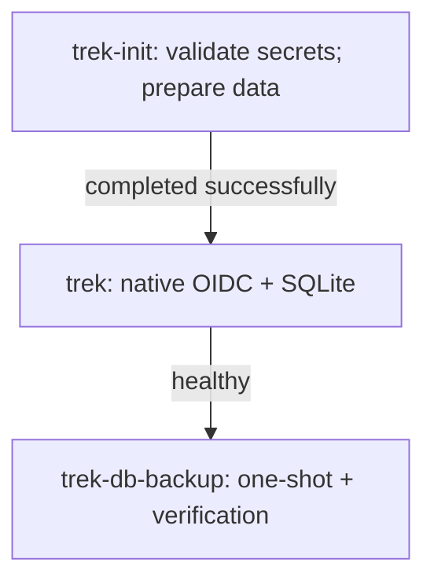

# TREK

[TREK](https://github.com/liketrek/TREK) is a collaborative travel planner.
**Blocked candidate for [issue #948](https://github.com/DevSecNinja/truenas-apps/issues/948);
not deployed or approved.** This integration depends on operational completion
of Pocket ID [PR #949](https://github.com/DevSecNinja/truenas-apps/pull/949).
Pocket ID operational readiness and adoption remain gated; no provider
deployment, TREK client issuance, or activation is confirmed.
The latest 2026-11-08 synthetic backup/recovery proof below is not activation approval.
Do not merge TREK before Pocket ID is complete.

## Why

Keep trip planning and uploaded travel documents on TrueNAS, using native
Pocket ID OIDC rather than an additional Entra Forward Auth login.

## Compose Files

- [compose.yaml](https://github.com/DevSecNinja/truenas-apps/blob/main/services/trek/compose.yaml) — candidate init, app, and backup services.
- [config/backup.sh](https://github.com/DevSecNinja/truenas-apps/blob/main/services/trek/config/backup.sh) — fail-closed backup verification wrapper.
- [compose.trek.yaml](https://github.com/DevSecNinja/truenas-apps/blob/main/services/traefik/compose.trek.yaml) — inert Traefik fragment, not included by active Compose.

## Access

These are **planned settings**, not an active endpoint:

| Setting                 | Value                                                               |
| ----------------------- | ------------------------------------------------------------------- |
| Application             | `https://trek.${DOMAINNAME}`                                        |
| Issuer                  | `https://id.${DOMAINNAME}`                                          |
| Exact callback          | `https://trek.${DOMAINNAME}/api/auth/oidc/callback`                 |
| Client                  | Dedicated confidential Pocket ID client; credentials not yet issued |
| Scopes / username claim | `openid email profile` / `preferred_username`                       |
| Authentication          | `OIDC_ONLY=true`; native TREK sessions                              |
| Proxy                   | HTTPS entrypoint, `chain-no-auth@file`; no Entra TFA on TREK        |

There is no inferred admin-group mapping. Per the upstream
[v5 wiki](https://github.com/liketrek/TREK/wiki), **the first SSO user becomes
administrator**. Restrict assignment on the dedicated Pocket ID client to the
bootstrap administrator **before any first login**. After bootstrap, explicitly
choose TREK's invitation/SSO auto-provisioning policy before widening assignment.
Pocket ID authentication and TREK authorization are separate checks.

## Architecture

Candidate startup order:



### Services

| Service          | Image                                 | Role and isolation                                                                                                                        |
| ---------------- | ------------------------------------- | ----------------------------------------------------------------------------------------------------------------------------------------- |
| `trek`           | `docker.io/mauriceboe/trek:5.1.0`     | Direct non-root Node process with dumb-init; bypasses root-only chown/gosu startup; read-only root, no capabilities, private `/tmp` tmpfs |
| `trek-db-backup` | `docker.io/nfrastack/db-backup:4.9.2` | Unapproved writable-root s6 compatibility candidate; no network; read-only database source                                                |
| `trek-init`      | `docker.io/library/busybox:1.38.0`    | Root, one-shot, no network; only `CHOWN`, `FOWNER`, `DAC_OVERRIDE`                                                                        |

All three services use `trek-candidate`, shared `tz.env`,
`no-new-privileges=true`, and a PID limit of 100. Memory declarations are
`64m` for init, `${MEM_LIMIT:-1024m}` for the app, and
`${BACKUP_MEM_LIMIT:-512m}` for backup. The app's default memory and PID limits
were verified in the current `5.1.0` and historical `5.0.1`/`5.0.0`
[Linux AMD64 runs](#live-linux-backup-and-recovery-evidence);
this does not validate every service's resource limit.

`TREK_SERVICES: "off"` explicitly opts out of `5.1.0`'s default automatic
enrollment in upstream hosted map services. The environment schema accepts
`auto`/`off`, and the tested app booted in `off` mode. This preserves the
unenrolled candidate; no community-sharing consent has been granted.

Init recursively chowns `./data/app` and `./data/uploads` under `/data` to the
[reserved app identity](../INFRASTRUCTURE.md#trek-candidate-identity), applies
`u=rwX,g=,o=`, and sets `/data` to mode `0700`. It never chowns `./config`.
The app uses direct `user:`, not PUID/PGID environment variables. Backup's
pre-init command creates and verifies the image-local `trekbackup` user/group
with the same reserved identity; s6 manages backup output ownership.
Its capability additions are `CHOWN`, `FOWNER`, `DAC_OVERRIDE`, `SETUID`,
`SETGID`, and `KILL`; this and its writable root remain unapproved.

The app alone joins `trek-frontend`; no host port is published. Readiness uses
`/api/health/ready` on container port `3000`. Homepage, Gatus, and Traefik
labels describe future discovery, not live integration. Shared Traefik has
no attachment to this network.

## State

| Host path             | Container path                              | Recovery role                                                      |
| --------------------- | ------------------------------------------- | ------------------------------------------------------------------ |
| `./backups/db-backup` | `/backup` (backup)                          | Encrypted SQLite artifacts and SHA1 sidecars                       |
| `./config`            | `/trek-config:ro` (backup)                  | Git-tracked wrapper; never runtime-owned                           |
| `./data/app`          | `/app/data` (app), `/trek-data:ro` (backup) | `travel.db`, SQLite WAL/SHM, persisted encryption/JWT key material |
| `./data/uploads`      | `/app/uploads` (app)                        | Travel documents; not included in the database dump                |

The dataset and service account are **reserved, not provisioned**. Preserve
the database, original keys, and uploads as a consistent recovery set;
database-only recovery is insufficient.

## Secrets

Only variable names and the implementation handoff status are recorded here;
no secret values were decrypted or reproduced for this documentation.

| Variable             | Purpose / candidate status                                                              |
| -------------------- | --------------------------------------------------------------------------------------- |
| `DB_ENC_PASSPHRASE`  | Independent 36-byte random value encoded as hex; GPG backup passphrase                  |
| `DOMAINNAME`         | Existing deployment domain reused without documenting its value                         |
| `ENCRYPTION_KEY`     | Independent 32-byte random value encoded as 64 hex characters; preserve across restores |
| `OIDC_CLIENT_ID`     | Present but intentionally empty until the dedicated Pocket ID client is issued          |
| `OIDC_CLIENT_SECRET` | Present but intentionally empty until issued                                            |

The implementation handoff reports successful encrypted-sentinel generation
and validation of `secret.sops.env`. Init rejects missing, empty, `GENERATE`,
or `CHANGE_ME` values for every variable above and rejects an invalid
`ENCRYPTION_KEY` length/encoding. Empty OIDC credentials therefore fail closed.
Never replace original application keys merely to make a restore start.

## First-Run Setup

<!-- dprint-ignore -->
!!! danger "DO NOT EXECUTE — all activation gates must clear first"
    Profiles are selection controls, not a security boundary. Explicitly
    targeting a service can start it despite its profile; do not use targeted
    Compose, profile overrides, or generic deployment to bypass this gate.
    No image exception or production activation is approved.

### Activation Prerequisites

- Complete Pocket ID first; verify its issuer, dedicated confidential client,
  exact callback, claims, and bootstrap-admin-only assignment. Store the
  issued `OIDC_CLIENT_ID` and `OIDC_CLIENT_SECRET` in TREK's encrypted
  secrets before deployment; both are currently empty.
- Clear every [image adoption gate](#image-evidence). Pocket's coordinator
  owns the common backup/BusyBox adoption review. Backup remains unsupported
  with incomplete applicability review: require a maintained compatible
  artifact or an explicit, narrow, dated exception; none is granted.
  Replacement is not required merely for assumed read-only incompatibility.
- Obtain target-host operator acceptance and coordinate storage-layer recovery
  of the database, original keys, and uploads. The 2026-11-08 Linux AMD64 run
  proved synthetic live-WAL backup, full recovery, and app hardening; it did
  not exercise changing uploads or production TrueNAS recovery.
- Through review, add registry key `trek` to `truenas-apps.json` with
  `account_name: svc-app-trek`, `account_id: 3134`, and
  `admin_group_member: false`; verify the reservation is collision-free.
  No registry entry currently exists.
- Review DNS `trek.${DOMAINNAME}` → `${IP_SVLNAS}`, removal of
  `trek-candidate` from all three services, and transfer of the inert
  Traefik network attachment/external declaration into active Compose.
  Apply the Traefik change only after the Custom App creates its network.
  Coordinate scheduled deployments so Traefik cannot reference a missing
  network. Do not change shared authentication or manually connect networks.

### Windows Continuation Checklist

Candidate continuation on branch `devsecninja-trek-service` began on Windows
on **2026-10-28** and resumed on **2026-11-08** after the host slept.
**This is not deployment approval.** Production encrypted
secrets and original application/backup keys remain preserved; do not rotate
or regenerate them. The dated Linux evidence below distinguishes completed
historical checks from the current `5.1.0` run; it does not clear production
or adoption gates. Any eventual commit requires 1Password-only signing.

- [ ] Complete Pocket ID #949 operationally, not merely merge it. Verify the
      issuer, dedicated confidential client, exact callback, claims, and
      bootstrap-admin-only assignment; enter the issued `OIDC_CLIENT_ID` and
      `OIDC_CLIENT_SECRET` through the repository's canonical SOPS workflow.
- [ ] Clear supported upstream image adoption for every image; coordinate
      common backup/BusyBox review with Pocket's coordinator and record
      reviewed pins. No downstream dependency patching or blind v5 upgrade.
- [x] Prove consistent backup from the read-only SQLite WAL source with a
      live writer and shared Linux storage, without making the source writable
      or using an immutable override.
- [x] Complete [focused wrapper tests](#focused-wrapper-evidence-2026-10-28)
      with mocked upstream/database/crypto operations and real process signals.
- [x] Verify the original sidecar lifecycle and unchanged wrapper with real
      encryption, exactly one output pair per run, 48-hour retention, and
      wrong-schema/sentinel-passphrase rejection in the historical `5.0.0`
      run. Historical `5.0.1` also passed live recovery, all assertions after
      force-recreation, and retention; its cleanup was verified on 2026-11-08.
      The real negative cases belong to `5.0.0`, not a later rerun.
      Timeout fault injection remains the focused-test evidence, not a claim
      about the successful run.
- [x] Demonstrate full synthetic recovery with representative `users`/`trips`,
      unchanged original encryption/JWT keys, uploads, and pre-backup sessions;
      retain schema, integrity, record, and direct-app authorization evidence.
- [x] Verify Linux AMD64 app hardening with `5.1.0`; retain historical
      repeat-init evidence from `5.0.0`.
- [x] Complete `5.1.0` restored-app recreation, sidecar retention, and runtime
      cleanup checks; all recovery assertions passed again after recreation,
      and labeled runtime resources were removed on 2026-11-08.
- [x] Run the new Compose opt-out regression for `TREK_SERVICES: "off"`;
      all 19 Compose/init/activation tests passed with exact BATS 1.14.0
      on 2026-11-08, including the new assertion.
- [ ] Obtain target-host operator acceptance and coordinate a coherent
      database/keys/uploads storage recovery set.
- [ ] Complete live provider/proxy/SSO allow/deny validation; synthetic
      direct-app JWT checks do not exercise Pocket ID login or Traefik.
- [ ] Only after all gates clear, review the
      [registry, DNS, Traefik, and profile activation changes](#activation-prerequisites),
      then follow the conditional TrueNAS rollout below, including first-SSO
      administrator bootstrap and registration/access checks.

### Conditional Rollout — DO NOT EXECUTE Until Approved

Use the existing TrueNAS aliases, already sourced from
`/mnt/vm-pool/apps/scripts/aliases.sh`, after the prerequisites clear and the
reviewed activation changes are available:

1. Pull/decrypt with the app-scoped first pass:

   ```sh
   dccd-app trek
   ```

   The initial missing TrueNAS app config directory and skipped deployment
   are expected. Do not begin with `dccd-all`.
2. Provision the reviewed registry identity and child dataset:

   ```sh
   cd /mnt/vm-pool/apps
   sudo bash scripts/truenas-prep-app.sh trek
   ```

3. Create a TrueNAS Custom App named **`trek`**:

   ```yaml
   include:
       - /mnt/vm-pool/apps/services/trek/compose.yaml
   services: {}
   ```

4. Confirm init completes, readiness is healthy, and `trek-frontend` exists.
   Apply the reviewed DNS and active Traefik attachment, then run:

   ```sh
   dccd-all
   ```

5. In a fresh browser session, sign in as the sole assigned bootstrap user.
   Confirm that user is TREK administrator. Set registration/invitation and
   SSO auto-provisioning policy before assigning anyone else.
6. Verify an assigned, permitted user can sign in and access only authorized
   trips; an unassigned Pocket ID user is denied; and a signed-in user
   without TREK permission cannot access another user's private trip.
   Check unauthenticated UI/API requests expose no private data and that no
   local-password or Entra TFA path bypasses native OIDC. Confirm logout and
   fresh-session behavior, readiness, and a newly verified backup.

## Backup

**Candidate coverage only; real synthetic live-WAL backup and full recovery
passed for `5.1.0` on 2026-11-08.** The unchanged wrapper and original `/init` sidecar
succeeded on Linux AMD64 with the source inspected as `RW=false`.
Historically, the **2026-10-27 native ARM64 run failed**: `sqlite3 .backup`
hung, timed out after 300 seconds, exited `124`, and emitted `ERROR`, with no
encrypted output or restore **in that run**. The later success supersedes a
blanket read-only-source incompatibility claim, not the historical observation.
The sidecar runs on deployment when started, not on an autonomous nightly
timer. It reads `./data/app:ro`, writes `./backups/db-backup`, uses GPG + ZSTD
with SHA1 sidecars, and retains 48 hours of output.

Unlike v4's potentially silent success, the wrapper requires exactly one
fresh nonempty encrypted dump and matching SHA1 sidecar, no extra fresh files,
a passing checksum/decrypt/decompress cycle, SQLite `quick_check=ok`, and both
`users` and `trips` tables. Private verification scratch retains `umask 077`
and is cleaned on exit; `umask 022` applies only to the upstream invocation
for root-created scratch compatibility. Table presence is not a row-level
restore drill.

The revised `run_stage` helper applies
`timeout --signal=TERM --kill-after=10s 300s` **separately to each stage**:

| Stage        | Command / check                                   |
| ------------ | ------------------------------------------------- |
| `dump`       | `backup01-now now`                                |
| `discovery`  | `find` for fresh output files                     |
| `checksum`   | `sha1sum --check`                                 |
| `decrypt`    | `gpg --decrypt`                                   |
| `decompress` | `zstd --decompress --stdout`                      |
| `integrity`  | `sqlite3` with `PRAGMA quick_check;`              |
| `schema`     | `sqlite3` counting the `users` and `trips` tables |

Each stage receives TERM at 300 seconds, then KILL after a 10-second grace
period if needed. **This is not a 300-second whole-job deadline.** Decrypt
and decompress run in a pipeline with independent timers; `pipefail` remains
enabled. Each helper error names the failed stage and returns its nonzero
status. The exactly-one output requirements and private scratch cleanup are
unchanged. [Focused wrapper tests](#focused-wrapper-evidence-2026-10-28)
passed on 2026-10-28; their mocked operations and real signal checks are
separate from the [real backup/recovery evidence below](#live-linux-backup-and-recovery-evidence).

See [TREK candidate coverage and conditional restore](../BACKUP.md#trek-candidate-coverage-and-restore)
for binary SQLite recovery, WAL precautions, and the matching keys/uploads set.
No production database or storage-layer backup coverage is claimed.

### Live Linux Backup and Recovery Evidence

The latest run on **2026-11-08** used rootless **Podman 5.8.6**,
**Compose 5.5.1**, and Linux AMD64, as did the historical 2026-10-29 runs.
The host SHA256-verified the official `5.1.0` OCI index, AMD64 child, and every
blob before loading the unchanged image; no rebuild or substitution occurred.
The backup artifact and bounded wrapper remain unchanged from source `589cd19`,
with wrapper SHA256
`6b59bb8de430c5de31fb016ccd048a734522f60db7f421242c0d7f29d9d0d42b`.
The historical `5.0.0` run also verified its index, child, and fetched blobs.
Exact version-specific pins are retained in [Image Evidence](#image-evidence).

All secrets were synthetic, with isolated internal/no-egress networking,
no published ports, and labeled Linux named storage. The runs used child
bind paths within the owned named volume because Podman Compose ignored
`volume.subpath`. Tracked configuration changes are limited to the candidate app pin
and explicit `TREK_SERVICES: "off"`; secrets, profiles, and activation gates
are unchanged.

| Run                              | Live writer / consistent snapshot revision | Full recovered schema                            | Restored-app recreation / retention                                            | Runtime cleanup                                                                                |
| -------------------------------- | ------------------------------------------ | ------------------------------------------------ | ------------------------------------------------------------------------------ | ---------------------------------------------------------------------------------------------- |
| `5.1.0`, 2026-11-08 — current    | 929 transactions / `115`                   | All 550 objects match the fresh `5.1.0` manifest | All recovery assertions repeated; 49-hour pair deleted, 47-hour pair preserved | Four containers, four volumes, two networks removed 2026-11-08; empty label queries verified   |
| `5.0.1`, 2026-10-29 — historical | 798 transactions / `182`                   | All 542 objects match the `5.0.1` manifest       | All recovery assertions repeated; 49-hour pair deleted, 47-hour pair preserved | Four containers, four volumes, two networks removed 2026-11-08; empty label queries verified   |
| `5.0.0`, 2026-10-29 — historical | 1,522 transactions / `235`                 | All 542 objects match the original manifest      | All recovery assertions repeated; 49-hour pair deleted, 47-hour pair preserved | Seven containers, seven volumes, two networks removed 2026-10-29; empty label queries verified |

#### TREK 5.1.0 — Current Candidate

- **Init and app:** the unchanged init ran, and the exact app became healthy
  with `TREK_SERVICES=off` confirmed in the environment and boot mode.
  App hardening passed: `CapEff=0`, `NoNewPrivs=1`, read-only root,
  memory limit `1073741824` bytes (1 GiB), and PID limit `100`.
  An actual root-filesystem write was denied; `/tmp` remained writable.
- **Representative state:** actual schema held two synthetic users
  (owner/administrator and nonmember), a trip, OIDC subject/issuer fields,
  an API value encrypted by the app's native AES-GCM helper, an upload and
  its database reference, and server-side `user_sessions`. Native HS256
  JWTs were minted **before backup** with the original synthetic keys,
  not through a provider login.
- **Live backup:** the original `4.9.2` `/init` sidecar and unchanged wrapper
  exited `0` with the live writer, exactly one encrypted ZSTD/SHA1 pair,
  and passing wrapper verification. The source was inspected as `RW=false`;
  the consistent snapshot revision and writer total are recorded above.
- **Full binary recovery:** checksum, GPG, ZSTD, SQLite integrity, and
  foreign-key checks passed. Fresh exact `5.1.0` became healthy after
  restoring the binary database and copying the original `.encryption_key`,
  `.jwt_secret`, and uploads. All **550 schema objects** matched the fresh
  manifest; original keys, encrypted-value decryption, and upload download
  (`200`) passed.
- **Direct-app authorization:** pre-backup JWT `/api/auth/me` and owner trip
  access returned `200`, nonmember access `404`, and anonymous access `401`.
  These used forwarded-HTTPS headers directly against the app, **not**
  Pocket ID login or the real proxy/SSO flow.
- **Schema delta:** the additive
  [place-origin migration](https://github.com/liketrek/TREK/blob/v5.1.0/server/src/db/migrations/Migration20200101046320_a_place_knows_where_its_details_came_from.ts)
  adds `place_field_origin`, `place_contrib_outbox`, and `place_contrib_log`
  plus five indexes. The full schema SHA256 is
  `1ec17a7cda33a78229cc6ad915af67f14232394468c2ee12eb4a805893b9235b`.
  Filtering only those eight objects yields the exact `5.0.1` full-schema
  hash `e162365baee9144d9410cf2caf71e8f2a492661330b659f0f3faeb6850d11ee3`.
  Source and runtime comparison found no other SQL schema change.
- **Recreation and retention:** all 550 schema objects, original keys,
  encrypted-value decryption, upload download (`200`), pre-backup JWT
  (`200`), owner (`200`), nonmember (`404`), and anonymous (`401`) checks
  passed again after force-recreating the restored app. The second original
  `/init` sidecar run exited `0`, deleted the 49-hour encrypted pair, and
  preserved the 47-hour pair. Both successful runs logged exactly one start,
  one `Backup 01` zero-exit receipt, and one wrapper-success message.
  All output files had the reserved ownership and mode `0600`.
- **Cleanup:** all four labeled containers, four named volumes, and two
  networks were removed on 2026-11-08; empty label queries verified removal.

Real negative-case evidence remains attributed to `5.0.0` below.
Functional recovery is not security approval.

#### TREK 5.0.1 and 5.0.0 — Historical Proof

Both 2026-10-29 runs completed full binary recovery with original keys,
native encrypted-value decryption, uploads and database links, OIDC fields,
administrator/nonmember records, and pre-backup sessions. Direct-app
`/api/auth/me`, owner-trip, and exact-byte file download returned `200`,
nonmember trip access `404`, and anonymous access `401`.
**All schema, key, decryption, JWT, access, and download assertions passed
again after force-recreating each restored app.** The `5.0.0` rerun required
no lease workaround, delay, or database edits.

Both second sidecar runs exited `0` with exactly one start, one `Backup 01`
zero-exit receipt, one wrapper-success message, and one fresh encrypted pair.
Retention at `2880` minutes deleted the 49-hour pair and preserved the
47-hour pair. New pairs used the [reserved identity](../INFRASTRUCTURE.md#trek-candidate-identity)
and mode `0600`; the source stayed read-only. App hardening included
`CapEff=0`, `NoNewPrivs=1`, read-only root, 1 GiB memory, PID limit `100`,
and private paths `0700`; `5.0.1` key files were `0600`.
The `5.0.0` run additionally verified repeat init, effective reserved identity,
working `/tmp`, and an actual source-write failure (`Read-only file system`)
while SQLite/WAL/SHM remained readable, without an immutable override.

The `5.0.1`
[plugin migration](https://github.com/liketrek/TREK/blob/v5.0.1/server/src/db/migrations/Migration20200101046310_an_admin_can_run_a_plugin_outside_its_trek_range.ts)
added nullable `TEXT` columns `plugins.trek_range_accepted_version` and
`plugins.trek_range_accepted_host`. Normalizing only those columns in its
full schema exactly matched `5.0.0`; no other SQL schema change was found.

**Real negative cases belong only to the `5.0.0` run:** a valid wrong-schema
database encrypted/decrypted successfully, but the unchanged wrapper exited
`1` for missing `users`/`trips` despite upstream's exit-`0` receipt.
`GENERATE` as the passphrase exited `1` before backup, without a start,
completion receipt, or wrapper-success message. These are not claimed as
`5.0.1` or `5.1.0` reruns.

The `5.0.1` resources persisted through the host's sleep until their verified
2026-11-08 cleanup in the table above. Tokens minted on 2026-10-29 had a
one-day lifetime and returned `200` during that run; they correctly returned
`401` on 2026-11-08 after real wall-clock expiry. No clock modification or
restore defect caused that expiry, and current validity is not claimed.

These runs prove synthetic live-WAL backup and full recovery with
**unchanged keys/uploads while the
writer changed only the database**; it is not a general synchronized backup
of changing uploads. Storage-layer coordination, target-host operator
acceptance, live provider/proxy/SSO checks, Pocket ID readiness, and image
adoption remain pending. Production ciphertext and keys remain preserved;
OIDC credentials remain blank and unissued.

### Focused Wrapper Evidence (2026-10-28)

**Runtime signal proof only, not encrypted backup/recovery proof or deployment
readiness.** Database, crypto, and upstream operations were **mocked**; no real
backup or full-sidecar lifecycle was exercised in this earlier suite. The
dated real-output evidence above supplements, rather than relabels, it.

- **59 tests passed with exact BATS 1.14.0:** 41 backup tests on Linux rootless
  Podman 5.8.6 and 18 Compose/init/activation tests on Windows.
- **Linux isolation:** the 41 backup tests ran offline in an isolated named
  volume using the exact existing `nfrastack/db-backup:4.9.2` index and
  `linux/amd64` artifact [listed below](#image-evidence). The image entrypoint
  was bypassed to Bash 5.3.9 and GNU coreutils `timeout` 9.11; this does not
  validate s6 startup or approve the image. The test container and volume were
  removed.
- **Wrapper checks:** all seven stage deadlines, stage-named nonzero failures,
  pipeline `pipefail`, missing/invalid/extra-output rejection, exactly-one
  matching output checks, and private scratch cleanup passed with mocks.
- **Real process signals:** TERM reached a cooperative parent and child;
  KILL escalation stopped a TERM-ignoring parent and child, with no leftover
  live test processes. The test harness first validates the production
  `--signal=TERM --kill-after=10s 300s` arguments, then substitutes a test-only
  2-second deadline / 1-second KILL grace.
- **Negative control:** six verification-timeout tests failed against an
  isolated reconstruction of the prior unbounded verification wrapper.
- **Validated wrapper SHA256:**
  `6b59bb8de430c5de31fb016ccd048a734522f60db7f421242c0d7f29d9d0d42b`.

The historical handoff also recorded a successful strict MkDocs build of the actual docs
using 32 materialized tracked symlink targets in an isolated copy; repository
links were unchanged. Targeted ShellCheck, shfmt, and dprint passed.
The full pre-commit hooks and eight main-sync validator tests also passed
historically; these are not current rerun claims. On **2026-11-08**, all
**19 Compose/init/activation tests** passed with exact BATS 1.14.0, including
the new `TREK_SERVICES: "off"` assertion. The prior **41 mocked backup tests
were not rerun that day**. Mocked checks alone do not establish real-output
retention, live-WAL consistency, or full recovery; the live runs above do.
None of these runs grants image adoption or Pocket ID readiness.

## Image Evidence

Fresh exact-TREK-artifact review on **2026-11-08** used Trivy **0.76.0**,
vulnerability DB `UpdatedAt=2026-11-08T06:39:21.614725497Z`,
`NextUpdate=2026-11-09T06:39:21.614725236Z`. This is not adoption approval.
The shared backup/BusyBox review below was supplied by Pocket's coordinator,
with a **2026-11-08 musl update** to the 2026-10-29 review,
**not independently rechecked by the TREK parent run**. It is not a blanket
approval; it narrows
applicability claims without granting adoption or clearing TREK's parser gate.

| Image                       | Maintenance / confidence    | Decision and gaps                                                                                                                                                                                             |
| --------------------------- | --------------------------- | ------------------------------------------------------------------------------------------------------------------------------------------------------------------------------------------------------------- |
| BusyBox `1.38.0`            | **unknown / medium**        | Empty scanner results; partial manual inventory/provenance now available, but pinned-build/libc applicability and delivery remain unreviewed; not approved                                                    |
| nfrastack/db-backup `4.9.2` | **unmaintained tag / high** | Unsupported under [latest-only policy](https://github.com/nfrastack/db-backup/blob/main/SECURITY.md); demonstrated pipeline review narrows exposure but leaves unresolved applicability; no exception granted |
| TREK `5.1.0`                | **partial / medium**        | Current candidate passed live backup/recovery; parser/base packages remain unchanged, with fixed-version findings and unresolved applicability; not approved                                                  |

Exact artifacts (all digests use SHA256):

| Artifact                                                            | Digest                                                             |
| ------------------------------------------------------------------- | ------------------------------------------------------------------ |
| Backup Compose index                                                | `cc95be0b5f551f432a218fc2811d63a2946233c8260598d5eda0ff624bb47412` |
| Backup scanned `linux/amd64`                                        | `af1a483f04a19427be307c356645adc887352f1e3432bb21bd8b60ccf12c4012` |
| BusyBox Compose index                                               | `fd8d9aa63ba2f0982b5304e1ee8d3b90a210bc1ffb5314d980eb6962f1a9715d` |
| TREK `5.1.0` current Compose index                                  | `23bf3fa6a134dc38a3b4f40ef8f7e8040abc96965105dffdcfcf5f202fb5d0b7` |
| TREK `5.1.0` current scanned/tested `linux/amd64`                   | `15a8e9842367884d98de8c40ad72616cb59bb1f02e2f28334cd568508496e4aa` |
| TREK `5.0.1` historical index                                       | `6f590b97c09158e92e9bc7d914ea1af207077735f07f7b622b1f6fb690442bc3` |
| TREK `5.0.1` historical scanned/tested `linux/amd64`                | `425993143173a8475a9ce7847bff28fd4d850711407aba3a070fdfc2f9627189` |
| TREK `5.0.1` historical `linux/arm64` manifest (not runtime-tested) | `8ff3c7ec0110431353495fb9bbc6c0bd8edd91db25794024663362c7e1ef84f2` |
| TREK `5.0.1` historical AMD64 image config                          | `14b9bdc5881ef3dcd2b2f5c1dc89a5fefbe7ebb6eafadf9cc292744dfce7e9ab` |
| TREK `5.0.0` historical index                                       | `0c0a8f5b488fc2967248695e04bb000bb177d0b63d3385089d33dca6fde4daf9` |
| TREK `5.0.0` historical scanned/tested `linux/amd64`                | `9d74cf9f4be6be29e452b00a0ac0525208dd0e9aaeb62605271b53bb4b83fa5c` |
| TREK `5.0.0` historical native-tested `linux/arm64`                 | `ea5318f44cc989799848ec17e9b135611a87f2b073a035ea9b1b599830a12dfd` |

- **Current TREK artifact:** [v5.1.0](https://github.com/liketrek/TREK/releases/tag/v5.1.0)
  was published 2026-10-31; OCI revision
  `dc36c21c08f681fd2806764fad8e17b270f6f175`, created
  `2026-10-31T11:13:23Z`. The 2026-11-08 scan inventoried 254 Debian 13.7
  packages, 471 npm entries, and four Go entries: **91 raw OS HIGH/CRITICAL
  entries, 39 unique CVEs**, including four fixed-version entries for three
  CVEs. A fresh `5.0.1` scan with the same DB produced the same findings.
  Zero npm/Go HIGH/CRITICAL findings is not a safety proof; Node scanning
  does not comprehensively cover the C-built Node runtime.
- **Historical artifacts:** [v5.0.1](https://github.com/liketrek/TREK/releases/tag/v5.0.1)
  was published `2026-10-28T10:54:10Z`, OCI revision
  `a0943f8226269bc192c1cda992fbac33333337a1`, created
  `2026-10-28T10:48:25Z`. Its 2026-10-29 scan reported 76 raw distro
  HIGH/CRITICAL entries / 28 unique CVEs and no fixed-version entries;
  those counts are superseded by the fresh scan above.
  The historical 54-commit `5.0.0` → `5.0.1` comparison changed only the
  three TREK version entries in package inventory, with no Dockerfile
  change and only lockfile version bumps; it was not a parser security fix.
  `5.0.0` was published 2026-10-25, OCI revision
  `bd1de9e1d50a0ef74adabcc86119178d017fc85d`.

Fixed-version OS findings in the **2026-11-08** scan:

| Packages / entries                   | Installed version             | CVE               | Fixed version                      |
| ------------------------------------ | ----------------------------- | ----------------- | ---------------------------------- |
| `apt`, `libapt-pkg7.0` (two entries) | `3.0.3`                       | `CVE-2026-109518` | `3.0.4`                            |
| `zlib1g` (one entry)                 | `1:1.3.dfsg+really1.3.1-1+b1` | `CVE-2026-76844`  | `1:1.3.dfsg+really1.3.1-1+deb13u1` |
| `zlib1g` (one entry)                 | `1:1.3.dfsg+really1.3.1-1+b1` | `CVE-2026-85091`  | `1:1.3.dfsg+really1.3.1-1+deb13u1` |

- **Apt applicability:** the finding requires package installation with
  redirects/retries, not the normal read-only, non-root app runtime.
  Build-path exposure still requires upstream review; this is not dismissal.
- **Zlib applicability:** `CVE-2026-76844` requires a failed `gzwrite`,
  `clearerr`, and subsequent stale input. `CVE-2026-85091` concerns a
  nonblocking `gzwrite`/`gzprintf` stall. Its upstream description names
  versions `1.3.1.2`–`1.3.2`, while Debian's installed package identifies
  `really1.3.1`; version/backport applicability needs review, not blanket
  exclusion.
- **Loaded parser path:** the exact `5.0.0` runtime `dpkg` check reported
  `libxml2=2.12.7+dfsg+really2.9.14-2.1+deb13u3`. `ldd` on
  `/usr/local/bin/kitinerary-extractor` confirmed loaded libxml2, Qt6
  Qml/Network/Core/Gui, KF6, and TIFF libraries.
  `dist/nest/booking-import/kitinerary-extractor.service.js` writes the
  uploaded buffer to a temporary file, then calls
  `execFile(extractor, [tmp], ...)` with timeout/output limits. These libraries
  cannot be dismissed as dormant tooling; their package versions are
  unchanged in `5.0.1` and `5.1.0`. This is retained path evidence, not a
  claim that the historical `ldd` check was rerun on each version.
- **libxml2 applicability:** Debian's
  [CVE-2026-6653 tracker](https://security-tracker.debian.org/tracker/CVE-2026-6653)
  describes DTD/use-after-free denial of service, vulnerable trixie, and
  `no-dsa`/minor-issue treatment. The upstream 2.11 fix does not clear this
  2.12-labelled Debian package, which reverted to 2.9.14.
  [CVE-2026-86138](https://security-tracker.debian.org/tracker/CVE-2026-86138)
  describes integer/heap overflow before 2.15.4; trixie remains vulnerable.
  [CVE-2026-74860](https://security-tracker.debian.org/tracker/CVE-2026-74860)
  concerns Python libxml2 SAX bindings; the exact `5.0.0` artifact checks
  found neither Python 3 nor `python3-libxml2`, excluding **that specific
  path**, not libxml2 as a whole. No finding is silently excepted. TREK remains
  **partial / medium**, requiring an upstream-fixed rebuilt artifact or an
  explicitly approved narrow exception for relevant findings and unknown
  reachability before adoption. **No exception is granted.**
- **Delivered maintenance:** release-source changes include
  [runtime dependencies, 2026-10-24](https://github.com/liketrek/TREK/commit/a6a9f3bbdd696edec2002bdef6276fbbed24d2d5),
  [MapLibre 6.15 fix, 2026-10-24](https://github.com/liketrek/TREK/commit/1696162d227c9a3cf0d449f65f0310795390ecef),
  and [gosu Go 1.26, 2026-10-11](https://github.com/liketrek/TREK/commit/1157805146eb61e5a968b409ac29d53b73cac0c1).
  The [successful build](https://github.com/liketrek/TREK/actions/runs/40187532814),
  [v5.0.0 Dependabot configuration](https://github.com/liketrek/TREK/blob/v5.0.0/.github/dependabot.yml),
  and [security policy](https://github.com/liketrek/TREK/blob/v5.0.0/SECURITY.md)
  evidence maintenance, latest-only support, and a 48-hour response target,
  not complete vulnerability coverage.
- **Base choice:** upstream builds with `golang:1.26-alpine` and
  `node:24-alpine`, then runs `node:24-trixie-slim`. Apt-provided
  `libkitinerary` explains Debian slim rather than Alpine for document
  parsing. No alternate hardened application artifact was verified.

### Shared Image Review (Pocket Coordinator, 2026-11-08)

- **Current coordinator update, 2026-11-08:** installed musl `1.2.6-r2`
  has **HIGH** `CVE-2026-107891` (`regcomp`), fixed in `1.2.6-r3`.
  No untrusted-regexp reachability has been proven; that is not proof of
  unreachability. Unsupported `4.9.2` still requires scoped applicability
  review and an adoption decision; **no exception is granted**.
- **Historical backup inventory and exercised tools, 2026-10-29:** coordinator-supplied Trivy
  **0.75**, DB updated `2026-10-29T13:09:46Z`, inventoried 166 Alpine 3.24.1
  packages in the unchanged `4.9.2` artifact. Exercised Bash `5.3.9-r1`,
  SQLite `3.53.4-r0`, GPG `2.4.9-r1`, libgcrypt `1.12.2-r0`, and ZSTD
  `1.5.7-r2` had zero HIGH/CRITICAL findings in that scan; this is not
  whole-image clearance.
- **Historical applicability review, 2026-10-29:** musl
  `CVE-2026-107891` was then UNKNOWN; the HIGH rating above supersedes it.
  The HIGH sudo finding requires `NOTBEFORE`/`NOTAFTER` policy. Examined
  sudoers lacked those settings, but includes were not fully reviewed.
  OpenSSL QUIC-server, curl HTTP/2-upload, Brotli, Perl-regex, and unused
  database-engine paths were not reached by the demonstrated pipeline.
  This scoped, incomplete review does not dismiss every image finding.
- **Backup adoption:** [latest-only support](https://github.com/nfrastack/db-backup/blob/main/SECURITY.md)
  still leaves `4.9.2` unsupported. Require a maintained compatible artifact
  or an explicit, narrow, dated exception; **none is granted**. No downstream
  dependency patching or blind v5 upgrade. Current upstream
  [5.0.10](https://github.com/nfrastack/db-backup/releases/tag/5.0.10),
  released 2026-11-04, includes SQLite schema fixes but has not been tested
  for this TREK candidate. Consistent live-backup compatibility remains
  unproven; it is not an approved drop-in replacement.
- **BusyBox partial inventory/provenance, 2026-10-29:** scanner output was empty,
  but manual inspection identified BusyBox `1.38.0` (2026-05-13) and GNU
  libc Debian `2.41-12+deb13u3`, with dynamic `ld-linux`, `libc`, `libm`,
  `libnss`, and `libresolv`, and no package database.
  [Official Images provenance](https://github.com/docker-library/official-images/blob/master/library/busybox)
  maps `1.38.0` AMD64 to `latest`/`glibc` and a source commit. The pinned
  build, libc applicability, and delivery remain unreviewed; neither empty
  scanner output nor this partial inventory is approval.

### Native Runtime Evidence and Limits

Historical **2026-10-27** evidence: Apple `container` **1.6.1**, native
`linux/arm64`, using the historical `5.0.0` app digest
above: non-root execution under the reserved identity, `CapEff=0`, denied
root-filesystem writes, working `/tmp` and uploads writes, readiness HTTP 200,
SQLite WAL integrity `ok`, and seeded actual `users`/`trips` plus uploads
retained after recreation. The exact init command passed twice on native Linux
disk volumes with the reserved ownership and mode `0700`.

Apple's native runtime minimum allocation was **256 MiB**; Compose's init
`64m` was not measured. macOS bind-root chmod failed, so testing used Linux
disk volumes without weakening production permissions. Native `NoNewPrivs=0` means this
does **not** prove Compose's no-new-privileges, PID, or Traefik policies, nor
target AMD64 behavior. The failed backup run used the exact immutable wrapper
with SHA256 `687f3b272e28a50b4ec5bebb4cebeeda048ab85af2cb5d8e9dca74cca4b817bf`;
see [Backup](#backup). These historical limitations are supplemented by the
[dated AMD64 runs](#live-linux-backup-and-recovery-evidence),
which proved synthetic live-WAL backup/recovery and the app hardening listed
above, not production activation readiness.

## Upgrade Notes

Keep the candidate blocked while reviewing new upstream artifacts and exact
digests under the [adoption policy](../ARCHITECTURE.md#adoption-gate-and-remediation-ownership).
After approval, preserve a coordinated database/keys/uploads recovery point
before upgrades and repeat OIDC, permissions, backup, and restore checks.
