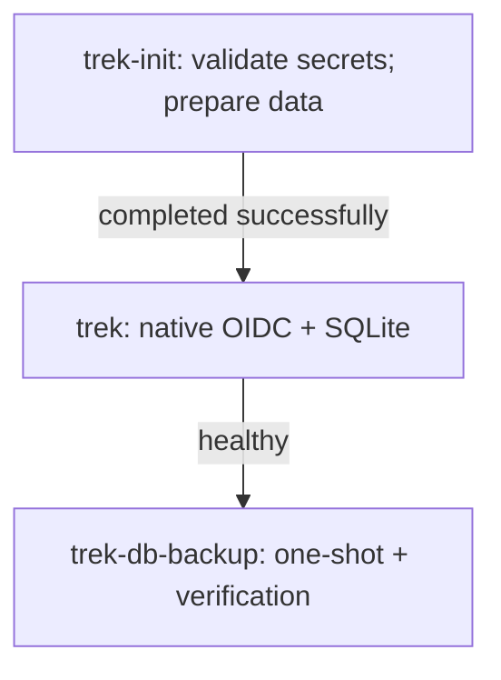

# TREK

[TREK](https://github.com/liketrek/TREK) is a collaborative travel planner.
**Blocked candidate for [#948](https://github.com/DevSecNinja/truenas-apps/issues/948); not deployed or approved.**
Pocket ID PR #949 merged at `eafb883`. On **2026-11-22**, the operator reported
Pocket ID production available in the personal homelab, first-admin passkey
setup, and a post-setup backup. We have not independently verified host runtime.
**No TREK client credentials have been issued or confirmed in this handoff.**
Pocket availability does not approve TREK; its gates remain below.

## Why

Keep trip planning and uploaded travel documents on TrueNAS, using native
Pocket ID OIDC rather than another Entra Forward Auth login.

## Compose Files

- [compose.yaml](https://github.com/DevSecNinja/truenas-apps/blob/main/services/trek/compose.yaml): candidate init, app, and backup.
- [config/backup.sh](https://github.com/DevSecNinja/truenas-apps/blob/main/services/trek/config/backup.sh): fail-closed backup verifier.
- [compose.trek.yaml](https://github.com/DevSecNinja/truenas-apps/blob/main/services/traefik/compose.trek.yaml): inert Traefik fragment, not an active include.

## Access

These are planned TREK settings, not an active endpoint:

| Setting                      | Value                                                                                               |
| ---------------------------- | --------------------------------------------------------------------------------------------------- |
| Application                  | `https://trek.${DOMAINNAME}`                                                                        |
| Issuer / discovery           | `https://id.${DOMAINNAME}` / `https://id.${DOMAINNAME}/.well-known/openid-configuration`            |
| Exact callback               | `https://trek.${DOMAINNAME}/api/auth/oidc/callback`                                                 |
| Client                       | Dedicated confidential client named **TREK**; public client disabled; no HTTP or wildcard redirects |
| TREK scopes / username claim | `openid email profile` / `preferred_username`                                                       |
| Authentication               | `OIDC_ONLY=true`; native TREK sessions; no inferred admin-group mapping                             |
| Proxy                        | HTTPS, `chain-no-auth@file`; no Entra TFA on TREK                                                   |

Per the upstream [v5 wiki](https://github.com/liketrek/TREK/wiki), **the first SSO user becomes administrator**.
Restrict client assignment to that bootstrap user before first login. Choose TREK's invitation/SSO
auto-provisioning policy before widening assignment; authentication is not trip authorization.

## Architecture



### Services

| Service          | Image                                 | Isolation                                                                                                                                                          |
| ---------------- | ------------------------------------- | ------------------------------------------------------------------------------------------------------------------------------------------------------------------ |
| `trek`           | `docker.io/mauriceboe/trek:5.1.4`     | Direct non-root Node with dumb-init; bypasses root-only chown/gosu startup; read-only root, no capabilities, private `/tmp`                                        |
| `trek-db-backup` | `docker.io/nfrastack/db-backup:4.9.2` | No network; read-only source; writable-root s6 risk conditionally [accepted until 2026-12-22](#temporary-backup-risk-exception-2026-11-22); activation still gated |
| `trek-init`      | `docker.io/library/busybox:1.38.0`    | Root one-shot; no network; only `CHOWN`, `FOWNER`, `DAC_OVERRIDE`                                                                                                  |

All three retain `trek-candidate`, shared `tz.env`, `no-new-privileges=true`, and PID limit `100`.
Memory: init `64m`, app `${MEM_LIMIT:-1024m}`, backup `${BACKUP_MEM_LIMIT:-512m}`.
Init recursively chowns `./data/app` and `./data/uploads` under `/data` to the
[reserved PUID/PGID](https://homelab.devsecninja.com/INFRASTRUCTURE/#trek-candidate-identity), applies `u=rwX,g=,o=`,
and sets `/data` to `0700`; never `./config`. The app uses direct `user:`, not PUID/PGID variables.
Backup pre-init verifies image-local `trekbackup` with the same identity; s6 manages output ownership.
Its writable root and added `CHOWN`, `FOWNER`, `DAC_OVERRIDE`, `SETUID`, `SETGID`, and `KILL`
are covered only by the [scoped backup exception](#temporary-backup-risk-exception-2026-11-22)
until **2026-12-22**; no broader privilege or activation approval is granted.

Only the app joins `trek-frontend`; no host port is published. Readiness is `/api/health/ready`
on container port `3000`. Discovery labels are not live integration; shared Traefik has no attachment.
`TREK_SERVICES: "off"` prevents automatic hosted-map enrollment, not egress.
No community-sharing consent or add-on enablement is granted.

### Proxy Health and Log Privacy

- Candidate `trek-monitor` matches only ``Host(`trek.${DOMAINNAME}`)`` and
  ``Path(`/api/health/ready`)`` on `monitoring`, with `chain-no-auth@file`.
  Gatus uses `http://172.30.100.6:8444/api/health/ready`, the
  `Host: trek.${DOMAINNAME}` header, and `client.ignore-redirect=true`.
  The existing entrypoint-level `monitoring-ipallowlist@file` restricts sources
  to `172.30.100.0/29`; port `8444` remains unpublished.
- Public `trek-rtr` sets `observability.accesslogs=false`. Shared Traefik logs
  `400-599` responses with query strings, and Alloy forwards those logs without
  redaction. Rejected OIDC callbacks or invitations could otherwise expose
  `code` or `token`; app-level redaction cannot protect proxy logs.
- Only TREK's public router loses those proxy access diagnostics; other routers
  and shared logging are unchanged. App `LOG_LEVEL=info`, health checks,
  metrics, and backup receipts remain available. The monitoring entrypoint
  already disables access logs.

These labels do not activate ingress: profiles and the inert Traefik attachment
remain gated. Provider/SSO acceptance is still pending; the logging change is
not a claim of blanket log privacy.

#### November 22 Proxy Fixture

**Recorded 2026-11-22 synthetic results; not production acceptance.**
Official Traefik `3.7.10` (not the pinned DHI image) used a file-provider
translation of the actual TREK labels and exact shared chain, rate limit,
headers, and IP allowlist, against actual TREK `5.1.4` with synthetic data only.

- Monitoring: Gatus-subnet readiness `200`, private path `404`, non-Gatus source `403`.
- TREK OIDC exchange rejection `400`; rate limiting returned `429` for 139 of 200 requests.
- Public callback `code` and invitation markers were absent from access logs;
  an access-log-enabled control router's `401` marker was present.

No host ports were published. This fixture does not validate the full Docker
provider, production TLS, or a real identity provider, and does not clear activation.

### State

| Host path             | Container path                         | Recovery role                                       |
| --------------------- | -------------------------------------- | --------------------------------------------------- |
| `./backups/db-backup` | `/backup`                              | Encrypted SQLite artifacts and SHA1 sidecars        |
| `./config`            | `/trek-config:ro`                      | Git-tracked backup wrapper                          |
| `./data/app`          | `/app/data`; `/trek-data:ro` in backup | `travel.db`, WAL/SHM, persisted encryption/JWT keys |
| `./data/uploads`      | `/app/uploads`                         | Travel documents, absent from the database dump     |

The dataset/account are reserved, not provisioned. Recover the database,
original keys, and uploads as one coordinated set.

## Secrets

Status is from the implementation handoff; no secrets were read or decrypted for this documentation.

| Variable             | Purpose / handoff status                                                          |
| -------------------- | --------------------------------------------------------------------------------- |
| `DB_ENC_PASSPHRASE`  | Existing independent 36-byte random hex value; preserve the GPG backup passphrase |
| `DOMAINNAME`         | Existing deployment domain; preserve                                              |
| `ENCRYPTION_KEY`     | Existing independent 32-byte value encoded as 64 hex characters; preserve         |
| `OIDC_CLIENT_ID`     | Intentionally empty pending dedicated client issuance                             |
| `OIDC_CLIENT_SECRET` | Intentionally empty pending issuance                                              |

Init rejects missing, empty, `GENERATE`, or `CHANGE_ME` values and malformed `ENCRYPTION_KEY`.
Backup loads only shared timezone via `env_file`; explicit `DEFAULT_ENCRYPT_PASSPHRASE`
receives `DB_ENC_PASSPHRASE`. It does not inherit `.env`, raw `DB_ENC_PASSPHRASE`, domain,
OIDC secrets, or application/JWT keys as environment variables. Its source mount still contains
persisted key files; environment minimization is not file isolation.

## First-Run Setup

### Activation Prerequisites

- Clear remaining app/parser and init [image gates](#image-evidence); keep the
  [TREK backup exception](#temporary-backup-risk-exception-2026-11-22) within scope and unexpired
  (**2026-12-22**, no automatic renewal). Pocket's **2026-12-21** exception covers Pocket ID only.
- Complete client preparation below, then verify issued credentials through SOPS. Do not rotate existing keys.
- Obtain target-host acceptance and coordinated database/keys/uploads recovery.
  Synthetic evidence is not production TrueNAS or changing-upload recovery.
- Review new-install add-on defaults, invitation/auto-provisioning, and sharing. Keep `TREK_SERVICES: "off"`.
- Only through later reviewed activation: add registry key `trek` using the
  [reserved identity](https://homelab.devsecninja.com/INFRASTRUCTURE/#trek-candidate-identity), `admin_group_member: false`;
  verify allocation collisions; review DNS `trek.${DOMAINNAME}` → `${IP_SVLNAS}`,
  profile removal on all three services, and transfer of the inert Traefik attachment into active Compose.

### Windows Continuation Checklist

**Preparation only; no client issuance or secret workflow was run here.** Do not merge/deploy,
provision storage, enable DNS/registry/Traefik, or remove candidate profiles during preparation.

1. Have the Pocket administrator verify discovery at
   `https://id.${DOMAINNAME}/.well-known/openid-configuration`, including the
   expected issuer. Confirm the claim-release contract: TREK requests
   `openid email profile` and expects `preferred_username`. These are TREK
   settings, not assumed Pocket client UI fields. Prepare the exact callback
   in [Access](#access); permit no wildcard or HTTP callback.
2. Prepare a dedicated group containing **only the intended bootstrap administrator**.
   Record TREK invitation/auto-provisioning policy; provider group membership
   is not an admin-role mapping.
3. Once issuance is authorized, create the **Confidential** client named **TREK**
   with the exact callback. Keep public-client mode disabled and retain the
   default group restriction (`isGroupRestricted: true`). Attach only the
   prepared group under allowed user groups **before first login**; do not
   disable restriction during setup. Then generate a secret in its client-secrets
   card; creation does not supply one automatically
   ([versioned UI](https://github.com/pocket-id/pocket-id/blob/v2.19.3/frontend/src/routes/settings/admin/oidc-clients/oidc-client-create-form.svelte)).
   Enter only issued `OIDC_CLIENT_ID`/`OIDC_CLIENT_SECRET` in the local Windows
   checkout, never chat. Use authenticated 1Password CLI, SOPS, and VS Code
   with the privately supplied Age-key reference in `$AgeKeyReference`:

   ```powershell
   Import-Module .\scripts\SopsSecrets.psm1 -Force
   Open-SopsEncryptedFile `
       -TargetPath 'services/trek/secret.sops.env' `
       -AgeKeyReference $AgeKeyReference
   ```

   Before use, disclose metadata checks (`sops filestatus` on the target), `op signin`, `op whoami`,
   `sops edit services/trek/secret.sops.env`, and its SOPS-triggered `op read "<reference withheld>"`.
   That read is a redacted preview, not a standalone command. Vault access is read-only;
   authentication changes the CLI session and grants broader access than these planned operations.
   SOPS opens a temporary plaintext editor file outside the repository, then re-encrypts after
   save/close and checks metadata again. Never print keys, references, or credentials.
   Preserve `ENCRYPTION_KEY` and `DB_ENC_PASSPHRASE`; do not run generators.
   The alternative [SOPS editor workflow](https://homelab.devsecninja.com/CONTRIBUTING/#safe-human-review)
   has the same disclosure and privacy requirements.
4. Record issuance separately from acceptance. Actual native OIDC allow/deny,
   logout, proxy health, and target-host recovery checks remain to be done.

### Conditional Rollout

<!-- dprint-ignore -->
!!! danger "DO NOT EXECUTE until gates clear and reviewed changes are merged"
    Profiles are selection controls, not a security boundary; explicit targeting can bypass them.
    Do not bypass approval with targeted Compose, profile overrides, or generic deployment.
    Pocket production is not TREK approval.

After all prerequisites clear and reviewed activation changes are merged,
use the existing aliases from `/mnt/vm-pool/apps/scripts/aliases.sh`:

1. Pull/decrypt with the app-scoped first pass, not `dccd-all`. Missing TrueNAS app config and skipped deployment are expected:

   ```sh
   dccd-app trek
   cd /mnt/vm-pool/apps
   sudo bash scripts/truenas-prep-app.sh trek
   ```

2. Create a TrueNAS Custom App named **`trek`**:

   ```yaml
   include:
       - /mnt/vm-pool/apps/services/trek/compose.yaml
   services: {}
   ```

3. Confirm init completion, readiness, and `trek-frontend`. Coordinate scheduled deployments;
   only then apply reviewed DNS/Traefik attachment. No missing-network references or manual connections.

   ```sh
   dccd-all
   ```

4. First login must be the sole assigned bootstrap user; confirm administrator status.
   Set invitation/SSO auto-provisioning policy before widening access.
5. Verify permitted-user login, unassigned-provider-user denial, private-trip owner/nonmember isolation,
   anonymous UI/API denial, logout/fresh sessions, and no local-password/Entra bypass.
   Check proxy/readiness health and readable uploads.
6. **After bootstrap, administrator/policy configuration, and setup are complete**,
   run a second deployment-triggered backup pass:

   ```sh
   dccd-all
   ```

   Require a new job `01` zero-exit receipt (`Backup 01`), wrapper verification
   success, and a fresh encrypted dump/SHA1 pair created **after setup**.
   The first pre-SSO backup cannot represent configured state. Before declaring
   setup complete, use [conditional recovery](https://homelab.devsecninja.com/BACKUP/#trek-candidate-coverage-and-restore)
   to check representative administrator/users/trips, original keys, and uploads
   from a coordinated post-setup recovery point.

## Backup

Deployment-triggered GPG/ZSTD binary SQLite + SHA1, retained 48 hours; no autonomous nightly timer.
Verification requires exactly one fresh nonempty pair, no extra fresh files, checksum/decrypt/decompress
success, `quick_check=ok`, and `users`/`trips`.
The sidecar must contain one lowercase SHA1 record naming the selected dump
(two spaces for text mode, or space plus `*` for binary mode). Verification hashes
that selected dump directly with `sha1sum --`; it never follows a manifest path
to another, possibly older file.
Each dump/discovery/checksum/decrypt/decompress/integrity/schema stage has
`timeout --signal=TERM --kill-after=10s 300s`, not a whole-job deadline.
Pipeline `pipefail`, private `umask 077` scratch, and exit cleanup remain; only upstream
invocation uses `umask 022` for root-created scratch compatibility. Table presence is not
a row-level restore drill. [Conditional recovery](https://homelab.devsecninja.com/BACKUP/#trek-candidate-coverage-and-restore)
also requires original keys and uploads.

### Live Linux Backup and Recovery Evidence

The **2026-11-22 review fix** was exercised against live synthetic TREK `5.1.4`
using the same pinned AMD64 backup image and original `/init`. The tightened
selected-dump checksum verifier passed real GPG/ZSTD/SHA1, SQLite integrity,
and schema checks; the one-shot exited `0` with one encrypted pair.
This targeted wrapper compatibility check did not repeat the full recovery
and retention drill below or extend the backup exception.

#### November 21 Current Candidate

**Recorded 2026-11-21, not rerun today or production approval.** Rootless Podman 5.8.6 /
Compose 5.5.1 on Linux AMD64 pulled the exact official artifact with verified config digest.
Synthetic secrets, owned Linux named volumes with child bind paths, no ports, no-egress networks.

| Check                   | Recorded result                                                                                                                                                                                                                 |
| ----------------------- | ------------------------------------------------------------------------------------------------------------------------------------------------------------------------------------------------------------------------------- |
| Real upgrade            | Populated `5.1.0` → `5.1.4`, healthy without manual DB repair; 550 → 554 SQL objects, only two tables/two autoindexes added; geography data also changed                                                                        |
| Migration choices       | Deleted legacy chat text cleared, live text retained; existing journeys/collections off preserved                                                                                                                               |
| Live backup             | Original `4.9.2` `/init` plus unchanged wrapper exited `0`; writer completed 417 transactions, coherent snapshot revision `211`; source database/WAL/SHM readable at `RW=false`, write denied                                   |
| Output and receipts     | Each cycle: one GPG/ZSTD + SHA1 pair, ownership `3134:3134`, mode `0600`; one start, one `Backup 01` zero-exit receipt, one wrapper-success message                                                                             |
| Full recovery           | Checksum/decrypt/decompress/integrity/foreign-key checks passed; all 554 schema objects matched; original `.encryption_key`/`.jwt_secret`, AES-GCM value, and uploads preserved                                                 |
| Access and repeat       | Upload `200`, pre-upgrade session `/api/auth/me` `200`, owner `200`, nonmember `404`, anonymous `401`; all recovery/migration assertions passed again after restored-app force-recreation, without clock/expiry workarounds     |
| Retention and hardening | Second cycle kept 47-hour pair, removed 49-hour pair; `CapEff=0`, `NoNewPrivs=1`, read-only root, writable `/tmp`, 1 GiB memory, PID `100`, data `0700`, keys `0600`                                                            |
| Checks and cleanup      | 19 Compose/init/activation tests with BATS 1.14.0, 10 selected pre-commit checks, separate strict MkDocs build with 32 materialized link targets passed; four containers/four volumes/two networks removed, label queries empty |

Direct-app checks did not exercise Pocket OIDC or Traefik. Keys/uploads stayed unchanged during writes;
changing-upload coordination, ARM64, hardware/mobile, and production TrueNAS recovery remain unproven.
Logical chat deletion does not erase old backups. Hashes, receipts, prior October/November proofs,
and test limits are in the [immutable historical record][history].

The **2026-11-22** handoff reports **62 regression checks passed**. This is historical
evidence, not a new execution for this documentation or production acceptance.

### Focused Wrapper Evidence (2026-10-28)

Historical: 41 mocked backup tests plus 18 Compose/init tests passed. Real TERM/KILL checks prove
signals, not crypto/backup. Real wrong-schema/sentinel rejection belongs only to the `5.0.0` run;
see the [historical record][history], not a claim of November 21 reruns.

### Native Runtime Evidence and Limits

The 2026-10-27 ARM64 `5.0.0` backup timed out in `sqlite3 .backup` at 300 seconds, exit `124`,
with no encrypted output. Later AMD64 success supersedes blanket incompatibility, not that observation.

## Image Evidence

**2026-11-21**, Trivy 0.76, DB `UpdatedAt=2026-11-21T18:38:32.889609542Z`,
`NextUpdate=2026-11-22T18:38:32Z`: 254 Debian 13.7 packages, 473 npm entries, four Go entries.
**146 raw OS HIGH/CRITICAL entries / 51 unique CVEs, zero fixed-distro HIGH/CRITICAL entries,
zero npm/Go HIGH/CRITICAL**. Not global zero-CVE clearance or proof every raw finding is exploitable.

| Image                       | Maintenance / confidence | Remaining gate                                                                                                                                                           |
| --------------------------- | ------------------------ | ------------------------------------------------------------------------------------------------------------------------------------------------------------------------ |
| BusyBox `1.38.0`            | Unknown / medium         | Broader exact-build maintenance/delivery review incomplete                                                                                                               |
| nfrastack/db-backup `4.9.2` | Unmaintained tag / high  | Unsupported; exact backup-job risk conditionally [accepted until 2026-12-22](#temporary-backup-risk-exception-2026-11-22), no automatic renewal; not activation approval |
| TREK `5.1.4`                | Partial / medium         | Loaded parser/base applicability and residual-risk review                                                                                                                |

Actual `dpkg` confirmed apt/libapt `3.0.4` and zlib `1:1.3.dfsg+really1.3.1-1+deb13u1`:
prior `CVE-2026-109518`, `CVE-2026-76844`, and `CVE-2026-85091` are **fixed, not current blockers**.
`libxml2=2.12.7+dfsg+really2.9.14-2.1+deb13u3` remains affected by
[CVE-2026-6653](https://security-tracker.debian.org/tracker/CVE-2026-6653)
and [CVE-2026-86138](https://security-tracker.debian.org/tracker/CVE-2026-86138).
The upload extractor loads libxml2/zlib/Qt/TIFF; upstream fixes for newer versions do not clear
Debian's `really2.9.14`. Unknown reachability is not safety. The
[versioned policy](https://github.com/liketrek/TREK/blob/v5.1.4/SECURITY.md) provides latest-only
support, Dependabot, and a 48-hour response target, not complete parser/base coverage.

| Exact SHA256 artifact             | Digest                                                             |
| --------------------------------- | ------------------------------------------------------------------ |
| Backup index                      | `cc95be0b5f551f432a218fc2811d63a2946233c8260598d5eda0ff624bb47412` |
| Backup scanned AMD64              | `af1a483f04a19427be307c356645adc887352f1e3432bb21bd8b60ccf12c4012` |
| BusyBox TREK index                | `fd8d9aa63ba2f0982b5304e1ee8d3b90a210bc1ffb5314d980eb6962f1a9715d` |
| TREK `5.1.4` index                | `991ff5aa53244b25d5a8ea40361dc286cfc8211638044eabe12b9926729db5cc` |
| TREK `5.1.4` scanned/tested AMD64 | `d0ece755ef4cc365fe656d42ffbb274d9880df4616fce7ed0d2d4ac7a20bc349` |

### Shared Image Review (Pocket Coordinator)

The supplied **2026-11-21** review covers the demonstrated local SQLite pipeline only.
Backup's fixed script/job-ID regex inputs and inspected sudoers including includes lack the
particular musl/sudo exploit preconditions. BusyBox's narrow glibc findings required absent
elevated-executable/`AT_SECURE` paths or Power8 rather than AMD64. Neither clears broader review.
TREK still pins `fd8d9…`, not Pocket's reviewed `a46257…` BusyBox build.

Pocket's [versioned backup exception](https://github.com/DevSecNinja/truenas-apps/blob/eafb8839edce0e48fdd7b0bc0f7cf8dee5189903/services/pocket-id/README.md#temporary-backup-risk-exception-2026-11-21)
expires **2026-12-21**, is Pocket-only, and cannot be inherited by TREK.
TREK instead has its own [November 22 backup-only acceptance](#temporary-backup-risk-exception-2026-11-22)
until **2026-12-22**; the shared evidence is not itself approval.
The November 21 review of latest backup
[`5.0.11`](https://github.com/nfrastack/db-backup/blob/5.0.11/src/internal/database/engine/sqlite/sqlite.go)
found independent `*sql.DB` source queries: `BEGIN`/`COMMIT` wrap output, not a hot-source
transaction. Its autoincrement fix is not live-consistency or TREK compatibility proof.
Do not blindly upgrade major versions or patch dependencies downstream.

### Temporary Backup Risk Exception 2026-11-22

**Approval source:** @DevSecNinja, **2026-11-22**: "Trek backup risk is accepted."
The **coordinator**, not the user quote, defines the exact scope below and the
**30-day review/expiry of 2026-12-22**, with **no automatic renewal**.
Only unsupported/unpatched maintenance and residual dated findings for this
backup job/artifact/platform/privileges are accepted; not deployment or production coverage.

**Exact artifact:** `docker.io/nfrastack/db-backup:4.9.2`, SHA256 identities:

- Index: `cc95be0b5f551f432a218fc2811d63a2946233c8260598d5eda0ff624bb47412`.
- `linux/amd64` platform manifest: `af1a483f04a19427be307c356645adc887352f1e3432bb21bd8b60ccf12c4012`.

**Exact job:** tracked [Compose](https://github.com/DevSecNinja/truenas-apps/blob/29c7e97a8686ef886e5dd2c73c2676b42e098ffd/services/trek/compose.yaml)
and [wrapper](https://github.com/DevSecNinja/truenas-apps/blob/29c7e97a8686ef886e5dd2c73c2676b42e098ffd/services/trek/config/backup.sh)
at `29c7e97a8686ef886e5dd2c73c2676b42e098ffd`; recorded wrapper SHA256
`6b59bb8de430c5de31fb016ccd048a734522f60db7f421242c0d7f29d9d0d42b`.

PR #954 tightens checksum verification to bind the record to the selected dump
and hash that dump directly. This checksum-only review changes no backup
artifact, path, engine, network, or privileges and grants no new exception.
The commit/hash above remain the historical proof, not the revised wrapper's
hash or evidence of a new runtime validation. The original acceptance and
**2026-12-22** expiry remain unchanged.

- Only `trek-db-backup`: local SQLite Online Backup API binary snapshot of
  `/trek-data/travel.db`, `./data/app:/trek-data:ro`, `./config:/trek-config:ro`,
  and output `./backups/db-backup:/backup`; no other engine or path.
- Manual deployment-triggered one-shot job `01`, GPG/ZSTD/SHA1, 2880-minute/48-hour
  retention; image-local `trekbackup` UID/GID `3134:3134`, PID limit `100`,
  memory `${BACKUP_MEM_LIMIT:-512m}`; no autonomous timer.
- `network_mode: none`, no ports or host-control socket; root s6/writable root,
  `no-new-privileges`, `cap_drop: ALL`, only `CHOWN`, `FOWNER`, `DAC_OVERRIDE`,
  `SETUID`, `SETGID`, `KILL` added.
- Only shared `tz.env` plus explicit backup settings/GPG passphrase; no inherited
  app `.env`, `ENCRYPTION_KEY`, JWT or OIDC credentials in the environment.
  Persisted key files remain in the source mount; read-only is not confidentiality.
- Preserve [all wrapper checks](#backup): 300-second TERM plus 10-second KILL grace
  **per stage**, not whole-job; one fresh pair, no extra fresh files, checksum,
  decrypt/decompress, `quick_check`, `users`/`trips`, private scratch and cleanup.
  Keep `config.watch=config`, `config.sha256=${CONFIG_HASH:-}`, `dccd.backup-jobs=01`.

**Dated evidence, not new execution:** reuse the [November 21 results](#november-21-current-candidate),
[shared review](#shared-image-review-pocket-coordinator), and [immutable history][history].
The shared Trivy 0.76.0 scan at **2026-11-21T20:12:22Z** (DB updated **18:38:32Z**)
reported 166 Alpine 3.24.1 packages: raw **4 CRITICAL / 167 HIGH / 152 MEDIUM /
90 LOW / 5 UNKNOWN**; Python and inactive bundled Go findings also remain.
Inventory counts are not applicability conclusions. Used musl `1.2.6-r2`,
**CVE-2026-107891** (`regcomp`, fixed `-r3`): inspected scripts/job `01` use fixed
regex patterns; no database-row regex input was identified. Used sudo `1.9.17_p2-r1`
**CVE-2026-96512** (fixed `-r2`) lacked required `NOTBEFORE`/`NOTAFTER` policies
in inspected sudoers/includes. These are narrow preconditions, not whole-image clearance.

**Residual risk:** root plus `DAC_OVERRIDE` can read key files, plaintext scratch
and passphrase material and modify outputs despite read-only source. No network
and a short job reduce, not eliminate, exposure. GPG/SHA1 neither protects against
a compromised backup container nor establishes output authenticity.

**Maintenance/exit:** **unmaintained tag / high confidence**, not supported or clean.
This is not a claim that the project is abandoned: upstream's
[latest-only policy](https://github.com/nfrastack/db-backup/blob/5.0.11/SECURITY.md) and
[5.0.11 release](https://github.com/nfrastack/db-backup/releases/tag/5.0.11) leave 4.9.2 unsupported.
The [5.0.11 SQLite source](https://github.com/nfrastack/db-backup/blob/5.0.11/src/internal/database/engine/sqlite/sqlite.go)
uses independent source queries; output `BEGIN`/`COMMIT` is not a coherent live snapshot.
No blind v5/latest upgrade or custom runner is approved.

**Owner/action:** @DevSecNinja must review **by 2026-12-22**: choose a maintained
compatible upstream artifact with exact-artifact/current-inventory scan and coherent full-schema
SQLite, users/trips, OIDC/original-key and uploads recovery, retention and fail-closed proof;
an explicitly reviewed new dated exception; or controlled rollback/retirement preserving recovery.
Expiry removes exception clearance; it **does not automatically stop backups**.
Profiles/runtime stay unchanged.
Changed image/platform/job paths/engine/network/privileges or new relevant findings require immediate review.
No blanket approval for future versions/findings or other stacks. TREK `5.1.4` parser/libxml2,
old BusyBox init, real SSO/client credentials, proxy/activation/operator gates,
production-host coverage and Pocket's separate exception are not cleared or changed.

## Upgrade Notes

Every app/init/backup update, including digest-only changes, requires manual exact-artifact review.
The scoped Renovate rule for `services/trek/compose.yaml` sets `automerge: false`, `groupName: null`.
After approval, preserve coordinated recovery points and repeat OIDC/permissions/backup/restore
checks under the [adoption policy](https://homelab.devsecninja.com/ARCHITECTURE/#adoption-gate-and-remediation-ownership).

- `5.1.4` delivers the LOW [AirTrail fix](https://github.com/liketrek/TREK/security/advisories/GHSA-mwf5-5px8-c9h5);
  compiled-service checks used stubs and real crypto, not outbound integration.
- New installs enable journeys/collections; upgrade preserved off choices. Review policy before deployment.
- Compiled OIDC checks rejected unverified/self-asserted email and changed subjects; HTTP unlink
  rejected non-admin/self-unlink. Not native Pocket login acceptance or automatic email relinking.
- Native-app closed testing requires `5.1.4`; no mobile/hardware test is claimed.
- Keep `LOG_LEVEL=info`. The November 22 [versioned middleware review](https://github.com/liketrek/TREK/blob/v5.1.4/server/src/middleware/globalMiddleware.ts)
  found info-level error/warn request lines use `req.path`, unlike Pocket's raw-URL behavior.
  Query/body appear only in redacted debug logging; `code`, `token`, and `client_secret` are redacted.
  Do not debug real OIDC flows until reviewed. Error stacks may vary: this is not blanket log
  safety or privacy/ingress acceptance. App redaction does not cover Traefik's query-bearing
  error access logs; the [router-specific control](#proxy-health-and-log-privacy) disables those
  for TREK without copying Pocket's app-log disablement.

[history]: https://github.com/DevSecNinja/truenas-apps/blob/e37798bde88184534ec54d171e27f0ab1a25792b/services/trek/README.md
